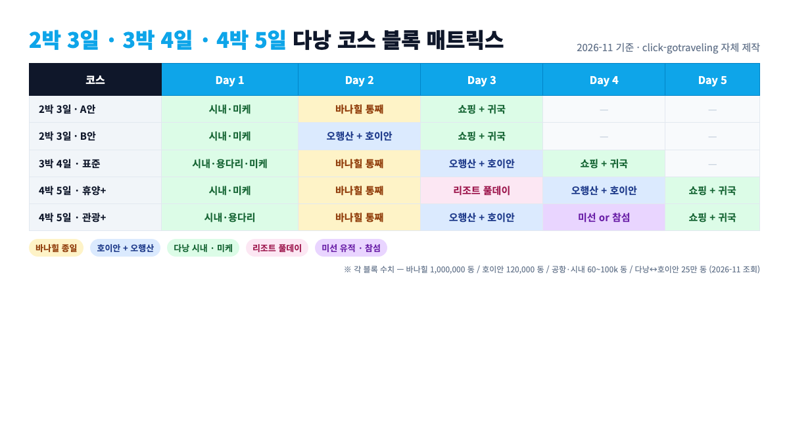
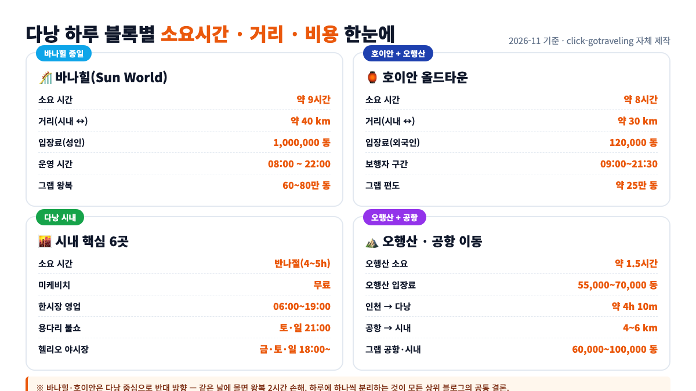
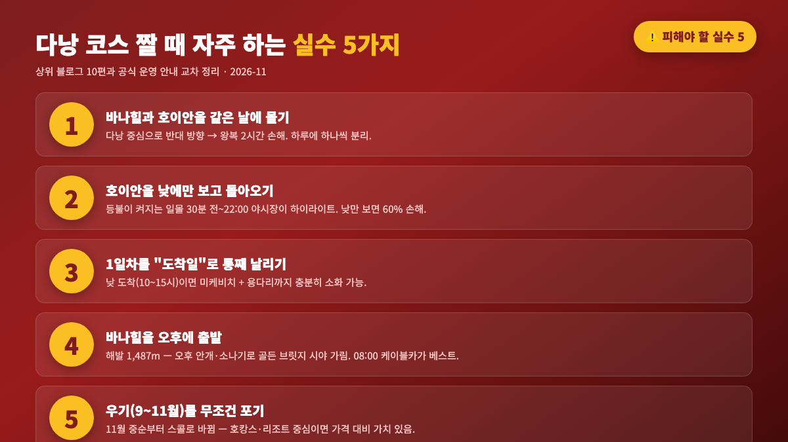

인천에서 비행 4시간 10분이면 닿는 다낭은 코스 짜기가 쉬워 보이지만, 바나힐 하나가 하루를 통째로 먹고 호이안은 반대 방향에 있어 2박 3일 안에 두 곳을 모두 끼우려 하면 꼭 꼬입니다. **베트남 다낭 여행 추천 코스**를 "3박 4일 템플릿" 한 장으로 외우지 말고, 2박·3박·4박 각각의 완성형 코스를 먼저 비교한 다음 나에게 맞는 블록을 조립하는 쪽이 안전해요. 2026년 11월 기준 바나힐 공식 입장료 100만 동(약 55,000원·성인)·호이안 올드타운 12만 동·공항에서 시내 4~6km라는 세 가지 숫자가 그 뼈대가 됩니다. 상위 블로그 10편과 바나힐·호이안 공식 안내를 교차해 코스별로 풀어 보겠습니다.

📌 3줄 요약
<b>2박 3일</b>이면 "바나힐 OR 호이안" 하나만 선택하고 나머지 하루는 다낭 시내·미케비치로 채우는 쪽이 꼬이지 않습니다.

<b>3박 4일</b>이면 "다낭 시내 → 바나힐 → 호이안(오행산 끼워) → 쇼핑·귀국"이 가장 많이 추천되는 완성형 템플릿이에요.

<b>4박 5일</b>이면 3박 4일 사이에 "리조트 풀데이" 하루를 끼워 넣는 설계가 가장 자연스럽고, 가족·호캉스 여행에 적합합니다.

## 베트남 다낭 여행 추천 코스, 2박3일·3박4일·4박5일 결론 한 장에

**핵심부터 요약하면 다낭 코스는 세 줄로 정리됩니다**. **2박 3일은 바나힐·호이안 중 하나를 포기**해야 꼬이지 않고, **3박 4일은 두 곳을 모두 넣을 수 있는 완성형 최소 단위**이며, **4박 5일은 그 사이에 리조트 풀데이 또는 미선·참섬 블록 중 하나를 끼워 넣는 설계**가 가장 자연스럽습니다. 이 한 문단이 아래 매트릭스 표의 요약이라 생각하고 읽어도 됩니다.

상위 블로그 10편을 열어 보면 "3박 4일이 기본, 4박 5일은 여유형"이라는 결론은 공통인데, 그 안에 묶는 블록 순서가 글마다 미묘하게 다릅니다. 이 글은 2박 3일·3박 4일·4박 5일 세 버전을 한 표로 먼저 못 박아 두고 시작합니다. 핵심 변수는 세 가지예요. **① 바나힐은 하루 통째**(케이블카 왕복 + 테마파크 + 저녁 복귀, [Jungle Boss Ba Na Hills 2026 공식 요금 정리](https://junglebosstours.com/explorer/tourism-blog/ba-na-hills-ticket-booking) 기준 08:00~22:00 운영), **② 호이안은 다낭에서 약 30km·차로 40분**(그랩 약 25만 동, [하이핀랩 2026 다낭 호이안 3박4일](https://hifineap.com/4%EC%8B%9C%EA%B0%84%EC%9D%B4%EB%A9%B4-%EB%8F%84%EC%B0%A9%ED%95%98%EB%8A%94-%EA%B0%80%EC%84%B1%EB%B9%84-%EC%B2%9C%EA%B5%AD-2026-%EB%8B%A4%EB%82%AD-%ED%98%B8%EC%9D%B4%EC%95%88-3%EB%B0%954%EC%9D%BC/) 2026-11 조회)이고 올드타운은 저녁까지 머물러야 등불이 켜지며, **③ 바나힐과 호이안은 다낭을 중심으로 반대 방향**이라 같은 날에 몰면 왕복 2시간을 넘깁니다([베트남가이드 다낭 호이안 자유여행 코스](https://vnguide.co.kr/bbs/board.php?bo_table=danang&wr_id=1479)에서도 "완전 반대"로 명시).

이 세 가지만 지키면 2박 3일은 "바나힐 OR 호이안 하나"가 유일한 해답이고, 3박 4일은 둘 다 넣을 수 있는 최소 단위, 4박 5일은 "리조트 풀데이 or 미선 유적" 같은 플러스 블록을 하나 넣는 설계가 됩니다. 아래가 결론 매트릭스예요.

| 구분 | 1일차 | 2일차 | 3일차 | 4일차 | 5일차 |
| --- | --- | --- | --- | --- | --- |
| **2박 3일** · A안 | 다낭 시내·미케비치·용다리 | **바나힐 통째** | 호이안 포기·시내 쇼핑 + 귀국 | — | — |
| **2박 3일** · B안 | 다낭 시내·미케비치 | 오행산 + **호이안 반일+등불** | 바나힐 포기·시내 쇼핑 + 귀국 | — | — |
| **3박 4일** · 표준 | 다낭 시내·용다리·미케비치 | **바나힐 통째** | **오행산 + 호이안 종일 — 등불 야시장까지** | 한시장 쇼핑·마사지·귀국 | — |
| **4박 5일** · 휴양+ | 다낭 시내·미케비치 | **바나힐 통째** | **리조트 풀데이**(수영장·마사지) | 오행산 + **호이안 반일+등불** | 한시장 쇼핑·귀국 |
| **4박 5일** · 관광+ | 다낭 시내·용다리 | **바나힐 통째** | 오행산 + **호이안 반일+등불** | **미선 유적**(My Son) 또는 참섬 투어 | 한시장 쇼핑·귀국 |

이 표의 핵심은 **2박 3일이면 하나는 포기해야 한다**는 것이에요. [트립스토어 혼자 여행 3박 4일 60만원 가성비 일정](https://www.tripstore.kr/blog/%EB%8B%A4%EB%82%AD-%ED%98%BC%EC%9E%90-%EC%97%AC%ED%96%89-3%EB%B0%95-4%EC%9D%BC-%EA%B0%80%EC%84%B1%EB%B9%84-%EC%95%88%EC%A0%84-%ED%8C%81)도 같은 결론으로, "바나힐과 호이안을 같은 날에 몰면 3박 4일에도 체력이 안 된다"고 적어 두고 있어요. 반대로 4박 5일이면 하루 여유가 생겨서 **리조트 호캉스 블록**(가족·커플) 또는 **미선 유적·참섬 투어 블록**(역사·액티비티) 중 성향에 맞춰 넣는 쪽이 자연스럽습니다.

## 1일차 — 공항 도착 시간대별로 갈라지는 다낭 첫날 설계

다낭 여행의 1일차는 상위 블로그마다 가장 설계가 흐릿한 구간이에요. "도착 후 호텔 체크인·미케비치 산책"으로만 묶어둔 글이 많은데, 실제로는 **인천발 항공편이 저녁 7~9시에 다낭에 떨어지는 경우가 가장 흔해서** 1일차가 반나절짜리가 되는 일이 잦습니다. 그래서 1일차는 "도착 시간대"에 따라 아래 세 패턴 중 하나를 고르는 쪽이 꼬이지 않아요.

- **낮 도착**(10~15시, 아시아나·대한항공 주간편 등): 체크인 후 **미케비치 → 용다리 → 한시장 → 저녁 해산물**까지 넉넉히 소화 가능. 공항→시내 그랩 **60,000~100,000 동**(약 3,000~5,000원, [다낭픽 2026 그랩·택시 비교](https://danangpick.net/danang-grab-vs-taxi-comparison-guide/) 2026-11 조회)으로 이동하고, 오후 5시 30분경 미케비치에서 일몰을 잡는 블록이 가장 사진이 잘 나옵니다.
- **저녁 도착**(19~21시, 비엣젯·에어서울 저가편 다수): 체크인 후 **미케비치 야간 산책 + 한강 용다리 불·물쇼**(주말 21:00 토·일만)로 짧게 마감. 식사는 **반미·쌀국수 야식**으로 끊고 2일차 바나힐 체력을 지킵니다.
- **심야 도착**(23시~새벽 01시, 저가 항공 상당수): 공항 → 호텔 직행. 2일차가 **바나힐**(표준·A안)이든 **오행산+호이안**(B안)이든 공통 과제는 **일찍 자기**예요. 둘 다 아침 일찍 출발하지 않으면 종일 블록 하나가 통째로 깨지기 때문입니다. 이 심야 패턴은 사실상 2박 3일의 1일차가 완전히 사라지는 구조라, **2박 3일을 포기하고 3박 4일로 늘리는 쪽이 비용 대비 체감 가치가 훨씬 큽니다**.

💡 심야 도착일 때 1일차를 살리는 작은 요령
공항 환전소 대신 <b>한시장 금은방</b>(09:00~19:00 영업)이 환율이 더 좋다고 상위 블로그가 공통으로 적지만, 심야 도착이라면 공항에서 <b>소액(5만 원 선)</b>만 바꾸고 나머지는 트래블카드로 ATM 출금하는 쪽이 피로를 덜어줍니다.

심야 도착 다음 날이 바나힐이라면 알람을 <b>06:30</b>에 맞추세요. 상위 블로그가 공통으로 "바나힐 오전 8시 전 출발"을 권하는 이유는 케이블카 대기열이 10시 이후 급증하기 때문입니다.

## 2일차 — 바나힐 하루 통째로 쓰는 최적 동선

바나힐(Sun World Ba Na Hills)은 다낭 서남쪽 **약 40km·차로 40분** 거리의 해발 1,487m 산악 테마파크입니다. 2026년 11월 기준 입장료는 [Jungle Boss 2026 공식 요금 정리](https://junglebosstours.com/explorer/tourism-blog/ba-na-hills-ticket-booking) 기준 성인 1,000,000 동(≈ 55,000원·US$ 38), 어린이 1~1.4m·70세 이상 800,000 동, 1m 미만 무료이고 **케이블카·골든 브릿지·판타지 파크·르 자르댕 다무르·영응 파고다**까지 전부 포함돼요. 다낭 주민은 성인 650,000 동으로 할인됩니다. **운영 시간은 08:00~22:00**(막차 케이블카 22:00 출발)이고, 2026년 1월 1일부터 티켓이 **연속 3일간 유효**로 연장되어 하루에 다 못 돌면 다음 날 재입장도 가능해요. 사전 예매가로는 약 900,000 동(≈ 49,500원) 선이어서 공식가 대비 차액이 약 10% 수준입니다.

이 공식 숫자를 깔아두면 2일차 동선은 아래처럼 정리됩니다.

1. **07:00 호텔 조식** → **08:00 그랩 또는 전세 택시로 출발**(시내 → 바나힐 약 40km, 왕복 그랩 60~80만 동 선).
2. **09:00 케이블카 탑승** → **09:30 골든 브릿지**(이 시간대가 인파가 가장 적음, [트립스토어 핵심 6곳 코스](https://www.tripstore.kr/blog/%EB%8B%A4%EB%82%AD-%EA%B0%80%EB%B3%BC%EB%A7%8C%ED%95%9C%EA%B3%B3-%EC%BD%94%EC%8A%A4-%EC%B6%94%EC%B2%9C)도 "오전 8시 전 출발" 권장).
3. **10:30~12:30 프렌치 빌리지·꽃정원·사원 산책** → **12:30~13:30 점심**(콤보 티켓 + 뷔페 1,250,000 동 선택 가능).
4. **13:30~16:30 판타지 파크·실내 어트랙션·와역스 박물관**(별도 요금) → **16:30 하산 케이블카**.
5. **17:30~18:00 시내 복귀** → **19:00 저녁 식사 + 60분 마사지**(약 25,000~30,000원 수준, [클리브리빙 다낭 3박4일/4박5일 가이드](https://cleaveliving.com/danang-travel-itinerary-3n4d-4n5d/) 2026-11 조회 "마사지 2.5~3만 원" 교차).

핵심은 **오전에 외부 어트랙션인 골든 브릿지·꽃정원을 모두 끝내고 오후에 실내로 들어가는 흐름**이에요. 바나힐은 해발 1,487m라 [Sun World 공식 운영 안내](https://junglebosstours.com/explorer/tourism-blog/ba-na-hills-ticket-booking)와 상위 블로그가 공통으로 적듯 **오후 안개·소나기**가 자주 끼고, 15시 이후엔 골든 브릿지 시야가 자주 가립니다. 반대로 야경·조명 쇼를 노린다면 하산 시간을 **20:00~21:00**으로 늦추되 **막차 케이블카 22:00 전 반드시 탑승**을 확인해야 해요.

*▲ 2박 3일·3박 4일·4박 5일 각 코스에서 "바나힐·호이안·시내·리조트·유적"을 어느 날에 어떤 블록으로 배치하는지 한 장에 묶은 자체 제작 매트릭스입니다(수치: 바나힐 100만 동·호이안 12만 동·공항-시내 6만~10만 동·다낭↔호이안 25만 동 기준, 2026-11 조회).*

## 호이안 하루 — 오행산·안방비치·올드타운 등불까지

호이안은 다낭 남쪽 약 **30km·차로 40분** 거리에 있고, 가는 길목에 **오행산**(Marble Mountains)·**안방비치**(An Bang Beach)가 나란히 있어요. 그래서 "호이안의 날"로 하루를 묶으면 **오전 오행산 → 점심 안방비치 → 오후 올드타운 → 저녁 등불·소원배 → 야시장 → 그랩 복귀**로 한 줄에 꿰입니다. [클리브리빙 다낭 3박4일/4박5일 가이드](https://cleaveliving.com/danang-travel-itinerary-3n4d-4n5d/)·[야놀자 트리플 3박5일 코스](https://tour.yanolja.com/content/articles/ca38ef83-8393-4ff2-b9ef-144ae2ef6bc1)가 공통으로 적는 동선이에요.

호이안 올드타운 입장권은 2026년 11월 기준 **외국인 성인 120,000 동**(약 6,500원), **베트남인 성인 80,000 동**이고 유효기간은 체류 **최대 3일**입니다([다낭 판타스틱시티 공식 안내 2026](https://danangfantasticity.com/en/discovery/hoi-an-ancient-town-entrance-tickets-2026) 2026-11 조회). 티켓은 올드타운 내 **박물관·고가·회관 중 지정 수**(古家 포함, 120,000 동은 주요 유적 1곳 + 문화 명소 3곳, 80,000 동은 주요 유적 1곳 + 문화 명소 2곳 선택)에 입장 가능하고, 구시가 자체는 **보행자 전용 시간 여름 09:00~21:30·겨울 09:00~21:00**로 운영돼요.

호이안 하루의 동선은 아래 블록이 가장 안정적입니다.

| 시간 | 블록 | 이동/비용 |
| --- | --- | --- |
| 09:00~10:30 | **오행산**(엘리베이터 포함 입장료 55,000~70,000 동) | 다낭 → 오행산 10km·그랩 약 8만 동 |
| 10:30~12:00 | 다낭 → **안방비치** 이동 + 해변 산책·점심 | 오행산 → 안방 15km·그랩 약 12만 동 |
| 12:00~14:00 | **안방비치 점심**(해산물·반미) | 안방 식당 1인 10~15만 동 |
| 14:00~16:00 | **호이안 올드타운** 입장(120,000 동)·일본교·푸젠 회관 | 안방 → 올드타운 7km·그랩 약 6만 동 |
| 16:00~18:00 | 코코넛 배·맞춤옷 주문·카페 휴식 | 코코넛 배 투어 1인 15~20만 동 |
| 18:00~21:00 | **등불·야시장·소원배**(1인 5만 동 선)·저녁 식사 | 야시장 간식 3~5만 동 단위 |
| 21:00~22:00 | 그랩으로 다낭 복귀 | 호이안 → 다낭 그랩 약 25만 동(≈ 13,000원) |

핵심은 **올드타운은 반드시 저녁까지 머무를 것**이에요. [하이핀랩 2026 가이드](https://hifineap.com/4%EC%8B%9C%EA%B0%84%EC%9D%B4%EB%A9%B4-%EB%8F%84%EC%B0%A9%ED%95%98%EB%8A%94-%EA%B0%80%EC%84%B1%EB%B9%84-%EC%B2%9C%EA%B5%AD-2026-%EB%8B%A4%EB%82%AD-%ED%98%B8%EC%9D%B4%EC%95%88-3%EB%B0%954%EC%9D%BC/)도 "낮의 호이안과 밤의 호이안은 거의 다른 도시"로 적고 있고, 등불이 켜지는 **일몰 30분 전부터 22:00 야시장 피크**까지가 호이안 여행의 체감 하이라이트예요. 그래서 호이안 하루는 "일찍 가서 일찍 돌아오기"가 아니라 "오전 오행산 + 늦게까지 올드타운"이 정답입니다.

## 미케비치·시내 핵심 포인트 — 반나절 코스로 묶는 법

바나힐·호이안을 뺀 나머지 "다낭 시내 블록"은 반나절(약 4~5시간)이면 핵심이 다 돌아가는 소형 코스예요. [박사트래블 2026 다낭 가이드](https://baksatravel.com/magazine/danang-travel-course-2026)·[트립스토어 3박4일 가이드](https://www.tripstore.kr/blog/%EB%B2%A0%ED%8A%B8%EB%82%A8-%EB%8B%A4%EB%82%AD-%EC%97%AC%ED%96%89-3%EB%B0%954%EC%9D%BC-%EA%B0%80%EC%9D%B4%EB%93%9C) 모두 공통으로 아래 다섯 곳을 묶습니다. **오행산은 지리상 다낭 남쪽 호이안 가는 길목**이라, 위 호이안 하루 블록의 09:00~10:30 구간에 포함했어요. 시내 반나절 코스에서는 중복을 피하려고 뺐습니다.

- **미케비치**(My Khe Beach) — 포브스가 선정한 **세계에서 가장 매력적인 6대 해변** 중 하나. 수영·일몰·조깅용으로 아침·저녁 블록이 모두 가능. 무료.
- **한강 용다리**(Dragon Bridge) — 666m 길이의 황룡 조형 다리. **토·일요일 21:00 불·물 분사 쇼** 15분(공연은 날씨에 따라 취소 가능).
- **한시장**(Han Market) — 1층 식료품·2층 아오자이 맞춤. 영업 **06:00~19:00**. 아오자이 맞춤 약 15,000원 선(상위 블로그 공통값).
- **다낭 대성당**(핑크 성당) — 1923년 프랑스 식민기 양식. 외관 사진 명소. 내부 미사 시간 제외 입장 자유.
- **헬리오 야시장**(Helio Night Market) — 금·토·일 18:00~22:30. 시내에서 그랩 약 3만 동.

이 다섯 포인트 중에서 가장 설명을 풀어 둘 만한 곳은 **다낭 대성당**(핑크 성당)이에요. 1923년 프랑스 식민기에 세워진 네오고딕 양식 성당으로, **연한 분홍빛 외벽과 지붕 위 황동 수탉 풍향계**가 상징이라 SNS 사진 포인트로 가장 많이 걸립니다. 운영은 미사 시간을 제외하면 **외관 촬영·내부 참관 자유**이고, 내부 촬영은 플래시 금지·예배 중 입장 금지 원칙만 지키면 됩니다. 한시장에서 **도보 5분 거리**라 "한시장 쇼핑 → 핑크 성당 외관 → 한강 산책"으로 자연스럽게 묶이고, 결혼식 촬영 팀이 많은 토요일 오전을 피해 **평일 오전이나 저녁 7시 이후**에 가면 사람 없는 외벽 샷을 얻기 쉬워요. 구글 리뷰·트립어드바이저 리뷰 모두 "15~20분이면 외관 체감 끝"이 공통 평이라 반나절 동선의 과부하 포인트가 되지 않습니다.

이 다섯 포인트를 반나절에 돌리는 **시내 코스 표준 동선**은 아래와 같아요.

1. **16:00 한시장** → 2. **17:00 다낭 대성당**(걸어서 5분) → 3. **17:30 한강 산책** → 4. **18:30 용다리 야경** → 5. **19:30 해산물 저녁**(로컬 식당은 1인 **2~3만 원대**, 대형 랍스터 전문점은 더 비쌈 — 가격은 매장·시즌에 따라 달라짐) → 6. **21:00 헬리오 야시장**(금·토·일) 또는 **21:00 용다리 불쇼**(토·일) → 7. **22:30 호텔 복귀**.

*▲ 바나힐·호이안·시내 핵심 블록이 각각 몇 시간 걸리고 그랩 왕복이 얼마 드는지를 한 장에 묶은 자체 제작 인포그래픽입니다. 수치는 바나힐 Sun World 공식·Hoi An Fantasticity 공식·다낭픽 그랩 비교(2026-11 조회)를 교차했어요.*

## 2박 3일·3박 4일·4박 5일 교통·예산 요약

같은 다낭 여행이라도 **항공·숙박 포함 여부**에 따라 글마다 경비가 40만 원대~100만 원대로 벌어집니다. 상위 블로그를 교차하면 **2026-11 기준 비엣젯 주중 편도 12만 9천 원대·주말 20만 원대**([하이핀랩 2026 가이드](https://hifineap.com/4%EC%8B%9C%EA%B0%84%EC%9D%B4%EB%A9%B4-%EB%8F%84%EC%B0%A9%ED%95%98%EB%8A%94-%EA%B0%80%EC%84%B1%EB%B9%84-%EC%B2%9C%EA%B5%AD-2026-%EB%8B%A4%EB%82%AD-%ED%98%B8%EC%9D%B4%EC%95%88-3%EB%B0%954%EC%9D%BC/))가 바닥선이에요. 숙박은 게스트하우스 1박 5만 원·호이안 호스텔 3~4만 원대부터, 5성급 리조트 1박 15~40만 원대까지 폭이 넓습니다. 아래 표는 1인 기준 "중간값" 예산이에요.

| 코스 | 항공 | 숙박 | 교통(그랩·전세) | 입장권·투어 | 식비·마사지 | 합계(1인·중간값) |
| --- | --- | --- | --- | --- | --- | --- |
| **2박 3일** | 25~30만 원 | 10~15만 원(2박) | 5~8만 원 | 5~7만 원(바나힐 or 호이안 1개) | 10~15만 원 | **55~75만 원** |
| **3박 4일** | 25~30만 원 | 15~20만 원(3박) | 8~12만 원 | 10~13만 원(바나힐 + 호이안) | 15~20만 원 | **75~95만 원** |
| **4박 5일** · 휴양+ | 25~30만 원 | 30~45만 원(리조트 포함) | 10~15만 원 | 10~13만 원 | 20~25만 원 | **95~130만 원** |
| **4박 5일** · 관광+ | 25~30만 원 | 20~25만 원 | 15~20만 원 | 15~20만 원(미선 투어 포함) | 20~25만 원 | **95~120만 원** |

교통은 **그랩**(KakaoT 연동 가능) 중심이 상위 블로그 공통 결론입니다. 공항→시내가 **60,000~100,000 동**, 다낭↔호이안 **25만 동**, 다낭↔바나힐 **왕복 전세 60만 동 전후**예요. 일반 택시는 **Vinasun 흰색·Mai Linh 초록** 외엔 바가지 리스크가 크다고 [다낭픽 그랩·택시 비교](https://danangpick.net/danang-grab-vs-taxi-comparison-guide/)가 명시하고 있어요. **호텔 전세 택시**(반나절·하루 단위)는 호텔·현지 가이드별로 호가가 크게 달라서 하나의 평균값으로 못 박기 어려워요. 숙소 프런트 호가와 그랩 왕복 견적을 **둘 다 뽑아 비교**한 뒤 결정하는 쪽이 안전합니다.

이 숫자를 더 깊게 쪼개고 싶다면 [다낭 여행 코스 짜는 법 (2박·3박·4박 동선 조립 원칙)](/danang-travel-course/)을 함께 보면 조립 원칙과 숫자가 맞물려 꽂힙니다. 그 글은 "왜 바나힐과 호이안을 같은 날 묶으면 안 되는가"라는 원칙에 더 깊게 내려간 자매편이고, 이 글은 그 원칙 위에 2박·3박·4박 각 완성형 코스를 얹은 실행편이에요.

## 아이·부모·혼자 — 동행 유형별 변형 코스

같은 3박 4일이어도 **누구와 가느냐**에 따라 블록 순서가 바뀝니다. 상위 블로그 다수가 공통으로 적는 변형을 세 유형으로 묶으면 아래와 같아요.

- **아이 동반**(미취학·초등): 바나힐은 **판타지 파크**(실내 어트랙션·3D 영화) 비중을 키우고, 골든 브릿지는 09:30 전에 빠르게 통과. 호이안은 **코코넛 배 투어**(투본강 바구니 배)와 **등불 띄우기** 블록을 길게 잡습니다. 2일차에 바나힐을 넣었다면 3일차는 **리조트 수영장 반일**로 체력 회복을 끼워 넣는 쪽이 안전해요([클리브리빙 3박4일 휴양 중심](https://cleaveliving.com/danang-travel-itinerary-3n4d-4n5d/)).
- **부모 동반**(중장년): 바나힐 **엘리베이터·느린 셔틀** 동선으로 짜고, 호이안은 **보행자 구간만** 집중(09:00~21:30 여름 기준, 돌길이 많아 밤 걷기 체력 소모 큼). 미케비치는 **조깅 아닌 카페 뷰** 중심. 오행산은 **엘리베이터 유료**(약 15,000 동 추가) 코스로만 설계하는 것이 무릎에 안전합니다.
- **혼자**(배낭·사진): [트립닷컴 다낭 혼자 여행 3박 4일 109만 원 코스](https://kr.trip.com/guide/stay/da-nang-solo-travel.html)가 참고 기준이에요. 혼자라면 **그랩 + 야시장 식사** 조합이 비용 대비 가장 효율이 좋고, 호이안은 **16:00~22:00 체류**(등불 피크) 중심, 참섬 투어·미선 유적 같은 **반나절 조인 투어**를 끼워 넣는 쪽이 심심하지 않습니다. 야간 이동은 **그랩만** 사용하고 거리 택시는 피하세요.

⚠️ 코스 짤 때 자주 하는 실수 5가지
<b>① 바나힐과 호이안을 같은 날에 몰기</b> — 다낭 기준 반대 방향이라 왕복 2시간 이상 손해.

<b>② 호이안을 낮에만 보고 돌아오기</b> — 등불 야경을 못 보면 호이안의 60%를 놓치는 셈.

<b>③ 1일차를 "공항 도착일"로 통째 날리기</b> — 낮 도착이면 미케비치 + 용다리까지 충분히 소화 가능.

<b>④ 바나힐을 오후에 출발</b> — 오후 안개·소나기로 골든 브릿지 시야가 자주 가림. 08:00~09:00 케이블카가 베스트.

<b>⑤ 다낭 전체를 "9~11월 우기"로 미리 포기</b> — 우기 안에서도 11월 중순부터 스콜로 바뀌는 패턴이라 호캉스 중심이면 가격 대비 가치 있음.

*▲ 상위 블로그 10편과 공식 운영 안내를 교차해 click-gotraveling이 자체 정리한 "다낭 코스 설계 실수 5가지" 체크리스트 인포그래픽입니다. 수치·시간대는 Sun World·Hoi An Fantasticity 공식 2026-11 조회.*

## 다낭 추천 코스 최종 체크리스트

출발 전 마지막 점검용으로 "이것만 확인하면 코스가 꼬이지 않는다"는 체크리스트를 묶어 두겠습니다.

✅ 출발 1주일 전 7가지
① <b>항공편 도착 시각</b>으로 1일차 패턴(낮/저녁/심야) 확정.

② <b>바나힐 티켓</b>을 공식 앱 또는 Klook·KKday에서 사전 예매(공식 100만 동, 사전 예매 약 90만 동).

③ <b>호이안 올드타운 입장권</b>(120,000 동) 현장 구매, 체류 최대 3일간 유효.

④ <b>KakaoT·Grab 앱</b> 설치·결제카드 등록. 공항 Wi-Fi 또는 유심/eSIM 미리 준비.

⑤ 바나힐 방문 전날 일기예보 확인, 오후 소나기 예보면 <b>08:00 케이블카 선점</b>.

⑥ 호이안 복귀 그랩은 <b>21:00~22:00 사이 호출</b>, 야시장에서 등불까지 보고 바로 복귀.

⑦ 외교부 <b>영사콜센터 +82-2-3210-0404</b>·여행자 보험·현지 비상 연락처를 폰 즐겨찾기에.

내부/외부 자료를 더 두껍게 참고하고 싶다면, 한국관광공사가 운영하는 [대한민국 구석구석(한국관광공사)](https://korean.visitkorea.or.kr/) 포털의 해외 안전여행 가이드 섹션과 외교부 해외안전여행 포털을 함께 보면, 다낭·호이안 지역 경보 단계와 재해 공지(태풍·집중호우)를 한 번에 체크할 수 있어요.

## 자주 묻는 질문

**Q. 베트남 다낭 여행 추천 코스에서 2박 3일로 바나힐과 호이안을 모두 보는 방법이 있나요?** 물리적으로는 가능하지만 추천하지 않습니다. 바나힐과 호이안은 다낭을 중심으로 반대 방향이라 한 날에 몰면 왕복 2시간 이상이 추가로 소모되고, 두 명소 모두 반나절에 끝내야 해서 체감 만족도가 크게 떨어져요. 2박 3일이면 바나힐 또는 호이안 중 하나를 선택하고 나머지 하루는 시내·미케비치로 채우는 쪽이 합리적입니다.

**Q. 바나힐 입장권은 현장에서 사도 되나요?** 됩니다. 2026년 11월 기준 성인 100만 동(≈ 55,000원)·어린이(1~1.4m) 80만 동이 공식 요금이고, 1m 미만은 무료입니다. 다만 Klook·KKday·선월드 앱에서 사전 예매하면 약 90만 동으로 10% 정도 저렴하고, 성수기에는 매표소 대기 20~30분을 줄일 수 있어요. 2026년 1월부터 티켓이 연속 3일간 유효로 바뀌어 하루에 못 돌아도 재입장이 가능합니다.

**Q. 호이안 올드타운 입장권은 꼭 사야 하나요?** 구시가 자체는 입장료 없이 지나다닐 수 있지만, 내관(일본교·푸젠 회관·고가 박물관 등)에 들어가려면 티켓이 필요합니다. 2026년 기준 외국인 성인 120,000 동(약 6,500원)이고 체류 최대 3일간 유효해요. 저녁 등불만 보고 올 거면 티켓 없이도 야시장·강변 산책은 자유로우니, 일정에 맞춰 선택적으로 구매하면 됩니다.

**Q. 다낭에서 바나힐·호이안으로 이동할 때 그랩이 좋을까요, 전세 차량이 좋을까요?** 바나힐은 그랩 왕복 60~80만 동 선이지만 하산 시간대 그랩이 잘 안 잡혀 **왕복 전세 차량**(60만 동 전후)이 더 안전합니다. 호이안은 편도 약 25만 동으로 그랩이 저렴하지만, 오행산·안방비치를 함께 묶는다면 **반나절 전세**(약 50만 동)가 시간 손실이 적어요. 혼자 여행이거나 짧은 체류라면 그랩이, 가족·일행이 3명 이상이면 전세가 1인당 체감 비용이 비슷해집니다.

**Q. 4박 5일로 늘리면 어떤 블록을 추가하는 게 가장 만족도가 높나요?** 성향에 따라 "둘 중 하나"를 넣는 설계가 본문 매트릭스와 일치합니다. **휴양 성향**(가족·커플·호캉스)이면 **리조트 풀데이** 하루(미케비치 인근 5성급 리조트 수영장·마사지)를 끼워 **휴양+ 분기**로, **관광 성향**(역사·액티비티)이면 **미선 유적지 또는 참섬 반나절 투어** 중 **하나**를 끼워 **관광+ 분기**로 설계하세요. 두 블록을 모두 넣으면 하루가 더 필요하고 동선이 꼬여서, 본문 매트릭스도 두 분기를 쪼개 **각 분기에서 하나씩만** 배치했습니다.

**Q. 다낭 여행 전 환전은 공항에서 하는 게 나을까요, 시내에서 하는 게 나을까요?** 시내 **한시장 금은방**이 공항 환전소보다 환율이 유리하다고 상위 블로그가 공통으로 적습니다. 다만 밤 도착이면 한시장이 이미 문을 닫았을 수 있으니, 공항에서는 공항철도·택시비 정도의 **소액**(5만 원 선)만 바꾸고 나머지는 트래블카드로 ATM 출금하거나 다음 날 한시장에서 바꾸는 쪽이 전체 수수료가 가장 낮아요.

### 이미지 출처

본문 그림 4장(히어로 포함)은 모두 click-gotraveling이 자체 디자인한 인포그래픽(HTML → PNG)으로, 참고한 1차 자료는 그림별로 다릅니다. 아래는 각 그림이 묶어 쓴 공식 출처와 조회일(2026-11) 목록입니다.

- **히어로 카드**(상단 제목 이미지) — "2박 3일·3박 4일·4박 5일 완성형 비교" 결론과 바나힐 100만 동·호이안 12만 동·공항-시내 4~6km 숫자를 디자인 라벨로 재조합. 수치 출처: [Sun World Ba Na Hills 공식 요금 2026](https://junglebosstours.com/explorer/tourism-blog/ba-na-hills-ticket-booking)·[Hoi An Ancient Town 공식 티켓 2026](https://danangfantasticity.com/en/discovery/hoi-an-ancient-town-entrance-tickets-2026)·[다낭픽 그랩·택시 비교](https://danangpick.net/danang-grab-vs-taxi-comparison-guide/), 2026-11 조회.
- **코스 블록 매트릭스** — 2박 3일(A·B안), 3박 4일(표준), 4박 5일(휴양+·관광+) 각 코스에서 어느 날에 바나힐·호이안·시내·리조트·유적 블록을 배치하는지 한 장에 묶은 자체 매트릭스. 참고: [하이핀랩 2026 다낭 호이안 가이드](https://hifineap.com/4%EC%8B%9C%EA%B0%84%EC%9D%B4%EB%A9%B4-%EB%8F%84%EC%B0%A9%ED%95%98%EB%8A%94-%EA%B0%80%EC%84%B1%EB%B9%84-%EC%B2%9C%EA%B5%AD-2026-%EB%8B%A4%EB%82%AD-%ED%98%B8%EC%9D%B4%EC%95%88-3%EB%B0%954%EC%9D%BC/)·[클리브리빙 다낭 3박4일/4박5일](https://cleaveliving.com/danang-travel-itinerary-3n4d-4n5d/)·[야놀자 트리플 다낭 3박5일](https://tour.yanolja.com/content/articles/ca38ef83-8393-4ff2-b9ef-144ae2ef6bc1), 2026-11 조회.
- **하루 블록 시간·거리·비용 인포그래픽** — 바나힐·호이안·시내 블록 각각의 소요 시간과 왕복 교통비를 한 장에 비교. 참고: [Jungle Boss Ba Na Hills 2026 가격](https://junglebosstours.com/explorer/tourism-blog/ba-na-hills-ticket-booking)·[Hoi An Fantasticity 공식](https://danangfantasticity.com/en/discovery/hoi-an-ancient-town-entrance-tickets-2026)·[다낭픽 그랩·택시](https://danangpick.net/danang-grab-vs-taxi-comparison-guide/), 2026-11 조회.
- **피해야 할 실수 5가지 체크리스트** — 상위 블로그 10편을 교차해 다낭 코스 설계에서 반복적으로 등장하는 실수를 자체 정리. 참고: [트립스토어 3박4일 가이드](https://www.tripstore.kr/blog/%EB%B2%A0%ED%8A%B8%EB%82%A8-%EB%8B%A4%EB%82%AD-%EC%97%AC%ED%96%89-3%EB%B0%954%EC%9D%BC-%EA%B0%80%EC%9D%B4%EB%93%9C)·[베트남가이드 다낭 호이안 자유여행 코스](https://vnguide.co.kr/bbs/board.php?bo_table=danang&wr_id=1479)·[박사트래블 2026 다낭 가이드](https://baksatravel.com/magazine/danang-travel-course-2026), 2026-11 조회.

저작권 표기: 모든 그림은 **click-gotraveling 자체 제작·2026-11 조회값 기준**이며, 각 그림에 쓰인 숫자는 위 1차 출처에서 가져왔고 재가공·시각화는 click-gotraveling이 수행했습니다. 상업적 재사용 시 출처 표기를 부탁드립니다.

---

**관련 키워드** — #베트남다낭여행추천코스 #다낭추천코스 #다낭여행일정 #다낭여행코스 #다낭3박4일 #다낭2박3일 #다낭4박5일 #바나힐코스 #호이안코스 #다낭자유여행 #미케비치 #오행산
