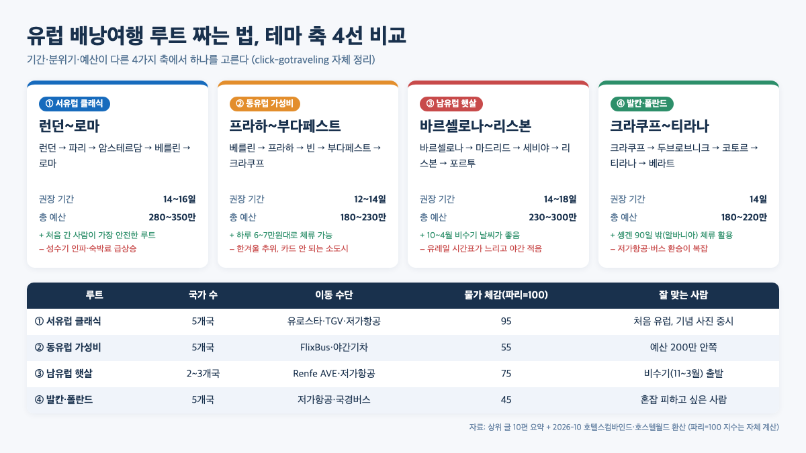
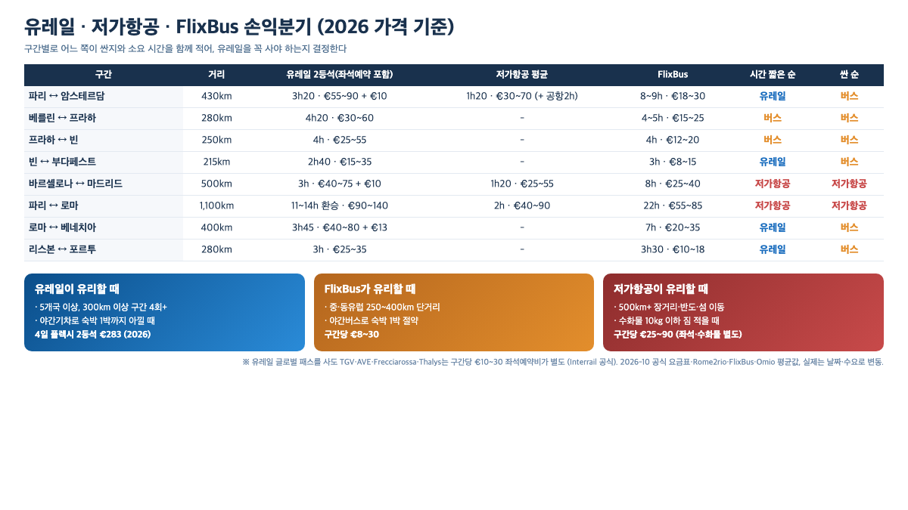
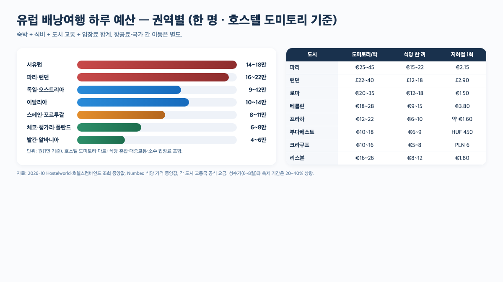

유럽 배낭여행 루트 짜는 법은 추천 코스 나열이 아니라 **① 기간 → ② 입·출국 공항 → ③ 테마 축 → ④ 이동수단** 순서로 좁혀 가는 작업입니다. 이 순서를 뒤집으면 "파리에서 로마까지 유레일로 가면 되지"라고 생각했다가 11시간 환승·좌석예약비 €20·숙박 1박 추가 같은 숨은 비용에 걸립니다. 2026년 10월 기준 공식 요금과 상위 가이드 8편(SERP 상위 10개 중 깊이 분석한 수)을 교차한 숫자로 4단계를 하나씩 풀어 보겠습니다.

📌 3줄 요약
루트는 <b>기간 → 인·아웃 공항 → 테마 축 → 이동수단</b> 4단계 순서로 좁힙니다. 추천 코스 베끼기 전에 이 순서를 먼저 지키세요.

유레일 글로벌 패스 4일 플렉시블(2등석, 공식명 Global Pass 4 days within 1 month)은 2026년 <b>€283</b>이고 TGV·AVE 좌석예약비는 구간당 €10～30 별도입니다.

솅겐 90일/180일 규정은 그대로이고 ETIAS 수수료는 €7에서 <b>€20</b>으로 올라갔으며 시행일은 2026-10 현재 공식 발표가 지연됐습니다.

## 유럽 배낭여행 루트 짜는 법, 4단계 전체 흐름

상위 가이드 8편(SERP 상위 10개 중 깊이 분석한 수)을 열어 보니 공통된 함정이 하나 보였습니다. 다들 "서유럽 클래식 루트는 런던-파리-로마"라는 **완성된 코스**부터 꺼내고, 그걸 자기 일정에 억지로 맞추게 만듭니다. 그런데 20일이 있는 사람과 14일이 있는 사람이 같은 코스로 가면 한쪽은 쫓기고 한쪽은 남습니다.

그래서 이 글은 역순으로 갑니다. 먼저 기간을 숫자로 못 박고, 어느 공항으로 들어가고 어느 공항으로 나올지(이게 생각보다 돈을 많이 바꿉니다)를 정한 뒤, 4개 테마 축 중에서 한 줄기를 고르고, 마지막에 유레일·저가항공·버스를 섞어 비용을 다듬는 흐름입니다. 1～4단계가 각각 제거하는 질문이 달라, 섞어 쓰면 오히려 헷갈립니다.

흐름 자체는 아래 표 한 장이면 요약됩니다. 각 단계가 **다음 단계의 선택지를 좁히는 역할**이라는 점만 기억해 두면 됩니다.

| 단계 | 답해야 할 질문 | 결과물 | 참고할 숫자 |
| --- | --- | --- | --- |
| 1 | 몇 밤이 있나? | 2주/3주/1개월 | 2주=3～5개국·3주=5～7개국 |
| 2 | 인·아웃 공항을 다르게 끊을까? | IN 공항·OUT 공항 | 오픈조 티켓 왕복과 가격 거의 동일 |
| 3 | 어떤 분위기를 원하나? | 테마 축 1개 선택 | 서유럽·동유럽·남유럽·발칸 중 1 |
| 4 | 어떻게 이동할까? | 유레일 vs 저가항공 vs 버스 | 유레일 4일 €283 + 좌석예약비 |

지금부터 네 단계를 하나씩 풀고, 마지막에 하루 예산·숙박 요령·솅겐/ETIAS까지 붙여 두겠습니다.

## 1단계. 여행 기간부터 숫자로 못 박기

가장 흔한 실수는 "14일인데 7개 도시 돌면 되지 않을까"입니다. [tali.kr의 2주 가이드](https://tali.kr/europe-backpacking-route)와 상위 글들이 공통으로 권하는 숫자는 **2주면 5개 도시 이내, 3주면 7개 이내**예요. 왜냐하면 도시 하나 사이 이동에 반나절은 꼭 들어가고, 체크인·체크아웃 하루 더하면 "짧은 도시"는 거의 둘러보지 못한 채 떠나기 때문입니다.

상위 가이드 8편을 교차하면 평균적으로 2주 기준 "**큰 도시 3곳 × 3박 + 중간 도시 2곳 × 2박**" 조합이 가장 많이 추천됩니다(참고: [tali.kr 2주 가이드](https://tali.kr/europe-backpacking-route), [트립스토어 서유럽 2주 코스](https://www.tripstore.kr/blog/%EC%84%9C%EC%9C%A0%EB%9F%BD-2%EC%A3%BC-%EC%97%AC%ED%96%89-%EC%BD%94%EC%8A%A4-%EC%9D%BC%EC%A0%95)). 파리나 로마 같은 볼거리 많은 도시는 3박, 암스테르담·프라하·빈 같은 도시는 2박, 하룻밤 환승 격인 쾰른·잘츠부르크는 1박으로 끊는 식입니다.

| 기간 | 권장 국가 수 | 권장 도시 수 | 평균 이동 일수 | 참고 가이드 |
| --- | --- | --- | --- | --- |
| 10일 | 2개국 | 3개 도시 | 1～2일 | 서유럽 2개국 집중 |
| 14일 | 3～4개국 | 5개 도시 | 2～3일 | 서유럽 클래식 |
| 21일 | 5～6개국 | 7개 도시 | 3～4일 | 서유럽+중부 혼합 |
| 30일 | 6～8개국 | 9개 도시 | 4～5일 | 서+동유럽 또는 유레일 1개월 |

유럽행은 비행 자체가 11～14시간이라 **첫날과 마지막날은 이동만 하는 날로 비웁니다**. 그래서 14일 티켓이어도 실제 유럽에서 돌 수 있는 날은 12일 안팎이에요. [인천국제공항](https://www.airport.kr/) 출발·도착 정보로 비행 시각까지 확정한 뒤에 1단계를 닫는 게 안전합니다.

## 2단계. 입국·출국 공항은 다르게 끊는다 (오픈조 티켓)

여기서 숨은 돈이 제일 많이 나옵니다. 왕복 티켓(ex. 인천↔파리)으로만 검색하면 "파리에 들어왔으니 파리로 돌아가야 한다"는 착각에 빠지고, 마지막 날 로마에서 파리까지 역방향으로 되돌아오는 일정을 짭니다. 이게 2일을 통째로 날립니다.

해법은 **오픈조 티켓**(open-jaw)이에요. "인천 → 파리"와 "로마 → 인천"을 다른 공항에서 끊는 티켓인데, 가격은 왕복과 거의 비슷하거나 몇만 원 차이에 그치는 경우가 많습니다. 카약·네이버항공권의 "다구간" 검색에서 **ICN→CDG, FCO→ICN**처럼 조합하면 나오고, 2026-10 기준 국적기(대한항공·아시아나) 자체 직항이 운항 중인 유럽 도시는 파리·로마·런던·프랑크푸르트·암스테르담·바르셀로나·마드리드·빈·취리히 정도입니다([대한항공 국제선 노선 안내](https://www.koreanair.com/kr/ko/schedule-booking/flight-schedules/routes-and-timetables)). 이스탄불은 터키항공 전담, 헬싱키는 KE가 2024년 운휴한 뒤 핀에어 코드쉐어 중심이라 "국적기 직항"에서 빠집니다.

오픈조로 끊는 순간 "입국 도시"와 "출국 도시"라는 두 기둥이 서고, 그 사이에 중간 도시를 끼우는 방식으로 루트가 자동으로 짜집니다. 서유럽 클래식 루트가 "런던 IN → 로마 OUT"으로 자주 짜이는 이유도 이것 때문이에요.

*▲ 상위 가이드 8편(SERP 상위 10개 중 깊이 분석한 수)을 모아 자주 등장하는 테마 축 4개를 비교해 직접 정리한 표입니다. "물가 체감 지수"는 호텔스컴바인드·호스텔월드 2026-10 조회 중앙값을 파리=100으로 환산한 자체 계산입니다.*

## 3단계. 테마 축 4개 중 하나를 고른다

여기부터는 "어떤 유럽을 원하는가"의 질문입니다. 상위 가이드가 추천하는 코스를 겹치는 것끼리 묶으면 결국 네 축으로 수렴해요. 네 축을 섞어서 짜는 건 추천하지 않는데, 2주 안에 서유럽과 발칸을 동시에 돌면 이동에만 사흘이 깨집니다.

### 축 1. 서유럽 클래식 — 런던～파리～로마

가장 안전한 입문 코스입니다. [트립스토어의 2주 가이드](https://www.tripstore.kr/blog/%EC%84%9C%EC%9C%A0%EB%9F%BD-2%EC%A3%BC-%EC%97%AC%ED%96%89-%EC%BD%94%EC%8A%A4-%EC%9D%BC%EC%A0%95)는 영국·프랑스·스위스 3개국 2주 코스를 약 350만 원으로 잡고, 다른 가이드들은 런던→파리→암스테르담→베를린→로마의 5개국 2주를 280～350만 원 선으로 봅니다. 익숙한 랜드마크(에펠탑·콜로세움·빅벤·뮌헨 호프브로이)가 몰려 있어 처음 유럽에 간 사람도 길을 잃기 어렵습니다. 다만 성수기(6～8월)에는 숙박료·입장료 대기줄이 모두 두 배가 됩니다.

### 축 2. 동유럽 가성비 — 프라하～부다페스트～크라쿠프

하루 체류비가 서유럽의 절반 수준입니다. [인포링크의 3주 300만 원 가이드](https://hifineap.com/%EC%9C%A0%EB%9F%BD-%EC%B2%AB-%EB%B0%B0%EB%82%AD%EC%97%AC%ED%96%89-%EA%B2%BD%EB%B9%84-%EB%82%98%EB%9D%BC%EB%B3%84-%ED%95%98%EB%A3%A8-%EC%98%88%EC%82%B0-3%EC%A3%BC-%EC%9D%BC%EC%A0%95%EC%9C%BC%EB%A1%9C-3/)에 따르면 체코·헝가리·폴란드가 하루 6～7만 원, 독일·오스트리아가 10만 원, 서유럽이 9만 원 안팎이라 **동유럽을 2주 중 1주 끼우면 평균 체류비가 20～30% 떨어집니다**(계산 근거: 서유럽 7일×9만 + 동유럽 7일×6.5만 = 108.5만 → 서유럽 14일 평균 126만 대비 약 14% 절감, 동유럽 비중을 10일로 늘리면 약 28% 절감). [tali.kr 가이드](https://tali.kr/europe-backpacking-route)도 서유럽 5개 도시 130～180만 원·동유럽 3개 도시 70～100만 원으로 격차를 비슷하게 집계해 교차 확인됩니다. 축 1과 섞어 "파리 3박 → 베를린 2박 → 프라하 2박 → 빈 2박 → 부다페스트 3박" 같은 변형도 자주 보이는 조합이에요.

### 축 3. 남유럽 햇살 — 바르셀로나～리스본

비수기(11～3월) 유럽을 노리는 사람에게 맞는 축입니다. 서유럽은 비수기에 흐리고 춥지만 바르셀로나·리스본은 11월 평균 최고 17～19℃ 수준이라 산책하기 편한 편입니다([Weather Atlas 바르셀로나 11월](https://www.weather-atlas.com/en/spain/barcelona-weather-november), [리스본 11월](https://www.weather-atlas.com/en/portugal/lisbon-weather-november), 2026-10 조회). 다만 유레일로 바르셀로나-포르투 구간을 넘어가는 건 환승이 많아 시간이 오래 걸립니다. 저가항공(Vueling·TAP) 조합을 미리 섞어 두는 쪽이 깔끔해요.

### 축 4. 발칸·폴란드 가성비 끝판왕

[인포링크의 폴란드·발칸 2주 216만 원 코스](https://hifineap.com/200%EB%A7%8C%EC%9B%90%EC%9C%BC%EB%A1%9C-2%EC%A3%BC-%EB%88%84%EB%A6%AC%EB%8A%94-%EC%9C%A0%EB%9F%BD-2026-%EA%B0%80%EC%84%B1%EB%B9%84-%EB%81%9D%ED%8C%90%EC%99%95-%ED%8F%B4%EB%9E%80%EB%93%9C-%EB%B0%9C/)가 공개한 숫자가 한 축을 보여줍니다. 코토르 숙소 1박 약 4만 원, 티라나 식당 세트 €3 수준이고, 알바니아·몬테네그로는 솅겐 밖이라 **90일 체류 카운트에서 벗어난다**는 장점도 있어요. 대신 저가항공·국경버스 환승이 서유럽보다 복잡하다는 점은 감안해야 합니다.

## 4단계. 이동수단 — 유레일·저가항공·FlixBus 손익분기

*▲ 상위 글이 가장 많이 빠뜨리는 질문이 "유레일 패스를 꼭 사야 하는가"입니다. 구간별로 유레일 요금(좌석예약비 포함)과 저가항공·FlixBus 평균을 함께 적어 손익분기를 직접 계산해 본 표입니다. 2026-10 Interrail 공식 요금과 Rome2rio·FlixBus·Omio 조회값 기준입니다.*

가장 많이 하는 오해가 "유레일 패스를 사면 유럽 기차는 다 공짜"라는 것인데, 사실과 다릅니다. [railpassguide의 2026 가격표](https://www.railpassguide.com/en/guides/eurail-pass-prices)에 따르면 글로벌 패스는 성인 2등석 **4일 플렉시블 €283** — 공식명 Global Pass 4 days within 1 month, 1개월 내 선택 사용 — **7일 플렉시블 €381**, **15일 연속 €476**, **1개월 연속 €696**인데, 여기에 **TGV·AVE·Frecciarossa·Thalys는 구간당 €10～30의 좌석예약비가 별도로 붙습니다**. 인터레일 공식 안내에 "most high-speed and night trains require a reservation at an additional cost"라고 분명히 나와 있어요.

12～27세는 Youth 요금이 적용돼 2등석 기준 성인가 대비 25～30% 쌉니다. 반대로 FlixBus는 중·동유럽 단거리에서 구간당 €8～30 선이 많아, "프라하↔빈 €15 야간버스"로 숙박까지 겸하는 방법이 서유럽 종단에서도 자주 쓰입니다. 저가항공(Ryanair·easyJet·Vueling)은 수화물만 적다면 500km 이상에서 가장 빠르고 쌉니다.

구간별로 어느 쪽이 유리한지는 위 그림의 표가 직접 보여줘요. 핵심 결론을 한 줄로 압축하면 다음과 같습니다. **5개국 이상·장거리 야간기차 활용 = 유레일. 중·동유럽 단거리 = FlixBus. 500km 이상·반도·섬 = 저가항공.** 이 세 수단을 섞는 것이 "유레일 vs 저가항공" 이분법보다 거의 항상 쌉니다.

## 하루 예산 — 서유럽·중부·동유럽·발칸 비교

*▲ 2026-10 Hostelworld·호텔스컴바인드·Numbeo·각 도시 교통국 공식 요금을 모아 직접 만든 표입니다. 숫자는 호스텔 도미토리 1박·식당+마트 혼합·대중교통·소수 입장료 합계이며 성수기·축제 기간은 20～40% 올립니다.*

위 그림이 상위 글에서 가장 자주 나오는 숫자를 묶어 둔 것이지만, 포인트는 **국가 평균보다 방문 도시 기준**이라는 점이에요. 같은 이탈리아여도 로마는 €20～35, 밀라노는 €25～40인 반면 나폴리는 €15～25로 폭이 큽니다. 체코도 프라하가 가장 비싸고 올로모우츠는 절반 수준입니다.

이 격차를 이용하면 2주 예산을 눈에 띄게 줄일 수 있습니다. 예컨대 "프랑크푸르트 IN → 쾰른 1박 → 암스테르담 2박 → 베를린 2박 → 프라하 2박 → 빈 2박 → 부다페스트 3박 → 뮌헨 OUT" 같은 구성은, 비싼 도시(암스테르담·빈)를 2박씩만 끊고 저렴한 도시(프라하·부다페스트)를 길게 머물러 균형을 맞춥니다.

"하루 평균 약 9만 원"이 어떻게 나오는지 숙박·식비·교통으로 쪼개 보면 아래와 같습니다. Hostelworld 2026-10 조회 도미토리 중앙값과 Numbeo 식비·교통 데이터를 묶어 가중평균한 값입니다.

| 구성 | 서유럽 2박(암스) | 중부 4박(독·오) | 동유럽 5박(체·헝) | 발칸 3박(폴·슬로베) | 가중평균 |
| --- | --- | --- | --- | --- | --- |
| 숙박(€/박) | 25 | 18 | 12 | 8 | **€14 ≈ 2.0만 원** |
| 식비(€/일) | 25 | 20 | 12 | 10 | **€15 ≈ 2.2만 원** |
| 교통·입장(€/일) | 20 | 15 | 10 | 8 | **€12 ≈ 1.8만 원** |
| 소계(€/일) | 70 | 53 | 34 | 26 | **€41 ≈ 6.0만 원** |
| 환전·수수료·여유 | — | — | — | — | **+3.0만 원** |
| **합계**(원/일) | **약 10.3만** | **약 7.8만** | **약 5.0만** | **약 3.8만** | **약 9만 원** |

하루 평균 약 9만 원 × 14일 = 숙박·식비·현지 교통 합산 **126만 원** 선이 나오고, 여기에 왕복 항공 120만 원·국가 간 이동 25만 원·입장료·보험·심카드 25만 원을 더하면 **총 300만 원 안쪽**으로 수렴해요.

## 솅겐 90일/180일 규정과 ETIAS 2026 현황

솅겐 지역은 **출국일 기준 과거 180일 이내 최대 90일 체류**가 원칙입니다. 외교부 [해외안전여행 안내](https://www.0404.go.kr/bbs/contsPst/MST0000000000117/17/detail)와 솅겐 공식 규정 모두 같은 숫자를 쓰고 있어요. 29개 가입국(2026년 10월 기준)을 합산해서 세기 때문에 "프랑스 30일 + 독일 30일 + 스페인 30일 = 90일 소진"이라는 점을 꼭 기억해야 합니다. 대부분의 배낭여행은 2～4주라 90일을 넘길 일이 없지만, 유럽에서 어학연수·장기 체류를 섞을 계획이라면 알바니아·몬테네그로 등 솅겐 밖 국가로 쉬어 가는 설계가 필요합니다.

ETIAS(유럽 여행 정보·허가 시스템)는 "비자가 아닌 사전 전자 허가"로, 한국·일본·미국 등 비자 면제 국가 국민에게 적용됩니다. 수수료는 유럽위원회가 2025년 7월에 **€7에서 €20으로 공식 인상**했고, 승인된 ETIAS는 **발급일로부터 3년 유효**입니다. 시행 시점은 원래 2026년 4분기가 공식 목표였는데, 2026년 7월경 공식 포털에서 해당 문구가 삭제됐다는 보도가 있었고([EU 공식 ETIAS 포털](https://travel-europe.europa.eu/etias_en)에서도 2026-10 현재 'Q4 2026' 문구 없이 'last quarter of 2026, pending final confirmation'으로만 안내), 2026-10 현재는 **공식 시행일 발표가 지연된 상태**로 보입니다. 출발 전에는 반드시 EU 공식 ETIAS 포털에서 가장 최신 안내를 다시 확인하는 쪽이 안전합니다.

## 숙박·식비·심카드까지 — 실전 절약 요령

숙박은 **호스텔 도미토리 + 1～2일 호텔**을 섞는 방식이 가장 보편적입니다. Hostelworld 2026-10 조회 기준 프라하 €12～22, 베를린 €18～28, 파리 €25～45가 평균이에요. 혼성 도미토리가 신경 쓰이면 여성 전용·4인실 방을 필터로 걸고 **위치점수 8.5 이상·리뷰 500건 이상**을 기준으로 거르면 체감 만족도가 올라갑니다.

식비는 "매일 식당"이 아니라 "하루 1끼 식당 + 2끼 마트·베이커리" 조합이 상위 가이드 공통 추천이에요. 서유럽 마트 샌드위치는 €3～5 선이고 로마·바르셀로나의 1인 피자·타파스 세트는 €8～12 선입니다. 심카드는 도착 공항 대신 국내에서 유심·eSIM을 미리 끊어 가는 쪽이 활성화 시간을 아끼는 데 유리합니다.

도시 안에서는 "72시간 교통권"이 거의 모든 수도에서 팔립니다. 이름만 다르고 구조는 같아요(지하철·트램·버스 통합). 2026-10 공식 요금 기준으로 묶으면 다음과 같습니다.

| 도시 | 72h 교통권 상품명 | 요금 | 포함 |
| --- | --- | --- | --- |
| 파리 | Navigo Jour × 3일 / Paris Visite 1～3존 3일권 | €22(존1-3) | 지하철·버스·트램·RER(존 내) |
| 베를린 | WelcomeCard 72h (AB존) | €25 | 대중교통 + 200개 할인 |
| 프라하 | 72h 공공교통권(DPP 3-day) | €13 (330 CZK) | 지하철·트램·버스 |
| 부다페스트 | 72h Budapest Travelcard(BKK) | €15 (5,500 HUF) | 대중교통 전체 |

*출처: [파리 Île-de-France Mobilités](https://www.iledefrance-mobilites.fr/en/tickets-pass), [베를린 WelcomeCard](https://www.visitberlin.de/en/berlin-welcomecard), [프라하 DPP 요금](https://www.dpp.cz/en/fares/ticket-prices), [부다페스트 BKK 요금](https://bkk.hu/en/tickets-and-passes/prices/) — 2026-10 조회.*

가격은 보통 **€13～25 선**인데 지하철·트램·버스가 전부 포함돼 있어 **2박 3일 체류라면 거의 손해 보지 않는 투자**입니다. 한편 다낭·태국처럼 짧은 도시형 코스를 직접 조립해 본 경험이 처음이라면 [다낭 여행 코스 짜는 법 (2박·3박·4박 동선 조립 원칙)](/danang-travel-course/)의 "큰 축 2개 + 작은 축 1개" 사고 틀이 유럽 2주 루트에도 그대로 적용됩니다.

## 자주 묻는 질문

**Q. 유럽 배낭여행 루트 짜는 법에서 가장 먼저 결정해야 할 건 뭔가요?** 기간입니다. 2주냐 3주냐에 따라 가능한 국가 수와 체류 패턴이 완전히 달라집니다. 기간을 숫자로 못 박은 뒤 공항·테마·이동수단 순으로 좁히는 게 정석입니다.

**Q. 처음 유럽 배낭여행인데 유레일 패스를 꼭 사야 하나요?** 꼭은 아닙니다. 간단한 손익분기 예시로, 파리→로마 TGV·Frecciarossa 단건 티켓은 2등석 €80 + 좌석예약비 €10 = **약 €90**인 반면, 유레일 4일 플렉시블(€283) ÷ 4일 = €70.75 + 구간 좌석예약비 €10 = **€80.75**로 1회 이용 기준 약 €10 유리합니다. 즉 300km 이상 고속구간을 **4회 이상** 탈 때 손익분기가 맞고, 단거리 위주면 FlixBus·저가항공 조합이 보통 더 쌉니다. 유레일을 사도 TGV·AVE 좌석예약비는 구간당 €10～30 별도라는 점을 잊지 마세요.

**Q. 유럽 배낭여행 2주 예산은 얼마가 적당한가요?** 서유럽 3～5개국 2주 기준 보통 **280～350만 원**(항공권 포함), 동유럽·발칸 중심이면 **180～230만 원**까지 내려갑니다. 하루 체류비(숙박+식비+교통)는 서유럽 14～18만 원, 동유럽 6～8만 원이 평균입니다.

**Q. 솅겐 90일 규정은 한 나라당 90일인가요?** 아닙니다. 솅겐 전체 29개국 합산으로 180일 중 90일입니다. 프랑스 30일 + 독일 30일 + 스페인 30일이면 이미 90일을 다 쓴 셈이에요.

**Q. ETIAS는 2026년에 꼭 받아야 하나요?** 2026년 10월 현재 시행일이 공식 발표되지 않아 아직 신청할 수 없습니다. 시행되면 수수료 €20·유효기간 3년으로, 솅겐 입국 전 온라인에서 받는 사전 전자 허가입니다. 출발 전 EU 공식 ETIAS 포털에서 최신 상태를 다시 확인하세요.

**Q. 인·아웃 공항은 꼭 다르게 끊어야 하나요?** 2개국 이상을 도는 2주 이상 일정이면 다르게 끊는 쪽이 거의 항상 유리합니다. 왕복으로 되돌아오는 2일을 아낄 수 있고 가격 차이는 몇만 원 수준에 그치는 경우가 많습니다.

## 이미지 출처

본문 그림 4장은 모두 click-gotraveling이 자체 디자인한 인포그래픽(HTML → PNG)으로, 참고한 1차 자료는 그림별로 다릅니다. 아래는 각 그림이 묶어 쓴 공식 출처와 조회일(2026-10) 목록입니다.

- **히어로 카드**(상단 제목 이미지) — 유레일 €283 숫자와 4단계 흐름 라벨을 디자인용으로 재조합. 수치 출처: [railpassguide 2026 가격표](https://www.railpassguide.com/en/guides/eurail-pass-prices)·[Interrail Global Pass](https://www.interrail.eu/en/interrail-passes/global-pass), 2026-10 조회.
- **테마 축 비교표**(루트 4선) — 자주 등장하는 코스를 서/동/남/발칸 4축으로 묶음. 물가·거리 참고: [Interrail 공식 노선 지도](https://www.interrail.eu/en/plan-your-trip)·[Rome2rio 구간 조회](https://www.rome2rio.com)·[Hostelworld 도미토리 요금](https://www.hostelworld.com), 2026-10 조회.
- **이동수단 손익분기 표** — 유레일 요금과 저가항공·버스 평균 비교. 참고: [Interrail 공식 요금](https://www.interrail.eu/en/interrail-passes/global-pass)·[Rome2rio](https://www.rome2rio.com)·[FlixBus 공식 사이트](https://global.flixbus.com)·[Omio 구간 조회](https://www.omio.com), 2026-10 조회.
- **하루 예산 비교 그래프** — 호스텔·식비·교통·입장료 합계를 권역별로 묶음. 참고: [Hostelworld 도미토리 중앙값](https://www.hostelworld.com)·[Numbeo 2026 Cost of Living](https://www.numbeo.com/cost-of-living/)·[외교부 해외안전여행](https://www.0404.go.kr/bbs/contsPst/MST0000000000117/17/detail)·각 도시 교통국 공식 요금, 2026-10 조회.

저작권 표기: 모든 그림은 **click-gotraveling 자체 제작·2026-10 조회값 기준**이며, 각 그림에 쓰인 숫자는 위 1차 출처에서 가져왔고 재가공·시각화는 click-gotraveling이 수행했습니다. 상업적 재사용 시 출처 표기를 부탁드립니다.

---

**관련 키워드** — #유럽배낭여행 #유럽배낭여행루트 #유럽배낭여행코스 #유럽2주배낭여행 #유럽3주배낭여행 #유레일패스2026 #ETIAS2026 #솅겐90일 #유럽저가항공 #유럽배낭여행예산
