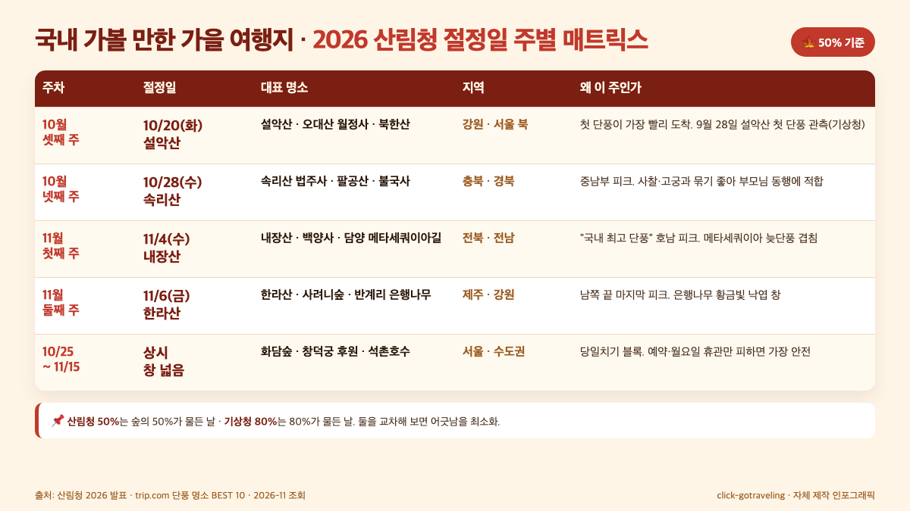
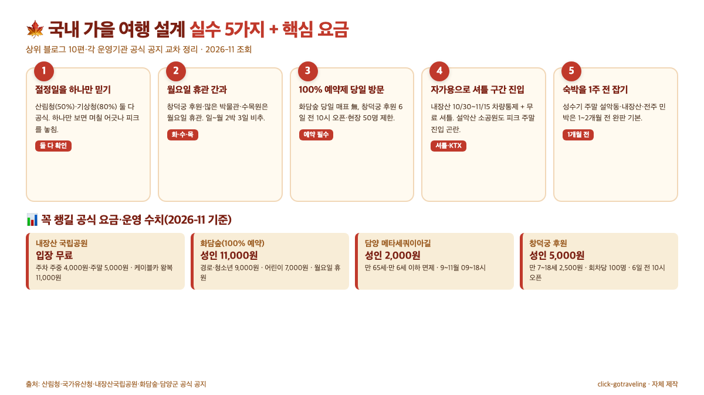

**국내 가볼 만한 가을 여행지**는 "가을 단풍 명소 베스트 10"만 보면 꼭 틀립니다. 2026년 산림청 공식 발표 기준 **설악산 10월 20일·속리산 10월 28일·내장산 11월 4일·한라산 11월 6일**로 절정일이 보름 가까이 벌어지기 때문이에요. "어디가 예쁜가"가 아니라 "내가 갈 수 있는 주에 어디가 절정인가"로 거꾸로 짜야 헛걸음이 없습니다. 2026년 11월 기준 산림청·기상청·각 운영기관 공식 수치를 교차해 주별로 정리했어요.

📌 3줄 요약
2026 산림청 기준 절정일은 <b>설악산 10/20 → 속리산 10/28 → 내장산 11/4 → 한라산 11/6</b> 순서로 북에서 남으로 약 <b>2주 반</b>에 걸쳐 내려옵니다.

산림청은 "<b>단풍 50% 든 날</b>"을, 기상청은 "80% 든 날"을 절정으로 잡아 기관마다 날짜가 며칠 어긋나니 하나만 믿지 말고 둘 다 확인하는 쪽이 안전합니다.

화담숲은 <b>100% 사전예약제</b>이고 창덕궁 후원도 6일 전 오전 10시 오픈, 내장산은 단풍철 <b>차량통제 + 셔틀</b>로 바뀌니 가기 전 공식 공지 1번은 꼭 확인해야 해요.

## 국내 가볼 만한 가을 여행지, 2026 산림청 절정일 한 장에

**결론부터 요약하면 2026년 가을 국내 여행지는 내가 쉴 수 있는 주를 먼저 정하고, 그 주에 절정인 산·숲·궁을 꽂아 넣는 쪽이 정답입니다**. 상위 블로그 10편을 열어 보면 "설악산·내장산·오대산·담양 메타세쿼이아길"이 공통으로 등장하지만, 각 명소의 절정일이 2주 이상 벌어진다는 사실은 거의 빠져 있어요. 그래서 "11월 중순에 설악산을 간다"거나 "10월 셋째 주에 내장산에 간다" 같은 어긋난 일정이 매년 반복됩니다.

이 글은 그 함정을 피하도록 **산림청 2026년 공식 발표**([Jungleboss 요약 foxcg.com 2026 절정 예상](https://foxcg.com/2026-autumn-foliage-peak)·[데일리안 2026 산림청 발표 기사](https://www.dailian.co.kr/news/view/1693325/%EC%98%AC%ED%95%B4-%EB%8B%A8%ED%92%8D-%EC%A0%88%EC%A0%95-10%EC%9B%94-%EB%A7%90%EC%84%A4%EC%95%85%EC%82%B0-20-2026) 2026-11 조회, 둘 다 산림청 출처 일치)를 그대로 가져와 주별 매트릭스로 묶었어요. 산림청은 "숲의 **50%가 물든 날**"을 절정으로 잡고, 기상청은 "80%가 물든 날"을 절정으로 잡아 기관마다 며칠씩 차이가 납니다. 이 글은 **산림청 50% 기준**을 뼈대로 쓰고, 기상청 수치는 범위로만 참고했습니다.

| 주 | 산림청 절정일 | 대표 명소 | 지역 | 왜 이 주인가 |
| --- | --- | --- | --- | --- |
| **10월 셋째 주** | **10/20** (화) 설악산 | 설악산·오대산·북한산 | 강원·서울 북 | 첫 단풍이 가장 빨리 도착하는 축, 9월 28일 첫 단풍 관측 |
| **10월 넷째 주** | **10/28** (수) 속리산 | 속리산 법주사·팔공산·불국사 | 충북·경북 | 중남부로 내려오는 피크, 사찰·고궁과 묶기 좋음 |
| **11월 첫째 주** | **11/4** (수) 내장산 | 내장산·백양사·담양 메타세쿼이아길 | 전북·전남 | 호남 대표 단풍지 피크, 메타세쿼이아 늦단풍 |
| **11월 둘째 주** | **11/6** (금) 한라산 | 한라산·사려니숲·반계리 은행나무 | 제주·강원 | 남쪽 끝 마지막 피크, 은행나무 황금빛 |
| **10/25~11/15** 상시 | — | 화담숲·창덕궁 후원·석촌호수 | 서울·수도권 | 당일치기 블록, 예약·휴관만 피하면 안전 |

이 표의 핵심은 **한 주 안에 절정을 맞는 명소가 세 곳씩 묶여 있다**는 점이에요. 그래서 10월 셋째 주에 쉴 수 있다면 설악산에 집중하고, 11월 첫째 주에 쉴 수 있다면 내장산·백양사를 묶어 호남으로 내려가는 쪽이 사진·체감 모두 만족도가 가장 높습니다. 반대로 절정일을 무시하고 11월 셋째 주에 설악산에 가면 대청봉은 이미 낙엽이 끝난 뒤라 "단풍 시즌을 놓친 설악산"만 보고 오게 됩니다.

*▲ 2026년 산림청 발표 절정일(설악산 10/20·속리산 10/28·내장산 11/4·한라산 11/6)을 주차별 매트릭스로 묶은 click-gotraveling 자체 제작 인포그래픽입니다. 산림청 50% 기준, 2026-11 조회.*

## 첫 단풍·절정·낙엽 — 산림청 50% 기준으로 외우기 쉬운 3주차 지도

왜 매년 "단풍 시기"가 어긋나느냐면, 첫 단풍·절정·낙엽을 한 묶음으로 생각하기 때문이에요. 세 시점은 보통 **약 2~3주**씩 벌어집니다. 2026년 기준 설악산은 **첫 단풍 9월 28일 → 절정 10월 20일 → 낙엽 11월 초**로 약 5주의 창이 있고, 내장산은 **첫 단풍 10월 말 → 절정 11월 4일 → 낙엽 11월 중순**으로 창이 짧은 편이에요([foxcg.com 2026 절정 예상](https://foxcg.com/2026-autumn-foliage-peak)·[데일리안 2026 산림청 발표](https://www.dailian.co.kr/news/view/1693325/%EC%98%AC%ED%95%B4-%EB%8B%A8%ED%92%8D-%EC%A0%88%EC%A0%95-10%EC%9B%94-%EB%A7%90%EC%84%A4%EC%95%85%EC%82%B0-20-2026) 교차, 2026-11 조회).

이 세 시점을 외우기 쉽게 "3주차 지도"로 정리하면 이렇게 됩니다.

- **D-14 ~ D-7**(절정 2주 ~ 1주 전): 숲이 **30~50% 물드는 구간**. 산 정상·대청봉·설악산 공룡능선처럼 **고도가 높은 코스**가 피크입니다. 사진은 아직 연한 주황·노랑이 섞인 톤이에요.
- **D-day ~ D+3**(절정일 전후): 산림청 50% 기준의 **절정 창**. 등산로 중턱·사찰 경내·숲길이 가장 붉습니다. 주말이 끼면 주차장 만차·입장 대기가 가장 길어지는 구간이에요.
- **D+7 ~ D+14**(절정 1주 ~ 2주 후): 산 정상은 이미 낙엽, 하지만 **저지대·호수 주변·은행나무 가로수**가 피크예요. 반계리 은행나무([한국관광공사 가을 인생 단풍 명소](https://korean.visitkorea.or.kr/detail/rem_detail.do?cotid=16b70896-12aa-4dd0-839e-ecd5aae26479) 2026-11 조회)·담양 메타세쿼이아길처럼 낙엽수 가로수길이 이 구간입니다.

💡 산림청 50% vs 기상청 80% 날짜가 왜 다른가
같은 "설악산 절정"인데 산림청은 10월 20일로, 기상청·민간 예보는 10월 25일 전후로 발표하는 이유는 <b>관측 기준이 다르기 때문</b>이에요. 산림청은 "숲의 50%가 물든 날", 기상청은 "80%가 물든 날"을 절정으로 잡습니다.

그래서 사진·체감으로 "완전히 붉어진 산"을 보고 싶으면 기상청 수치에 가깝게, 교통·주차 피크를 피해 "지금 막 절정 시작한 때"에 가고 싶으면 산림청 수치에 가깝게 잡으면 됩니다.

## 10월 셋째 주 — 설악산·오대산·북한산으로 가는 강원·수도권 북쪽 축

**이 주는 가장 먼저 단풍이 터지는 강원도 북부 축이 정답입니다**. 2026년 산림청 기준 설악산 절정일은 **10월 20일** (화), 오대산은 **10월 15~24일 창**, 북한산은 10월 셋째 주 중후반이에요([foxcg.com 2026 절정 예상](https://foxcg.com/2026-autumn-foliage-peak)·[trip.com 2026 단풍 명소 BEST 10](https://kr.trip.com/blog/%EB%8B%A8%ED%92%8D%EB%AA%85%EC%86%8C/) 2026-11 조회). 세 곳이 한 주 안에 몰려 있어 **당일치기·1박 2일로 묶기 가장 좋은 주**이기도 합니다.

설악산은 소공원 코스(권금성 케이블카·울산바위 들머리)로 **반나절**에 핵심을 돌 수 있고, 체력에 자신 있으면 **오색-대청봉 당일 왕복**이 정석이에요. 국립공원공단 설악산국립공원 공식 코스 안내([국립공원공단 설악산국립공원](https://seorak.knps.or.kr/) 2026-11 조회)에 따르면 오색탐방지원센터에서 대청봉까지 편도 약 **5km·4~5시간**, 왕복 **약 10시간**이 표준 소요시간이니 **일출 전 출발**을 전제로 계획해야 안전합니다. 평창 월정사 전나무 숲길은 **오대산 월정사 전나무길**로 불리는 1km 코스가 유명하고, 주차장에서 월정사 입구까지 이어지는 흙길이 **왕복 1시간** 정도 걸립니다. 북한산은 서울에서 접근이 가장 쉬운 축이라 **10월 셋째 주 평일 오전**이 황금 타임이에요.

⚠️ 10월 셋째 주 설악산 함정
설악산 소공원 주차장은 <b>성수기 토·일 오전 중 만차가 잦다</b>고 알려져 있어요. 차량 이동이면 금요일 밤 출발·속초 숙박 후 토요일 새벽 진입이 안전하고, 공식 교통 안내는 <b>국립공원공단 설악산국립공원</b> 홈페이지에서 당일 공지를 재확인하세요.

권금성 케이블카는 기상 악화 시 수시 운휴. 비·안개 예보가 뜨면 설악산을 포기하고 <b>속초 영랑호·외옹치 바다부채길</b>로 플랜 B를 짜 두세요.

## 10월 넷째 주 — 속리산·팔공산·불국사로 내려오는 충북·경북 축

**이 주는 사찰·고궁과 단풍이 함께 잡히는 중남부 피크**예요. 2026년 산림청 기준 **속리산 10월 28일** (수), 팔공산 10월 23~30일, 경주 불국사 10월 22~29일로 창이 겹칩니다([foxcg.com 2026 절정](https://foxcg.com/2026-autumn-foliage-peak)·[trip.com 단풍 명소 BEST 10](https://kr.trip.com/blog/%EB%8B%A8%ED%92%8D%EB%AA%85%EC%86%8C/) 2026-11 조회). 상위 블로그들이 공통으로 추천하는 "경주 1박 2일" 코스가 바로 이 주에 겹쳐요.

속리산 법주사는 매표소에서 법주사까지 이어지는 **1km 전나무·단풍 숲길**이 가을 하이라이트이고, 국립공원 입장료·법주사 관람료는 둘 다 무료입니다. 팔공산은 동화사·갓바위·케이블카가 세트이고, 경주는 불국사 + 첨성대 + 안압지(동궁과 월지) 야간 조명을 묶으면 1박 2일 밀도가 가장 높아요. 사찰과 고궁이 묶인 축이라 **부모님 동행·역사 투어 성향**에 특히 잘 맞습니다.

### 이 주에 꼭 피해야 할 함정

- **월요일 휴관** — 경주 국립박물관·안압지 야간개장 일정은 월요일 휴관이 많습니다. 금~일 일정이 꼬이면 반드시 월요일 재방문이 가능한지 공식 공지로 확인하세요.
- **단풍철 주말 경부·중부고속도로 정체** — 서울→신경주 KTX는 **공식 소요 약 2시간**([코레일 KTX 공식 시각표](https://www.letskorail.com/) 2026-11 조회)이고, 자가용은 성수기 주말 **평균 통행시간에 1~2시간이 추가**되는 사례가 잦아요. 불확실성이 큰 피크 주말엔 KTX 쪽이 체감 훨씬 빠릅니다.
- **속리산 법주사 매표소~법주사 1km 도보 필수** — 성인·노약자 모두 30분은 잡아야 해요. 왕복 1시간 + 법주사 경내 1시간 = 최소 2시간 블록으로 설계합니다.

## 11월 첫째 주 — 내장산·백양사·담양 메타세쿼이아길 호남 축

**호남의 대표 단풍지들이 한 주 안에 피크를 치는 주**예요. 2026년 산림청 기준 **내장산 11월 4일** (수)이고, 담양 메타세쿼이아길은 10월 29일~11월 4일 창에 걸려 있어 **같은 주 안에 묶으면 밀도가 최고**입니다([foxcg.com 2026 절정](https://foxcg.com/2026-autumn-foliage-peak)·[트립닷컴 단풍 명소](https://kr.trip.com/blog/%EB%8B%A8%ED%92%8D%EB%AA%85%EC%86%8C/) 2026-11 조회).

### 내장산 공식 운영 정보(2026-11 조회)

내장산은 국립공원·내장사 관람료가 **모두 무료**이고, 비용은 주차·케이블카에 집중돼요([make2t 2026 내장산 요금 정리](https://www.make2t.kr/2026/11/naejangsan-admission-parking-cablecar-2026.html)·[viewus 내장산 108그루 터널](https://feed.viewus.co.kr/ai/article/354208/) 2026-11 조회).

| 항목 | 요금(2026-11 기준) | 비고 |
| --- | --- | --- |
| 국립공원 입장료 | **무료** | 2007-01-01 폐지 |
| 내장사 관람료 | **무료** | 2023-05-04 면제 |
| 주차료(소형) | 주중 **4,000원** / 주말·성수기 **5,000원** | 내장호 주차장은 무료 |
| 케이블카 | 대인 왕복 **11,000원**(편도 7,000원) / 어린이 왕복 7,000원 | 성수기 대기 30~60분 |
| 셔틀버스(10/30~11/15) | **무료**, 내장호 주차장↔월영교 | 평일 9~17시 / 주말 8~17시 |
| 오토캠핑장 | 주중 **20,000원** / 성수기 **30,000원** | 11/2부터 성수기 요금 적용 |

요금표만큼 중요한 건 "어디서 사진이 가장 밀도 있게 걸리는가"예요. 내장산은 **내장사 매표소~내장사 본전 약 1km 단풍 숲길에 수령 100년 이상 108그루 단풍 터널**이 겹쳐 있어, 케이블카를 안 타도 평지 왕복 2시간으로 사진 밀도가 가장 높은 구간을 전부 커버할 수 있습니다([viewus 내장산 108그루 터널 정리](https://feed.viewus.co.kr/ai/article/354208/) 2026-11 조회).

### 담양 메타세쿼이아길 입장료 함정

담양 메타세쿼이아길은 "가로수길"이라 무료로 아는 분이 많은데, 공식 포토존 구간은 **유료 입장**이에요. 성인 **2,000원**, 청소년·군인 1,000원, 어린이 700원이고, 만 65세 이상·만 6세 이하·담양군민·국가유공자·장애인은 **면제**입니다([담양군 공식 안내 기반 발품뉴스 정리](https://www.balpumnews.com/travel/damyang-metasequoia-lined-road-8)·[텔트립 담양 메타세쿼이아길 운영 안내](https://www.telltrip.com/domestic-travel/damyang-metasequoia-road-forest-tunnel-walk/) 2026-11 조회). 운영시간은 담양군 공식 안내 기준 **9월~4월 09:00~18:00, 5월~8월 09:00~19:00**이고, 설·추석 당일 외 연중무휴입니다.

내장산·백양사·담양은 지리적으로 **가까워 1박 2일에 세 곳 모두 묶을 수 있는 유일한 주**예요. 전주 한옥마을까지 확장하면 2박 3일 일정이 가장 자연스럽고, 가는 길에 짐을 효율적으로 싸려면 [캐리어 짐싸는법, 공간이 남는 순서와 배치 요령](/carrier-packing-guide/)을 먼저 훑어 두면 1박 캐리어의 공간이 꽤 남습니다.

## 11월 둘째 주 — 한라산·사려니숲·반계리 은행나무 남부·제주 축

**가을 국내 여행의 마지막 피크가 걸리는 주**예요. 2026년 산림청 기준 한라산 절정일은 **11월 6일** (금)로, 제주 사려니숲길·1100도로 드라이브까지 묶기 좋습니다([foxcg.com 2026 절정](https://foxcg.com/2026-autumn-foliage-peak)·[trip.com 단풍 명소](https://kr.trip.com/blog/%EB%8B%A8%ED%92%8D%EB%AA%85%EC%86%8C/) 2026-11 조회). 한라산은 어리목·영실 코스가 **왕복 4~5시간**으로 체력 부담이 적고, 윗세오름까지 가는 코스가 11월 첫째 주·둘째 주에 가장 붉어요.

반계리 은행나무는 원주시에 있는 **천연기념물 제167호**, 국가유산청 공식 기재 기준 **수령 약 800년 이상**([국가유산청 국가유산포털 천연기념물 제167호](https://www.heritage.go.kr/) 2026-11 조회)의 거목입니다. 한라산 피크와 같은 주에 반계리 은행나무가 **낙엽 피크**를 맞아 "한쪽은 붉은 단풍, 한쪽은 노란 은행"으로 가을의 마지막 투샷을 잡을 수 있어요. 늦게 출발한 가을 여행을 구제하는 주차라 생각하면 됩니다. 사려니숲길은 입장료가 없고, 1코스 **왕복 10km·3~4시간**이 표준 블록입니다.

💡 이 주에 어울리는 사람
<b>이미 10월을 놓친 분</b> — 설악산·내장산 피크가 끝났어도 "가을이 이대로 끝난 건 아니다"는 각이 이 주예요. 한라산·반계리가 마지막 창입니다.

<b>등산 부담이 있는 분</b> — 한라산 어리목·영실은 왕복 4~5시간으로 설악산 대청봉(12시간)보다 체감 난이도가 훨씬 낮아요.

<b>가족·부모님 동행</b> — 사려니숲 1코스·반계리 은행나무는 평지 중심으로 아이·어르신에게 무리가 없습니다.

## 서울·수도권 — 창덕궁 후원·석촌호수·화담숲 당일치기 블록

주말 하나로 가볍게 끝내는 "수도권 가을 당일치기"는 **창덕궁 후원·화담숲·석촌호수** 세 축이 정답입니다. 셋 다 **10월 말~11월 중순**에 피크가 길게 겹쳐 있어 날짜 선택의 폭이 가장 넓어요. 다만 셋 모두 **예약 또는 휴관 함정**이 있어 함부로 가면 돌아서게 됩니다.

### 창덕궁 후원 — 2026 가을 운영 정보

창덕궁 후원은 **입장료 성인 5,000원·만 7~18세 2,500원**, 회차당 **100명**(인터넷 50 + 현장 50)이고, 온라인 예매는 **관람일 6일 전 오전 10시**에 오픈합니다([국가유산청 궁능유적본부 공식 예약](https://royal.khs.go.kr/ROYAL/contents/R601000000.do?schGroupCode=cdg)·[omnlog 창덕궁 후원 예약 방법](https://info.omnlog.com/entry/%EC%B0%BD%EB%8D%95%EA%B6%81-%ED%9B%84%EC%9B%90-%EC%98%88%EC%95%BD-%EB%B0%A9%EB%B2%95-6%EC%9D%BC-%EC%A0%84-%EC%98%A4%EC%A0%84-10%EC%8B%9C%C2%B7%EC%98%88%EC%95%BD%EC%A1%B0%ED%9A%8C%C2%B7%ED%98%84%EC%9E%A5%ED%91%9C-%ED%99%95%EC%9D%B8) 2026-11 조회). 11월 한국어 해설 회차는 **10:00~15:00 매시 정각**, 소요 70분이에요. **월요일 휴관**이라 토·일에 집중하거나 평일 화·수를 노리는 쪽이 안전합니다.

### 화담숲 — 100% 사전예약·성수기 운영시간

화담숲은 **100% 사전예약제**로 운영되고, 2026년 가을 축제는 **10월 1일~11월 22일**입니다([lightone 화담숲 가을 축제 2026 공식 정리](https://lightone.kr/hwadam-forest-autumn-foliage-festival-2026/) 2026-11 조회). 입장료는 성인 **11,000원**·경로 청소년 9,000원·어린이 7,000원, 모노레일은 순환 **7,000~9,000원**이에요. 성수기 운영시간은 **10/23~11/1 08:00~18:00**, **11/2~11/15 08:00~17:00**, **11/16~11/22 09:00~17:00**(월요일 휴원)로 바뀌니 가기 전 반드시 확인해야 합니다. 당일 현장 매표가 없다는 점이 가장 큰 함정이에요.

### 석촌호수 — 무료로 가장 가볍게

석촌호수는 **입장료 무료**, 지하철 잠실역에서 도보 5분이라 서울 당일치기 중 가장 가볍습니다. **10월 30일~11월 5일**이 산림청 서울 지역 절정 창([trip.com 2026 단풍 명소 BEST 10](https://kr.trip.com/blog/%EB%8B%A8%ED%92%8D%EB%AA%85%EC%86%8C/) 2026-11 조회)에 들어가요. 롯데월드타워 뷰·호수·단풍이 한 컷에 들어와 사진 밀도가 높은 반면, 피크 주말 오후는 사람이 가장 많은 시간대라 **평일 저녁 야간 산책**이 체감 만족도가 가장 높습니다.

### 남산공원 — 서울 도심의 10월 말~11월 중순 창

예약·입장료 부담을 아예 빼고 싶다면 **남산공원**이 정답입니다. 서울시 공식 안내 기준 남산공원은 **상시 개방·입장료 무료**([서울의 공원 남산공원](https://parks.seoul.go.kr/) 2026-11 조회)이고, 산림청 서울 지역 단풍 절정 창과 겹치는 **10월 말~11월 중순**에 북측·남측 순환로의 단풍이 가장 붉어요. 명동·충무로·회현역에서 도보 10~15분이면 들머리에 닿고, 북측 순환로(명동 → 팔각정 방면)는 평지 구간이 많아 부모님 동행에도 무리가 없습니다. 창덕궁 후원처럼 회차 예약을 못 잡았거나 화담숲 사전예약이 마감됐을 때 **즉시 바꿔 탈 수 있는 수도권 플랜 B**로 기억해 두세요.

## 가을 여행 실수 5가지 — 월요일 휴관·100% 예약·셔틀 제한

*▲ 상위 블로그 10편·각 기관 공식 안내를 교차해 click-gotraveling이 자체 정리한 "가을 여행 설계 실수 5가지" 체크리스트 인포그래픽입니다. 2026-11 조회값 기준.*

### ① 절정일을 하나만 믿기

산림청(50% 기준)·기상청(80% 기준)·민간 예보 중 **두 개 이상을 교차**해 판단합니다. 하나만 보면 며칠 어긋나 "단풍 못 본 여행"이 됩니다.

### ② 월요일 휴관을 간과하기

창덕궁 후원·많은 박물관·지자체 수목원은 **월요일 휴관**이에요. 특히 가을 성수기엔 월요일 휴관이 사전 공지보다 더 엄격히 지켜지니 토~일 2박 3일보다 **일~월 2박 3일은 피하는 쪽**이 안전합니다.

### ③ 100% 사전예약 명소를 당일에 방문

화담숲은 **100% 사전예약제**, 창덕궁 후원은 **인터넷 50명 + 현장 50명 회차 제한**이에요. 당일 현장 방문으로 되는 곳과 안 되는 곳을 미리 분리해서 체크리스트에 넣어 두세요. 실제로 화담숲은 2026년 가을 축제(10/1~11/22) 기간 동안 **당일 현장 매표를 아예 운영하지 않고**, 취소표만 이용 시간 1시간 전까지 구매할 수 있습니다([lightone 화담숲 가을 축제 2026 공식 정리](https://lightone.kr/hwadam-forest-autumn-foliage-festival-2026/) 2026-11 조회). 창덕궁 후원도 **관람일 6일 전 오전 10시**에만 온라인 예매 창이 열려, 피크 주말은 열리자마자 1~2분 안에 마감되는 회차가 많아요.

### ④ 단풍철 셔틀·차량통제를 모르고 자가용 진입

내장산은 **10월 30일~11월 15일 차량통제 + 무료 셔틀**로 전환됩니다. 내장호 주차장 ↔ 월영교 구간을 **평일 09:00~17:00, 주말 08:00~17:00**로 운행하고 대기 시 10~15분 간격이 표준이에요([make2t 2026 내장산 요금·셔틀 정리](https://www.make2t.kr/2026/11/naejangsan-admission-parking-cablecar-2026.html) 2026-11 조회). 설악산 소공원·오대산 월정사도 피크 주말 자가용 진입이 사실상 어려워요. KTX·광역버스 + 지역 셔틀 조합이 훨씬 빠릅니다.

### ⑤ 숙박을 1주 전에 잡기

성수기 주말(10월 셋째 주 설악산 인근·11월 첫째 주 호남) 숙소는 **조기 마감이 잦아, 2~4주 전 선점을 권장**합니다([야놀자 2026 가을 여행 트렌드 리포트](https://partners.yanolja.com/) 2026-11 조회). 늦게 잡으면 2~3배 가격의 리조트나 1시간 떨어진 모텔만 남는 경우가 흔해요. 설악동 리조트는 성수기 주말 1박 평균 **20만~35만 원 선**, 내장산 인근 펜션·호텔은 **15만~25만 원 선**이 체감 범위라 일정이 확정되면 그 주 안에 숙소를 먼저 잡고 교통편을 잡는 쪽이 비용 효율이 좋습니다.

## 가을 여행 준비 체크리스트 — 이것만 확인하면 꼬이지 않는다

출발 1주일 전 마지막 점검용으로 **이것만 확인하면 가을 여행이 꼬이지 않는다**는 7가지를 묶어 두겠습니다. 상위 블로그 10편과 각 명소 공식 공지를 교차해 뽑은 체크 포인트예요.

✅ 출발 1주일 전 7가지
① <b>절정일 재확인</b> — 산림청·기상청 두 곳 교차. 출발 3일 전 재확인이 필수.

② <b>예약·휴관 명소 분리</b> — 화담숲(100% 예약), 창덕궁 후원(6일 전 10시), 국립박물관(월요일) 체크.

③ <b>자가용 vs 셔틀 결정</b> — 내장산 10/30~11/15 차량통제, 설악산 성수기 주말 자가용 진입 난이도.

④ <b>숙박 최소 2주 전</b> — 설악동·내장산 호텔·전주 한옥 민박은 1개월 이상 앞서 잡기.

⑤ <b>옷차림 — 산은 평지 대비 5~10℃ 낮음</b>. 바람막이·얇은 패딩·장갑 1세트.

⑥ <b>카메라/스마트폰 배터리</b> — 저온에서 리튬 배터리 효율이 급감하므로 예비 배터리·핫팩 보관 필수.

⑦ <b>국내 여행 긴급 연락처</b> — 국립공원공단 콜센터 <b>1670-9201</b>, 한국관광공사 관광안내 <b>1330</b>.

더 두꺼운 공식 자료가 필요하다면 한국관광공사가 운영하는 [대한민국 구석구석(한국관광공사)](https://korean.visitkorea.or.kr/) 포털의 "가을 여행지·단풍 명소" 섹션과 국립공원공단 공지를 함께 보면, 단풍 절정·차량통제·셔틀 정보까지 한 번에 체크할 수 있어요.

## 자주 묻는 질문

**Q. 국내 가볼 만한 가을 여행지를 한 달 중 어느 주에 가야 가장 안전한가요?** 2026년 산림청 발표 기준으로는 **10월 마지막 주 ~ 11월 첫째 주**가 전국 평균 피크로 가장 안전합니다. 이 창은 속리산(10/28)·내장산(11/4)이 모두 들어가 있고, 수도권 화담숲·창덕궁 후원도 겹칩니다. 다만 강원도 설악산을 노린다면 10월 셋째 주(10/20 전후), 제주 한라산을 노린다면 11월 둘째 주(11/6)로 좁혀야 해요.

**Q. 산림청 절정일과 기상청 절정일이 다른데 어느 걸 믿어야 하나요?** 둘 다 공식이고 기준이 다를 뿐이에요. 산림청은 **숲의 50%가 물든 날**을, 기상청은 **80%가 물든 날**을 절정으로 잡습니다. 사진으로 "완전히 붉은 산"을 원하면 기상청 수치에 가깝게, 대기·주차 피크를 피하고 싶으면 산림청 수치에 맞춰 조금 일찍 가는 쪽이 유리합니다. 가장 안전한 건 두 수치를 모두 확인해 "겹치는 창"에 맞추는 거예요.

**Q. 내장산·설악산 같은 국립공원은 입장료가 있나요?** 2007년 1월 1일부로 국립공원 입장료는 전면 폐지되었습니다. 2026년 11월 기준 내장산·설악산·속리산·오대산 모두 **입장료는 무료**예요. 다만 주차료(소형 주중 4,000원·주말·성수기 5,000원)와 케이블카(내장산 대인 왕복 11,000원·편도 7,000원)는 별도이고, 성수기 셔틀버스는 무료 운영됩니다.

**Q. 화담숲은 왜 100% 사전예약제인가요? 당일에 가면 정말 못 들어가나요?** 화담숲은 환경 보전과 관람 밀도 관리를 위해 **100% 사전예약제**로 운영됩니다. 2026년 가을(10/1~11/22 축제 기간) 당일 현장 매표는 운영하지 않고, 취소표만 이용 시간 1시간 전까지 구매할 수 있어요. 성인 입장료 11,000원·경로 청소년 9,000원·어린이 7,000원이고, 모노레일은 순환 7,000~9,000원이 별도입니다.

**Q. 창덕궁 후원은 어떻게 예약하고, 당일 현장 발매는 가능한가요?** 창덕궁 후원은 **국가유산청 궁능유적본부 통합예약**에서 **관람일 6일 전 오전 10시**에 오픈합니다. 회차당 100명 중 **인터넷 50명 + 현장 50명** 구조라, 인터넷이 마감돼도 당일 오전 9시부터 현장 매표가 가능해요. 성인 5,000원·만 7~18세 2,500원이고, 11월 한국어 해설은 오전 10시부터 오후 3시까지 매시 정각에 6회차가 진행됩니다. 월요일은 휴관입니다.

**Q. 담양 메타세쿼이아길은 입장료가 없다는 글도 있는데 진짜인가요?** 공식 포토존 구간은 **유료**이고 성인 2,000원, 청소년·군인 1,000원, 어린이 700원입니다. 다만 만 65세 이상·만 6세 이하·담양군민·국가유공자·장애인은 신분 확인 후 면제예요. 9월~4월은 09:00~18:00, 5월~8월은 09:00~19:00 운영이고 설·추석 당일 외 연중무휴입니다.

**Q. 자가용 vs KTX, 어느 쪽이 유리한가요?** 피크 주말(설악산 10월 셋째 주·호남 11월 첫째 주)은 **KTX가 거의 항상 빠릅니다**. 서울-신경주 KTX는 **공식 소요 약 2시간**([코레일 KTX 공식 시각표](https://www.letskorail.com/) 2026-11 조회)이 안정적으로 유지되는 반면, 자가용은 성수기 주말 평균 통행시간에 **1~2시간이 추가**되는 사례가 잦아요. 반대로 담양·내장산 같은 KTX 직결이 약한 지역은 자가용이 편하지만, 피크 주말엔 국립공원 셔틀·차량통제 구간을 꼭 미리 체크해야 합니다.

### 이미지 출처

본문 그림 3장(히어로 포함)은 모두 click-gotraveling이 자체 디자인한 인포그래픽(HTML → PNG)으로, 각 그림의 수치 출처는 아래와 같습니다. 모두 2026-11 조회.

- **히어로 카드**(상단 제목 이미지) — "2026 산림청 단풍 절정일 주별 TOP 10"을 결론으로 요약하고 설악산 10/20·속리산 10/28·내장산 11/4·한라산 11/6을 날짜 라벨로 표시. 수치 출처: [foxcg.com 2026 단풍 절정 예상(산림청 요약)](https://foxcg.com/2026-autumn-foliage-peak)·[데일리안 2026 산림청 발표 기사](https://www.dailian.co.kr/news/view/1693325/%EC%98%AC%ED%95%B4-%EB%8B%A8%ED%92%8D-%EC%A0%88%EC%A0%95-10%EC%9B%94-%EB%A7%90%EC%84%A4%EC%95%85%EC%82%B0-20-2026).
- **주별 매트릭스 인포그래픽** — 10월 셋째 주부터 11월 둘째 주까지 산림청 절정일·대표 명소·지역·왜 그 주인지를 한 장에 묶은 자체 매트릭스. 참고: 산림청 공식 발표(위 두 기사) + [trip.com 2026 단풍 명소 BEST 10](https://kr.trip.com/blog/%EB%8B%A8%ED%92%8D%EB%AA%85%EC%86%8C/).
- **실수 5가지 체크리스트** — "절정일 하나만 믿기 / 월요일 휴관 / 100% 사전예약 / 셔틀·차량통제 / 숙박 늦게 잡기" 5가지를 자체 정리. 참고: [lightone 화담숲 공식 정리](https://lightone.kr/hwadam-forest-autumn-foliage-festival-2026/)·[make2t 내장산 셔틀·요금](https://www.make2t.kr/2026/11/naejangsan-admission-parking-cablecar-2026.html)·[국가유산청 창덕궁 공식 예약](https://royal.khs.go.kr/ROYAL/contents/R601000000.do?schGroupCode=cdg).

저작권 표기: 모든 그림은 **click-gotraveling 자체 제작·2026-11 조회값 기준**이며, 수치는 산림청·국가유산청·각 운영기관 공식 발표에서 가져와 click-gotraveling이 재가공·시각화했습니다. 상업적 재사용 시 출처 표기를 부탁드립니다.

---

**관련 키워드** — #국내가볼만한가을여행지 #가을여행지 #가을단풍명소 #단풍절정시기 #설악산단풍 #내장산단풍 #한라산단풍 #화담숲예약 #창덕궁후원 #담양메타세쿼이아길 #서울가을여행 #11월국내여행
