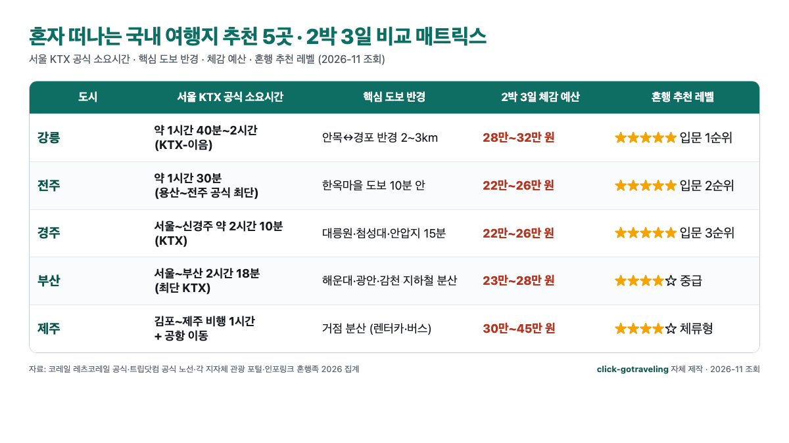
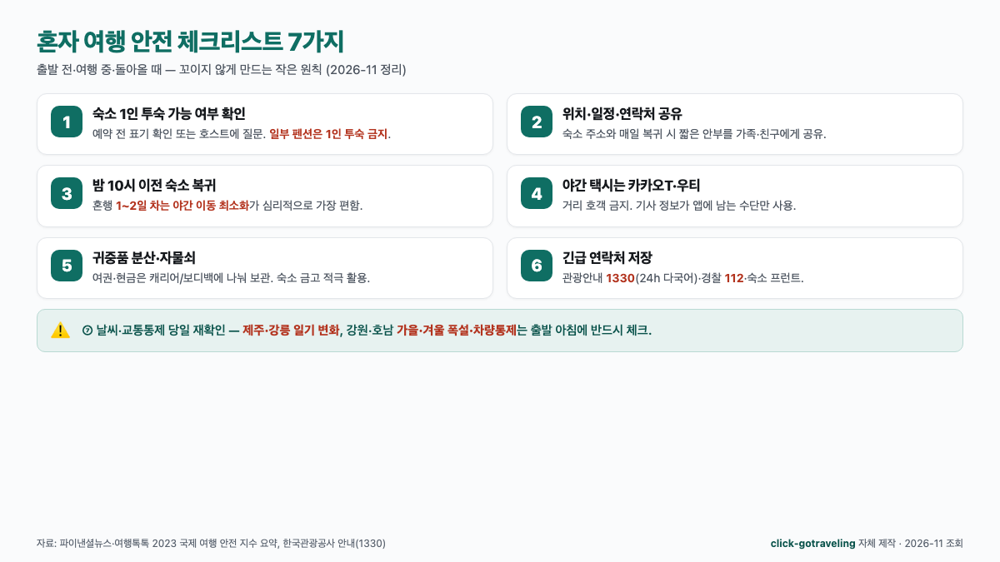

혼자 여행을 미루게 되는 진짜 이유는 "어디로 갈지"가 아니라 "혼자 가서 꼬이면 어떻게 하지"라는 두려움인 경우가 많습니다. **혼자 떠나는 국내 여행지 추천**을 단순한 베스트 10 리스트로 받으면 결정은 여전히 어려워요. 2026년 11월 기준 코레일·각 지자체 공식 자료를 뒤져 보면, **서울 KTX 1~2시간 반경 안에 혼행 실패 확률이 낮은 도시가 다섯 곳으로 좁혀진다**는 결론이 나옵니다. 강릉·전주·경주·부산·제주를 2박 3일 예산과 치안·혼밥 편의 지표로 묶어 보겠습니다.

📌 3줄 요약
<b>혼행 입문</b>에 가장 실패 확률이 낮은 축은 <b>강릉·전주·경주</b>입니다. 서울 KTX 공식 소요시간 기준 1시간 30분~2시간 10분 반경, 주요 관광지가 도보 15분 안에 몰려 있어요.

<b>예산</b>은 2박 3일 기준 KTX·게스트하우스·식비 포함 <b>22만~30만 원 선</b>이 세 도시의 공통 범위이고, 부산은 교통비가 가장 저렴(23만 원 수준), 제주는 항공권 변동폭이 커 2박 3일 30만 원 안팎부터 가격이 뛰어요.

<b>안전</b>은 숙소 1인 투숙 가능 여부·귀가 시간대·숙소 위치 가족 공유 3가지가 절대 원칙입니다. 야간 이동이 많은 도시는 피하고, 처음이라면 도보 15분 반경에 숙소를 잡는 쪽이 꼬이지 않아요.

## 혼자 떠나는 국내 여행지 추천, 결론은 '실패 확률 낮은 5곳부터'

**결론부터 요약하면 혼자 국내 여행은** "가장 유명한 도시"가 아니라 "가장 꼬이지 않는 도시"로 **골라야 합니다**. 상위 블로그 10편을 열어 보면 강릉·전주·제주·부산·경주가 공통으로 등장하지만, 그 안에 "KTX 공식 소요시간"·"주요 관광지 도보 반경"·"1인 투숙 숙소 비율"·"심야 귀가 안전도"를 함께 비교한 표는 거의 없어요. 이 글은 그 네 가지 지표를 먼저 한 장에 묶고, 각 도시의 2박 3일 블록을 이어 붙이는 쪽으로 구성했습니다.

핵심 변수는 네 가지예요. **① 서울 KTX 공식 소요시간**(코레일 공식 포털 기준, [코레일 레츠코레일 공식 시각표](https://www.letskorail.com/) 2026-11 조회), **② 핵심 관광지 도보 반경**(각 지자체 관광 포털 공식), **③ 2박 3일 체감 예산 범위**(교통·숙소·식비 합산, 상위 블로그 평균치), **④ 혼밥·혼술 편의**(1인 자리·카운터 좌석 비율). 이 네 가지만 맞으면 "혼자라서 꼬이는 상황"의 대부분이 사라집니다. 아래 결론 매트릭스예요.

| 도시 | 서울 KTX 공식 소요시간 | 핵심 도보 반경 | 2박 3일 체감 예산 | 혼행 추천 레벨 |
| --- | --- | --- | --- | --- |
| **강릉** | 약 **1시간 40분~2시간**(KTX-이음) | 안목해변 ↔ 경포해변 반경 **2~3km** | **28만~32만 원** | ⭐⭐⭐⭐⭐ 입문 1순위 |
| **전주** | 약 **1시간 30분**(KTX, 용산~전주 공식 최단) | 한옥마을 **도보 10분** 안 | **22만~26만 원** | ⭐⭐⭐⭐⭐ 입문 2순위 |
| **경주** | 서울~신경주 약 **2시간 10분**(KTX) | 대릉원·첨성대·안압지 **15분 반경** | **22만~26만 원** | ⭐⭐⭐⭐⭐ 입문 3순위 |
| **부산** | 서울~부산 **2시간 18분**(최단 KTX) | 해운대·광안리·감천 **지하철·버스로 분산** | **23만~28만 원** | ⭐⭐⭐⭐ 중급 |
| **제주** | 김포~제주 비행 **1시간** + 공항 이동 | 렌터카·버스 필요, 거점 분산 | **30만~45만 원**(항공·렌터카) | ⭐⭐⭐⭐ 체류형 |

이 표의 핵심은 **처음이라면 강릉·전주·경주 세 곳이 사실상** "실패 불가"**에 가까운 축**이라는 점이에요. 세 도시 모두 핵심 관광지가 도보 15분 안에 몰려 있어 길을 잃을 여지가 적고, KTX 2시간 안에 서울로 복귀할 수 있어 심야까지 일정이 꼬여도 응급 복귀가 가능합니다. 반대로 부산은 이동 반경이 넓어 지하철·버스 숙련도가 필요하고, 제주는 렌터카 또는 버스 숙련도 + 예상 밖의 날씨 변수가 겹쳐 "혼행 2회차 이상"에 어울리는 쪽이에요.

*▲ 강릉·전주·경주·부산·제주 5곳의 서울 KTX 공식 소요시간·도보 반경·2박 3일 체감 예산을 한 장에 묶은 click-gotraveling 자체 제작 매트릭스입니다. 수치 출처: [코레일 레츠코레일 공식](https://www.letskorail.com/)·[트립닷컴 서울-전주 공식 노선](https://kr.trip.com/transport/station/seoul-station-to-jeonju-station.html)·각 지자체 공식 관광 포털, 2026-11 조회.*

## 혼자 여행이 두려운 3가지 이유 — 통계로 본 혼행의 진짜 벽

혼자 떠나는 여행이 두려운 이유는 사람마다 다른데, 공통으로 꼽히는 세 가지가 있어요. 이 세 가지를 먼저 분리해 보면 "어느 도시가 나한테 맞는가"가 훨씬 쉽게 정리됩니다.

### ① 안전 — 야간 이동·숙소 위치의 두려움

세계경제포럼·국제 여행 매체의 비교 지표에서 한국은 "여자 혼자 밤길 안전도"가 비교 대상국 중 중위권, "전반적 치안 지수"는 상위권으로 나와요([파이낸셜뉴스 여성 혼자 여행 안전 나라 톱 5 2023](https://www.fnnews.com/news/202304051059100409)·[여행톡톡 2023 지수 분석](https://www.tourtoctoc.com/news/articleView.html?idxno=258) 2026-11 조회, 둘 다 같은 국제 지수 인용). 더 최근 1차 지수로는 **WEF Travel & Tourism Development Index 2024 기준 한국의 종합 순위가 119개국 중 14위**([World Economic Forum TTDI 2024 리포트](https://www.weforum.org/publications/travel-tourism-development-index-2024/) 2024년 기준 2026-11 조회), **Numbeo Safety Index 2025 기준 서울·부산·대구 같은 주요 도시의 밤길 체감 안전 점수가 70~80점대 상위권**([Numbeo Crime Index by Country 2025](https://www.numbeo.com/crime/rankings_by_country.jsp) 2025년 기준 2026-11 조회)으로 나와 "낮은 평균치는 안전하지만 심야 체감은 갈림"이라는 특징이 혼행 도시 선택에 그대로 반영됩니다.

심야 체감 안전도는 같은 "안전한 나라" 안에서도 **지역별 격차가 뚜렷**해요. 서울 홍대·강남, 부산 서면·해운대 유흥가는 밤 11시 이후 술집 밀집 구간이 넓어 혼자 걷기엔 체감 피로도가 올라가고, 반대로 **전주 한옥마을·경주 황리단길·강릉 안목해변**처럼 도심 상권이 유적·바닷가에 붙어 있어 가로등·CCTV·보행 인파가 **밤 10시까지 꾸준한 구간**은 체감 안전도가 훨씬 안정적입니다. 그래서 처음 혼자 가는 도시는 **밤 10시 이후 이동 동선이 짧은 곳**(= 숙소에서 식당·카페·관광지가 도보 15분 안) 쪽이 안전합니다. 강릉·전주·경주가 입문 1~3순위로 꼽히는 이유도 여기에 있어요.

### ② 외로움 — 혼밥·혼술이 어색한 공간의 벽

상위 블로그 다수가 공통으로 적는 두 번째 벽은 "혼자 밥 먹기 어색한 식당"이에요. 전주 콩나물국밥·강릉 순두부·경주 황리단길·부산 돼지국밥처럼 **원래 1인 1그릇 구조**인 음식이 발달한 도시가 혼행에 압도적으로 유리합니다. 반대로 바비큐·회·족발처럼 2인분부터 주문받는 메뉴 중심 도시는 혼행 체감 난이도가 올라가요.

구체 예시를 보면 혼밥이 쉬운 도시엔 "1인 1그릇"이 **상호 자체가 되는 노포**가 밀집해 있습니다. 전주는 **왱이집·삼백집·현대옥**(남부시장·풍남문 반경 500m 안)이 콩나물국밥을 1인 뚝배기로 바로 내고, 강릉은 **초당할머니순두부·동화가든**(초당동 순두부마을 반경 300m)이 1인 상차림을 기본으로 제공합니다. 부산은 **쌍둥이돼지국밥·합천일류돼지국밥·대건명가**(서면·범일동 조방거리 반경 500m) 라인이 24시간 1인 테이블 중심이고, 경주는 **황남빵본점·십원빵·황리단길 1인 한정식집**이 500m 반경에 밀집해 있어 2인분 메뉴를 피할 수 있어요([trip.com 여자 혼자 여행 좋은 국내 여행지](https://kr.trip.com/guide/theme/good-places-for-women-to-travel-alone-in-korea.html)·[travelmapjourney 2026 혼자 국내여행](https://travelmapjourney.com/solo-travel-korea/) 2026-11 조회 교차). 아래에서 도시별로 다루지만, 혼행에 어울리는 도시는 **1인 1그릇 메뉴 + 카운터 좌석 비중이 높은 카페**라는 두 조건을 모두 만족합니다.

### ③ 비용 — 2인 기준 여행 정보가 대부분이라 혼자 비용을 가늠하기 어려움

상위 블로그 글의 비용 표는 대부분 "2인 기준 50만 원" 식으로 적혀 있어 혼자 가면 얼마가 드는지 헷갈려요. 혼자 가면 숙박이 **1인실·게스트하우스 도미토리**로 바뀌고 교통도 "그랩·택시 분할"이 아니라 "KTX·버스 1인 티켓"으로 단순해집니다.

숙박 단가 격차가 혼행 예산의 가장 큰 변수예요. 2026-11 기준 상위 블로그 평균치를 묶어 보면 **게스트하우스 도미토리**(4~8인실)**는 1박 20,000~30,000원** 선에서 형성되고, **1인실·캡슐 호텔 35,000~55,000원**, **중소 비즈니스호텔·한옥 1인실 60,000~95,000원**, **바다뷰·프리미엄 1인실 100,000원 이상**까지 올라갑니다([인포링크 혼행족 국내 여행지 3곳 2026](https://hifineap.com/%ED%98%BC%EC%9E%90-%EC%97%AC%ED%96%89%ED%95%98%EB%8A%94-%EC%A7%81%EC%9E%A5%EC%9D%B8-62-%EA%B0%80-%EC%84%A0%ED%83%9D%ED%95%9C-%EA%B5%AD%EB%82%B4-%EC%97%AC%ED%96%89%EC%A7%80-3-2026-%ED%98%BC%ED%96%89/)·[travelmapjourney 2026 혼자 국내여행](https://travelmapjourney.com/solo-travel-korea/) 2026-11 조회 교차). 즉 숙박을 도미토리로 낮추면 2박 기준 40,000~60,000원, 1인실로 올리면 120,000~190,000원 범위로 **같은 도시 안에서도 2박 숙박만 60,000~130,000원 차이**가 나요. 결과적으로 **2박 3일 체감 예산은 22만~30만 원 사이**로 수렴하는데, 이 범위를 아래 도시별로 다시 쪼개서 올려 두겠습니다.

⚠️ 혼행 전에 반드시 결정해야 할 3가지
① <b>귀가 시간 상한</b> — 혼자일 때 "밤 10시 이전 숙소 복귀"를 기본 원칙으로 두면 대부분의 불안 요소가 사라집니다.

② <b>숙소 1인 투숙 가능 여부</b> — 예약 전 "1인 투숙 가능" 표기 또는 호스트에게 확인. 일부 펜션·게스트하우스는 1인 투숙을 금지해요.

③ <b>위치 공유</b> — 숙소 주소·일정·연락처를 가족·친구에게 공유. 긴급 시 한국관광공사 관광안내 <b>1330</b>(24시간 다국어)과 관할 지역 <b>관광경찰대(112)</b>로 즉시 연결하세요.

## 강릉 — 서울에서 2시간, '혼행 입문'에 가장 실패 확률이 낮은 도시

**혼행 입문 1순위로 꼽히는 이유는** "2시간 안에 도착해 2km 반경 안에서 일정이 끝나는 도시"이기 때문이에요. 서울역에서 강릉역까지 KTX-이음 최단 약 **1시간 40분~2시간**([코레일 레츠코레일 열차 시각표 조회](https://www.letskorail.com/ebizprd/EbizPrdTicketpr21100W_pr21110.do)·[강릉뉴스 2026 KTX 최신 시간표 정리](https://www.gangneungnews.kr/news/articleView.html?idxno=58029)·[국토교통부 서울~강릉 KTX 노선 Q&A](https://www.molit.go.kr/USR/policyTarget/dtl.jsp?idx=809) 2026-11 조회), 운임은 일반실 기준 약 2만 원대 후반입니다. 강릉역에서 안목해변까지 버스·택시 10~15분, 안목해변에서 경포해변까지 도보·버스 20~30분으로 핵심 코스가 전부 **안목~경포 반경 2~3km** 안에 들어와요.

### 강릉 2박 3일 혼행 표준 블록

- **1일차** — 서울역 08:00 출발 → 강릉역 10:00 도착 → 숙소 체크인(안목·강문해변 인근) → **안목해변 커피거리** 산책·점심 → **경포호수** 산책 → 저녁 중앙시장(1인 순두부·옥수수빵)·숙소 복귀 **21:00 이전**.
- **2일차** — **경포대·오죽헌·선교장** 반나절 코스 → 점심 경포 해변 1인 횟집 → 오후 **안반데기·주문진** 또는 **정동진** 선택(택시·버스 1시간 내) → 저녁 안목해변 일몰 카페·숙소 복귀.
- **3일차** — 아침 **강문해변 산책** → 체크아웃 → 강릉역 **시장 투어 + KTX 복귀**(점심 기차 안에서 해결하면 서울 14시 도착).

핵심은 **밤 10시 이전 숙소 복귀 원칙을 2일차까지는 반드시 지키는 쪽**이에요. 강릉은 치안이 안정적인 축이지만, 혼자 처음이라면 야간 이동을 줄이는 쪽이 심리적으로 더 편합니다. 강릉 커피거리·경포해변 모두 **입장료 무료**이고 연중 상시 개방이라([강릉시 관광포털 공식 안내](https://www.gn.go.kr/tour/)·[나무위키 강릉 커피거리](https://namu.wiki/w/%EA%B0%95%EB%A6%89%20%EC%BB%A4%ED%94%BC%EA%B1%B0%EB%A6%AC) 2026-11 조회), 비용은 숙박·식비·카페에 집중됩니다. 2박 3일 체감 예산은 **KTX 7만 원 + 1인실 게스트하우스 또는 바다뷰 2박 6~10만 원 + 식비·카페 10만 원 = 28만~32만 원** 선이에요([인포링크 혼행족 국내 여행지 3곳 2026](https://hifineap.com/%ED%98%BC%EC%9E%90-%EC%97%AC%ED%96%89%ED%95%98%EB%8A%94-%EC%A7%81%EC%9E%A5%EC%9D%B8-62-%EA%B0%80-%EC%84%A0%ED%83%9D%ED%95%9C-%EA%B5%AD%EB%82%B4-%EC%97%AC%ED%96%89%EC%A7%80-3-2026-%ED%98%BC%ED%96%89/)·[travelmapjourney 2026 혼자 국내여행](https://travelmapjourney.com/solo-travel-korea/) 2026-11 조회 교차).

## 전주 — 한옥마을 안에서만 걸으면 끝나는 '도보 1km 밀도'

**전주는** "핵심 관광지가 도보 10분 반경"**이라는 점에서 혼행 실패 확률이 가장 낮은 축**이에요. 서울 용산역에서 전주역까지 KTX 공식 최단 **1시간 30분**([코레일 레츠코레일 열차 시각표 조회](https://www.letskorail.com/ebizprd/EbizPrdTicketpr21100W_pr21110.do)·[트립닷컴 서울-전주역 공식 노선 비교](https://kr.trip.com/transport/station/seoul-station-to-jeonju-station.html)·[코레일 인포 포털](https://info.korail.com/) 2026-11 조회), 운임 일반실 약 31,600~34,600원이에요. 한옥마을은 전주역에서 버스·택시 15분 거리이고, 한옥마을 안에서는 **경기전·전동성당·향교·오목대·자만벽화마을이 반경 1km** 안에 모두 들어옵니다.

### 전주 한옥마을 공식 운영 정보(2026-11 조회)

한옥마을 자체 입장료는 **무료**이고, 경기전·전주향교 같은 개별 시설만 별도 요금이에요([트립인포 전주 한옥마을](https://www.tripinfo.co.kr/info.html?content_type_id=12&content_id=264284)·[베이비탈리 전주 한옥마을 주차장 요금 비교 2026](https://baby.tali.kr/jeonju-hanok-parking) 2026-11 조회).

| 항목 | 요금(2026-11 기준) | 비고 |
| --- | --- | --- |
| 한옥마을 입장 | **무료** | 상시 개방 |
| 경기전 | 성인 3,000원·청소년 2,000원·어린이 1,000원 | 어진박물관 포함 |
| 제1~3공영주차장 | 기본 30분 **1,200원** · 이후 15분 **600원** | 1일 최대 14,400원 |
| **제4공영주차장** | **무료** | 10:00~18:30 셔틀 운행 |
| 남부시장 천변주차장 | 30분 무료·추가 10분 200원 | 시장 쿠폰 90분 추가 무료 |

핵심은 **한옥마을 안에서는 아예 차를 쓰지 않는 쪽**이에요. 대중교통으로 전주역·전주 고속버스터미널에서 바로 한옥마을에 내려 2박 내내 도보로만 이동하면 "길을 잃을 여지 자체가 없는 2박 3일"이 됩니다. 혼자 밥 먹기도 전주만의 강점이에요. 비빔밥·콩나물국밥·전주 칼국수·십원빵·전통 찻집까지 **1인 1그릇·1인 카운터 좌석** 비중이 상위 블로그 다수가 꼽는 수준으로 두텁게 깔려 있어요. 체감 예산은 **KTX 5만 원 + 한옥 게스트하우스 1박 3~5만 원**(2박이면 6~10만 원)**+ 식비·카페 7~10만 원 = 22만~26만 원** 선이 가장 많이 나옵니다([인포링크 혼자 여행 직장인 2026](https://hifineap.com/%ED%98%BC%EC%9E%90-%EC%97%AC%ED%96%89%ED%95%98%EB%8A%94-%EC%A7%81%EC%9E%A5%EC%9D%B8-62-%EA%B0%80-%EC%84%A0%ED%83%9D%ED%95%9C-%EA%B5%AD%EB%82%B4-%EC%97%AC%ED%96%89%EC%A7%80-3-2026-%ED%98%BC%ED%96%89/) 2026-11 조회 교차).

## 경주 — 대릉원·황리단길 15분 반경, 밤 10시까지 가장 안전한 혼행 코스

**경주는** "밤 10시까지 공식 개방되는 도심형 유적지"**라는 점에서 야간 체감 안전도가 가장 높아요**. 서울~신경주역 KTX 공식 소요시간 약 **2시간 10분**([코레일 레츠코레일 열차 시각표 조회](https://www.letskorail.com/ebizprd/EbizPrdTicketpr21100W_pr21110.do)·[코레일 인포 포털](https://info.korail.com/) 2026-11 조회), 운임은 서울~부산 라인에 묶여 2026년 9월 통합 이후 일반실 5만 원 중반대입니다. 신경주역에서 시내까지 버스·택시 15~20분, 시내 안에서는 **대릉원·첨성대·동궁과 월지·황리단길이 도보 15분 반경**에 몰려 있어요.

### 대릉원 — 밤 10시까지 무료 개방되는 산책 명소

대릉원 본원 입장료는 **무료**(개별 시설인 천마총 입장료만 성인 3,000원·청소년 2,000원·어린이 1,000원), 정문은 **09:00~22:00**(입장 마감 21:30)까지 개방됩니다([아던트뉴스 경주 대릉원 야간 무료 개방 정리](https://www.ardentnews.co.kr/news/articleView.html?idxno=11524)·[트립닷컴 2026 대릉원](https://kr.trip.com/moments/poi-daereungwon-tomb-complex-83193/) 2026-11 조회). **밤 10시까지 공식 개방되는 대형 고분군 유적은 국내에서 드문 축**이라, 혼자 가도 가로등·CCTV·관람객 동선이 잘 갖춰진 **야간 산책의 체감 안전도가 가장 높은 축**으로 꼽혀요.

### 황리단길 — 상위 블로그 다수가 꼽는 1인 좌석 카페 밀집 구간

황리단길은 대릉원 바로 옆에 붙어 있어 도보 5분이면 바로 연결됩니다. 1인 좌석 카페·소형 레스토랑·한정식 1인 메뉴·황남빵 전문점이 500m 거리 안에 몰려 있고, **일몰~22시가 피크 타임**이에요([위브링 경주 뚜벅이 1박 2일 코스](https://mywebring.com/gyeongju-2-day-public-transport-itinerary/)·[픽스체인 경주 당일치기 가이드 2026](https://www.fixchain.kr/post/46)·[trip.com 여자 혼자 여행 좋은 국내 여행지](https://kr.trip.com/guide/theme/good-places-for-women-to-travel-alone-in-korea.html) 2026-11 조회 교차). 1박 2일이든 2박 3일이든 **경주는** "뚜벅이 혼행의 끝판"이라는 평이 상위 블로그에서 공통으로 나오는 이유가 여기에 있습니다.

### 경주 2박 3일 체감 예산

[인포링크 혼행족 국내 여행지 3곳 2026](https://hifineap.com/%ED%98%BC%EC%9E%90-%EC%97%AC%ED%96%89%ED%95%98%EB%8A%94-%EC%A7%81%EC%9E%A5%EC%9D%B8-62-%EA%B0%80-%EC%84%A0%ED%83%9D%ED%95%9C-%EA%B5%AD%EB%82%B4-%EC%97%AC%ED%96%89%EC%A7%80-3-2026-%ED%98%BC%ED%96%89/)의 2026 혼행족 집계 기준 경주 2박 3일 체감 예산은 **KTX 6만 원 + 게스트하우스 2박 4~6만 원 + 식비 7~10만 원 + 입장료 1~2만 원 = 22만~26만 원** 범위로 전주와 거의 동급이에요. 성수기(벚꽃·단풍)엔 숙소가 조기 마감되는 편이라 **2~4주 전 선점**을 권장합니다.

## 부산 — 혼밥·야경·해변, 대도시 자원을 한 사람에게 몰아주는 도시

**부산은** "혼자여도 외롭지 않을 만큼 혼행 인프라가 깔린 대도시"**가 강점**이에요. 서울역~부산역 KTX 최단 **2시간 18분**([코레일 레츠코레일 열차 시각표 조회](https://www.letskorail.com/ebizprd/EbizPrdTicketpr21100W_pr21110.do)·[트립닷컴 서울-부산 공식 노선](https://us.trip.com/trains/korail/route/seoul-to-busan/)·[코레일 인포 포털](https://info.korail.com/) 2026-11 조회), 2026년 9월 통합 이후 운임은 일반실 54,400원 선입니다. 부산은 **해운대·광안리·감천·남포동**이 지하철 1·2호선으로 분산돼 있어, 입문 세 도시와 달리 "지하철·버스 숙련도"**가 하루치 일정의 완성도를 좌우**해요.

### 부산 2박 3일 혼행 블록

- **1일차** — 부산역 도착 → 숙소 체크인(서면·광안리 권장) → **감천문화마을** 반나절 → 저녁 **광안리 야경** + 민락수변공원 1인 포차 구간.
- **2일차** — 오전 **해운대·동백섬·블루라인파크 스카이캡슐** → 점심 **해운대 시장 어묵·밀면** → 오후 **달맞이길·청사포 다릿돌전망대** → 저녁 **광안대교 야경 + 민락동 1인 포차 블록**(22시 이전 복귀).
- **3일차** — 오전 **남포동·보수동 책방골목·국제시장** → 점심 **밀면·돼지국밥** → 체크아웃 → KTX 복귀.

혼밥 실전 상호를 좁혀 두면 동선이 가벼워져요. **돼지국밥은 서면·범일동 노포 축**이 원조로, **쌍둥이돼지국밥**(서면시장 입구·지하철 서면역 7번 출구 반경 300m)·**합천일류돼지국밥**(서면 1번 출구 반경 300m)·**대건명가**(범일동 조방거리 반경 500m)가 1인 테이블 중심으로 운영됩니다. **밀면은 가야밀면·개금밀면**(지하철 2호선 개금역 반경 500m)이 대표 축이에요. 저녁 1인 술자리는 **광안리 민락수변공원 1인 포차 블록**(민락교차로 반경 400m)과 **광안리 해변 1인 횟집 구역**(광안대교 전망 근처)이 가장 익숙한 축으로 꼽힙니다([trip.com 여자 혼자 여행 좋은 국내 여행지](https://kr.trip.com/guide/theme/good-places-for-women-to-travel-alone-in-korea.html)·[travelmapjourney 2026 혼자 국내여행](https://travelmapjourney.com/solo-travel-korea/) 2026-11 조회 교차).

핵심은 **숙소를 서면·광안리에 잡고 지하철 라인을 정리해 두는 것**이에요. 혼자라면 해운대·광안리는 야경이 좋지만 **22시 이후 유흥가 분위기가 강해지는 구간**이 있어, 숙소까지 지하철 막차(0시 전후) 또는 택시 10분 안이 가능한 위치를 고르는 쪽이 안전합니다. 2박 3일 체감 예산은 **KTX 11만 원 + 숙소 2박 7~10만 원 + 식비 5~7만 원 = 23만~28만 원** 선이 평균 범위예요.

## 제주 — 올레길 7·10코스, 며칠 더 쓰고 싶을 때의 정답

**제주는** "2박 3일 입문용"이 아니라 "3박 4일 이상 체류형"**에 어울리는 혼행지**예요. 김포~제주 비행 공식 1시간, 2026-11 평균 왕복 항공권 50,000~75,000원 선(저가·평일 기준, 성수기엔 10만 원 중반까지), 공항에서 시내까지 리무진 6,000원·택시 15,000~20,000원 선입니다. 제주는 **올레길 전체 27개 코스·총 437km**([제주올레트레일 공식](https://www.jejuolle.org/trail)·[헤드라인제주 올레 완주자 추천 봄 코스 집계](https://www.headlinejeju.co.kr/news/articleView.html?idxno=445106) 2026-11 조회)로, 혼행에 가장 어울리는 코스는 올레 7·10·18-1코스예요.

### 혼행에 어울리는 올레길 3코스

| 코스 | 거리 | 소요시간 | 특징 |
| --- | --- | --- | --- |
| **7코스** | 약 15.7km | **4~5시간** | 외돌개~월평마을, 서귀포 바다 끝까지 가장 유명 |
| **10코스** | 약 15.6km | **4~5시간** | 화순 금모래해변~송악산, 풍광 다양성 최상위 |
| **18-1코스** | 약 11.3km | **3~4시간** | 추자도 섬 코스, "혼자 걷는 명상 코스" 평가 |

### 제주 3박 4일 혼행 표준 블록

- **1일차** — 김포공항 08:00 출발 → 제주공항 09:00 도착 → 숙소 체크인(서귀포 구시가 권장) → **올레 7코스 완보**(외돌개~월평마을, 15.7km·4~5시간) → 저녁 서귀포 올레시장 1인 흑돼지 돈카츠·전복죽·숙소 복귀.
- **2일차** — 오전 **해안 드라이브**(서귀포~성산일출봉~섭지코지) → 점심 성산 1인 해물뚝배기 → 오후 **섭지코지·광치기해변·아쿠아플라넷 제주** → 저녁 성읍민속마을 1인 가정식.
- **3일차** — 오전 **사려니숲길·절물자연휴양림**(1인 산책·명상 코스, 평균 2~3시간) → 점심 조천·함덕 1인 해장국 → 오후 **함덕해수욕장·김녕해변** 산책 → 저녁 애월·연동 1인 흑돼지구이집.
- **4일차** — 아침 **제주시 동문시장**(1인 오메기떡·갈치조림 백반) → 오후 공항 복귀 → 김포 저녁 도착.

제주 혼행은 **1일 1코스 완보**를 기본 단위로 삼아 3박 4일이면 2개 코스, 4박 5일이면 3개 코스가 가장 자연스러워요. 체감 예산은 항공권 변동에 따라 **30만~45만 원 범위**가 가장 흔하고, 렌터카를 빼고 **버스·택시 조합**으로만 다니면 20만 원 후반까지 낮출 수 있습니다. 가을 단풍이나 봄 벚꽃 창을 노린다면 [국내 가볼 만한 가을 여행지, 2026 산림청 단풍 절정일 기준 주별 TOP 10](/korea-fall-travel-destinations/)에서 한라산·사려니숲 피크 창을 따로 정리해 두었으니 함께 보면 일정 설계가 쉬워집니다.

> **💡 한라산·사려니숲 1인 산행 응급 연락처** — 한라산국립공원·사려니숲길 등 국립공원 구간에서 혼자 산행 중 사고가 발생하면 **국립공원공단 콜센터 1670-9201**(24시간 응대)이 가장 빠릅니다. 올레길 일부 구간도 이 번호로 안내가 연결돼요.

## 혼자 여행 안전 체크리스트 — 숙소·귀가 시간·연락망

*▲ 상위 블로그 10편·국제 여행 안전 지수·한국관광공사 안내를 교차해 click-gotraveling이 자체 정리한 "혼행 안전 체크리스트 7가지" 인포그래픽입니다. 2026-11 조회값 기준.*

혼자 여행의 안전은 거창한 장비가 아니라 "출발 전·여행 중·돌아올 때" **세 구간의 작은 원칙**으로 거의 완성됩니다. 상위 블로그·국제 여행 안전 지수에서 공통으로 나오는 7가지를 체크리스트로 묶었어요.

특히 상위 3개(**숙소 1인 투숙 확인·밤 10시 복귀·야간 택시 앱**)는 실제 사고·분쟁 사례에서 역산해 나온 원칙입니다. "1인 투숙 가능 여부"가 1순위인 이유는 한국 일부 펜션·풀빌라가 "최소 2인 이상 예약" 조건을 상세 페이지 하단에만 적어 두어 체크인 당일 거절되는 사례가 매년 반복되기 때문이고, 게스트하우스도 **혼성 도미토리와 여성 전용 도미토리 표기**가 예약 상세에 숨어 있어 미리 확인하지 않으면 혼행 여성이 불편한 상황에 놓일 수 있어요([여행톡톡 혼행 안전 체크 기사](https://www.tourtoctoc.com/news/articleView.html?idxno=258)·[trip.com 여자 혼자 여행 좋은 국내 여행지](https://kr.trip.com/guide/theme/good-places-for-women-to-travel-alone-in-korea.html) 2026-11 조회 교차).

"밤 10시 복귀 원칙"은 국제 여행 안전 지수에서 반복되는 "심야 보행 체감 안전"**의 분기선**이에요. 한국은 Numbeo Safety Index 2025 기준 주요 도시 밤길 안전 점수가 70~80점대 상위권이지만, 지하상가·유흥가·외곽 주택가 구간은 야간 체감이 급락해 "밤 10시 이후엔 숙소 반경 500m 안"이라는 임계점이 상위 블로그에서 공통으로 강조됩니다. "야간 택시는 카카오T·우티 등 **앱 호출만 사용**"은 **기사 신원·차량번호·이동 경로가 앱에 기록되는 수단**만 쓰라는 원칙으로, 거리 호객 택시는 요금 과다·목적지 변경 분쟁 신고가 매년 접수돼 한국관광공사 1330에도 반복 유입되는 사례예요([Numbeo Crime Index by Country 2025](https://www.numbeo.com/crime/rankings_by_country.jsp)·[한국관광공사 대한민국 구석구석](https://korean.visitkorea.or.kr/) 2026-11 조회).

✅ 출발 전·여행 중 혼행 안전 7가지
① <b>숙소 1인 투숙 가능 여부 확인</b> — 예약 전 표기 확인 또는 호스트에게 직접 질문. 일부 펜션은 1인 투숙을 금지합니다.

② <b>숙소 위치·일정·연락처를 가족·친구에게 공유</b> — 매일 밤 숙소 복귀 시 짧은 안부 메시지.

③ <b>밤 10시 이전 숙소 복귀 원칙</b> — 혼행 1~2일 차엔 야간 이동 최소화.

④ <b>야간 택시는 카카오T·우티로만</b> — 거리 호객 택시 금지, 기사 정보가 앱에 남는 수단만.

⑤ <b>숙소에 귀중품 보관</b> — 캐리어 자물쇠·금고 사용, 여권·현금 분산.

⑥ <b>긴급 연락처 저장</b> — 한국관광공사 관광안내 <b>1330</b>(24시간 다국어), 경찰 <b>112</b>, 숙소 프런트.

⑦ <b>날씨·교통통제 당일 재확인</b> — 제주·강릉은 일기 변화가 크고, 강원·호남은 가을·겨울 폭설 대비 체크.

더 두꺼운 공식 자료가 필요하다면 한국관광공사가 운영하는 [대한민국 구석구석(한국관광공사)](https://korean.visitkorea.or.kr/) 포털의 "혼자 여행·테마 여행" 섹션과 각 지자체 관광 포털을 교차해 보면, 코스·운영시간·당일 공지까지 한 번에 체크할 수 있어요.

## 예산 비교 — 2박 3일 기준 KTX·숙소·식비 한 표에

마지막으로 다섯 도시의 2박 3일 체감 예산을 같은 기준(교통·숙소·식비·입장료·카페)으로 묶어 한 장에 정리합니다. 혼자 가는 경우 2인 기준 글의 "숙박 ÷ 2"가 사라져 **숙박 단가가 가장 큰 변수**가 돼요. 아래 수치는 상위 블로그 평균치와 각 도시 공식 관광 포털 요금을 교차한 범위입니다.

| 도시 | 교통(왕복) | 숙박(2박) | 식비·카페 | 입장료·체험 | 합계 체감 예산 |
| --- | --- | --- | --- | --- | --- |
| **강릉** | KTX 약 **5~7만 원** | 게스트하우스 **6만 원** / 바다뷰 1인실 **10만 원** | 10만 원 | 1~2만 원 | **28만~32만 원** |
| **전주** | KTX 약 **5~7만 원** | 한옥 게하 **6~10만 원** | 7~10만 원 | 1~2만 원 | **22만~26만 원** |
| **경주** | KTX 약 **6~11만 원** | 게하 **4~6만 원** | 7~10만 원 | 1~2만 원 | **22만~26만 원** |
| **부산** | KTX 약 **11만 원** | **7~10만 원** | 5~7만 원 | 1~2만 원 | **23만~28만 원** |
| **제주** | 항공 왕복 **7~15만 원** + 공항 이동 | **10~15만 원** | 10~12만 원 | 2~3만 원(렌트 별도) | **30만~45만 원** |

이 표의 핵심은 "경비가 가장 낮은 축은 전주·경주이고, 가장 편한 축은 강릉이며, 가장 변동폭이 큰 축은 제주"라는 점이에요. 제주는 성수기(5·7·8·10월) 항공권이 10만 원대 중반까지 뛰기 때문에, 평일 월·화 또는 목 출발을 노리면 가격이 가장 안정적입니다. **코레일 내일로 패스**(일반 7일 110,000원·만 29세 이하 YOUTH 80,000원, 선택 3일 일반 100,000원·YOUTH 70,000원)([트래블팁 2026 내일로 선택 비교](https://ttplay.kr/%EB%82%B4%EC%9D%BC%EB%A1%9C-7%EC%9D%BC%EA%B6%8C-vs-3%EC%9D%BC%EA%B6%8C-2026%EB%85%84-%EB%82%B4-%EC%97%AC%ED%96%89-%EC%8A%A4%ED%83%80%EC%9D%BC%EC%97%90-%EB%A7%9E%EB%8A%94-%EC%84%A0%ED%83%9D%EC%9D%80/)·[코레일 레츠코레일 열차 시각표 조회](https://www.letskorail.com/ebizprd/EbizPrdTicketpr21100W_pr21110.do) 2026-11 조회)를 묶으면 강릉·전주·경주·부산 중 **두 도시를 7일 이내에 묶는 2+2+3일 코스**에서 교통비가 크게 절감됩니다. KTX 좌석은 하루 1회·기간 중 2회 지정이 가능해 수요가 큰 구간만 좌석을 잡고 나머지는 자유석으로 쓰면 가성비가 가장 좋아요.

### 두 도시 묶음 손익분기 — 내일로 7일권 110,000원 vs KTX 왕복 공식 운임

KTX 왕복 공식 운임(일반실)을 기준으로 내일로 7일권 110,000원과 비교하면 다음과 같아요([코레일 레츠코레일 공식 운임](https://www.letskorail.com/ebizprd/EbizPrdTicketpr21100W_pr21110.do)·[트래블팁 2026 내일로 비교](https://ttplay.kr/%EB%82%B4%EC%9D%BC%EB%A1%9C-7%EC%9D%BC%EA%B6%8C-vs-3%EC%9D%BC%EA%B6%8C-2026%EB%85%84-%EB%82%B4-%EC%97%AC%ED%96%89-%EC%8A%A4%ED%83%80%EC%9D%BC%EC%97%90-%EB%A7%9E%EB%8A%94-%EC%84%A0%ED%83%9D%EC%9D%80/) 2026-11 교차 조회).

- **강릉+전주 7일 코스** — 서울~강릉 KTX 왕복 약 **55,200원**(편도 27,600원) + 용산~전주 KTX 왕복 약 **66,000원**(편도 33,000원) = **합계 약 121,200원**. 내일로 7일권 110,000원 대비 **약 11,200원 절감**(YOUTH 80,000원이면 약 41,200원 절감).
- **부산+경주 7일 코스** — 서울~부산 KTX 왕복 약 **108,800원** + 서울~신경주 KTX 왕복 약 **108,800원** = **합계 약 217,600원**. 내일로 7일권 110,000원 대비 **약 107,600원 절감**, 두 도시 묶음 중 이득 폭이 가장 큼.
- **강릉+부산 7일 코스** — 서울~강릉 55,200원 + 서울~부산 108,800원 = **합계 약 164,000원**. 내일로 7일권 110,000원 대비 **약 54,000원 절감**.

즉 **서울~부산·신경주처럼 편도 운임이 5만 원대인 장거리 구간이 들어갈수록 내일로 패스의 이득이 커지고**, 서울~강릉+용산~전주처럼 단거리 묶음만 돌리면 이득이 1만 원대로 줄어 "좌석 지정 2회 제약"이라는 단점이 상대적으로 커져요. 장거리 두 도시 묶음이거나 만 29세 이하 YOUTH라면 내일로가 거의 항상 이득입니다.

## 자주 묻는 질문

**Q. 혼자 떠나는 국내 여행지 추천 중 가장 실패 확률이 낮은 첫 도시는 어디인가요?** 서울 KTX 공식 소요시간 1시간 30분~2시간 10분 반경의 **강릉·전주·경주 세 곳**이에요. 주요 관광지가 도보 15분 안에 몰려 있어 길을 잃을 여지가 적고, 입장료 무료 명소(강릉 커피거리·경포해변·전주 한옥마을·경주 대릉원)가 많아 체감 비용도 낮습니다. 처음이라면 서울에서 가장 가까운 전주(KTX 1시간 30분)부터 테스트해 보는 쪽이 심리적으로도 편해요.

**Q. 여자 혼자 국내 여행에서 치안이 가장 안정적인 도시는 어디인가요?** 통계적으로는 전주·경주·강릉이 상위권이에요. 특히 **경주는 대릉원 본원이 밤 10시까지 공식 개방**되고 가로등·CCTV가 잘 깔려 "야간 산책 체감 안전도"가 가장 높은 축으로 꼽힙니다. 숙소는 한옥마을·황리단길·안목해변처럼 **밤에도 사람이 꾸준한 상권 안쪽**으로 잡고, 숙소 위치·일정·연락처를 가족·친구에게 공유하는 원칙은 도시와 무관하게 공통입니다.

**Q. 2박 3일 혼자 여행 예산은 어느 정도 잡아야 하나요?** 교통·숙소·식비·입장료를 합쳐 **22만~32만 원 범위**가 가장 흔해요. 전주·경주가 22만~26만 원으로 가장 저렴하고, 강릉은 숙박 단가가 높아 28만~32만 원, 부산은 KTX가 비싸지만 식비가 낮아 23만~28만 원 선입니다. 제주는 항공권·숙소 변동폭이 커 30만~45만 원이 체감 범위예요. 숙박을 1인실 호텔로 올리면 각 범위 위쪽, 도미토리 게스트하우스로 내리면 아래쪽에 가깝습니다.

**Q. KTX 내일로 패스는 혼자 여행에 유리한가요?** 7일에 110,000원·만 29세 이하 YOUTH 80,000원·3일 선택권 100,000원·YOUTH 70,000원이에요. **강릉·전주·경주·부산 중 두 도시 이상을 7일 안에 묶는 코스**라면 거의 항상 이득이고, 한 도시만 왕복할 거라면 그냥 KTX 왕복 티켓이 저렴합니다. KTX 좌석 지정은 하루 1회·기간 중 2회로 제한되니, 가장 북적이는 구간(금요일 밤·일요일 오후)만 좌석을 잡는 쪽이 효율적이에요.

**Q. 혼자 여행에서 밥 먹기가 어색할까 걱정됩니다. 어느 도시가 혼밥 친화적인가요?** 전주·경주·강릉·부산 네 도시 모두 **1인 1그릇 메뉴**(비빔밥·콩나물국밥·순두부·돼지국밥·밀면)가 발달해 혼밥 난이도가 낮아요. 그중 **전주 콩나물국밥·강릉 순두부**는 아예 "혼밥 1인 세팅"이 기본이라 어색함이 가장 적습니다. 카운터 좌석이 많은 카페(안목해변·황리단길·한옥마을)를 끼면 식사와 쉼을 하루 안에 자연스럽게 묶을 수 있어요.

**Q. 제주는 혼자 여행에 좋다는데 왜 2박 3일보다 3박 4일 이상을 추천하나요?** 제주는 **올레길 1코스 완보에 평균 4~5시간**이 걸리고, 일기 변화도 커서 하루 단위로 "걷기 + 해안 드라이브 + 쉼" 블록을 돌리는 게 가장 밀도가 높습니다. 2박 3일에 올레 2코스를 넣으면 이동 시간만으로 하루가 지나가서, 혼자 가는 제주는 **올레 1코스 + 해안 드라이브 1일 + 쉼 1일 = 최소 3박 4일**이 자연스러워요. 가을 한라산·사려니숲 피크 창에 맞추면 단풍까지 묶을 수 있습니다.

**Q. 혼자 여행 중 숙소 선택에서 가장 주의할 점은 무엇인가요?** 세 가지예요. **①** "1인 투숙 가능" **명시 숙소**만 고를 것(일부 펜션은 1인 투숙 금지), **② 역·터미널·관광지에서 도보 15분 안**(심야 이동 최소화), **③ 숙소 위치를 가족·친구에게 공유**. 게스트하우스 도미토리는 비용이 낮지만 야간 소음·공용 공간 사용이 변수라, 혼행이 처음이라면 1인실·캡슐 호텔·한옥 1인실부터 시도해 보는 쪽이 심리적으로 편합니다.

### 이미지 출처

본문 그림 3장(히어로 포함)은 모두 click-gotraveling이 자체 디자인한 인포그래픽(HTML → PNG)으로, 각 그림의 수치 출처는 아래와 같습니다. 모두 2026-11 조회.

- **히어로 카드**(상단 제목 이미지) — "혼자 떠나는 국내 여행지 추천 5곳"을 결론으로 요약하고 강릉 1시간 40분·전주 1시간 30분·경주 2시간 10분·부산 2시간 18분을 서울 KTX 공식 소요시간 라벨로 표시. 수치 출처: [코레일 레츠코레일 공식](https://www.letskorail.com/)·[강릉뉴스 2026 KTX 시간표](https://www.gangneungnews.kr/news/articleView.html?idxno=58029).
- **5곳 비교 매트릭스 인포그래픽** — 강릉·전주·경주·부산·제주의 서울 KTX 공식 소요시간·도보 반경·2박 3일 체감 예산·혼행 추천 레벨을 한 장에 묶은 자체 매트릭스. 참고: [트립닷컴 서울-전주역 공식 노선](https://kr.trip.com/transport/station/seoul-station-to-jeonju-station.html)·[인포링크 혼행족 국내 여행지 3곳 2026](https://hifineap.com/%ED%98%BC%EC%9E%90-%EC%97%AC%ED%96%89%ED%95%98%EB%8A%94-%EC%A7%81%EC%9E%A5%EC%9D%B8-62-%EA%B0%80-%EC%84%A0%ED%83%9D%ED%95%9C-%EA%B5%AD%EB%82%B4-%EC%97%AC%ED%96%89%EC%A7%80-3-2026-%ED%98%BC%ED%96%89/).
- **혼행 안전 체크리스트 7가지** — "숙소 1인 투숙 / 위치 공유 / 밤 10시 복귀 / 야간 택시 앱 / 귀중품 분산 / 긴급 연락처 / 날씨 재확인" 7가지를 자체 정리. 참고: [파이낸셜뉴스 여성 혼자 여행 안전 나라 2023](https://www.fnnews.com/news/202304051059100409)·[여행톡톡 2023 지수 분석](https://www.tourtoctoc.com/news/articleView.html?idxno=258)·한국관광공사 안내.

저작권 표기: 모든 그림은 **click-gotraveling 자체 제작·2026-11 조회값 기준**이며, 수치는 코레일·각 지자체 관광 포털·국제 여행 지수에서 가져와 click-gotraveling이 재가공·시각화했습니다. 상업적 재사용 시 출처 표기를 부탁드립니다.

---

**관련 키워드** — #혼자떠나는국내여행지추천 #혼자여행추천 #혼행국내 #여자혼자여행국내 #강릉혼자여행 #전주혼자여행 #경주혼자여행 #부산혼자여행 #제주혼자여행 #2박3일국내여행 #KTX혼자여행 #혼밥여행지
