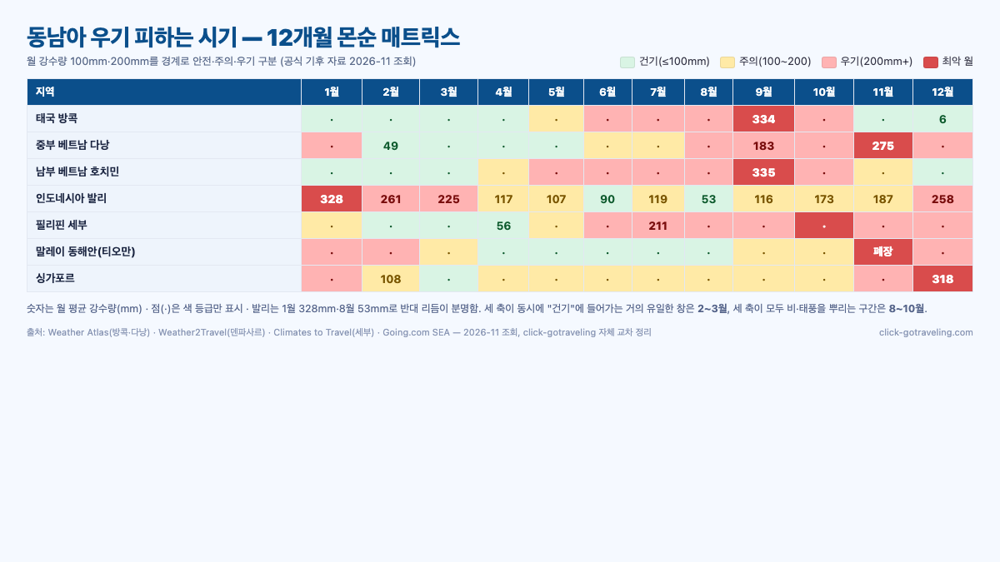
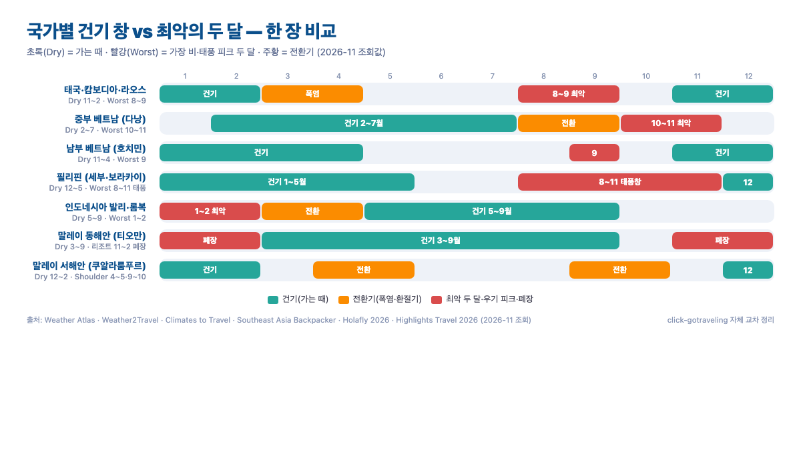

같은 동남아라도 11월의 다낭·발리·세부는 세 축이 반대로 갑니다. 다낭은 우기 피크(월 275mm), 발리는 건기 말미, 세부는 태풍 창 끝물이에요. **동남아 여행 우기 피하는 시기**를 한 줄로 외우려고 하면 꼭 틀립니다. 본토(태국·베트남 북·중부·캄보디아·라오스)는 **5~10월**이 우기, 섬(발리·롬복·인도네시아)은 **11~3월**이 우기, 필리핀은 **6~12월**이 우기이면서 **8~11월 태풍 창**이 가장 깊어요. 2026년 11월 기준 각국 공식 기후 자료와 상위 블로그 10편을 교차해 월별로 지도처럼 풀었습니다.

📌 3줄 요약
동남아는 <b>본토·섬·필리핀</b> 세 축이 서로 반대로 움직여, 한 달에 "동남아 어디나 좋다"는 달은 <b>2~3월</b>뿐입니다.

본토는 11~2월이 왕도, 섬(발리·롬복)은 <b>5~9월</b>이 왕도, 필리핀은 <b>12~5월</b>이 왕도이고 <b>8~11월 태풍</b>은 모두 피합니다.

다낭은 9~11월 강수량이 평균 <b>200~275mm</b>로 뛰고, 발리는 1월 <b>328mm</b>, 세부는 10월이 <b>200mm</b>로 가장 많아요.

## 동남아 우기 피하는 시기, 국가별 한눈에 건기 지도

상위 블로그 10편을 열어 보면 "동남아 우기는 5~10월"이라는 한 줄짜리 결론이 가장 많이 돌아다닙니다. 그런데 이게 발리·롬복·필리핀 세부에는 틀립니다. 몬순이 부는 **방향**과 **반구**가 다르기 때문이에요. 그래서 이 글은 "한 줄 결론"부터 밀어두고, 세 축으로 쪼개 두는 쪽으로 시작합니다. 결론만 먼저 보려면 아래 표 한 장이면 끝입니다.

| 축 | 어디가 속하나 | 건기(가는 때) | 우기(피하는 때) | 가장 나쁜 2개월 |
| --- | --- | --- | --- | --- |
| 본토 | 태국·캄보디아·라오스·베트남 북·남부 | **11~2월** | 5~10월 | 8~9월 |
| 중부 베트남 | 다낭·호이안·후에·나트랑 | **2~7월** | 8~1월 | **9~11월** |
| 섬(남반구·적도 섬) | 발리·롬복·수마트라·자바 | **5~9월** | 11~3월 | **1~2월** |
| 필리핀(대부분) | 세부·보라카이·마닐라 | **12~5월** | 6~12월(태풍 포함) | **8~11월** |
| 말레이시아 서해안 | 쿠알라룸푸르·랑카위·페낭 | **12~2월** | 4~5·9~10월 | — |
| 말레이시아 동해안 | 티오만·페르헨티안 | **3~9월** | **11~2월 폐장** | — |
| 싱가포르 | 싱가포르 | **6~9월**(편차 적음) | 11~1월 | — |

세 축을 묶어서 외우기 어려우면 "같이 쉬는 달"만 기억해도 됩니다. **2~3월**은 본토·섬·필리핀 어디를 골라도 안정된 거의 유일한 창이에요. 반대로 **8~10월**은 세 축이 모두 비를 뿌리는 구간이고, 같은 기간 필리핀·베트남은 태풍 경로까지 겹칩니다.

## 왜 같은 동남아인데 월이 다를까 — 몬순 두 축과 태풍

가장 큰 혼란은 "동남아는 다 비슷하지 않나"에서 옵니다. 실제로는 **남서 몬순**(5~10월, 인도양에서 불어와 본토를 적심)과 **북동 몬순**(11~3월, 남중국해에서 불어와 베트남 중·북부와 말레이 동해안·필리핀 동부를 적심)이 서로 반대 계절에 분다고 [Southeast Asia Backpacker의 기후 플래너](https://southeastasiabackpacker.com/southeast-asia-climate/)와 [Holafly 2026 가이드](https://esim.holafly.com/travel-tips/best-time-to-visit-southeast-asia/)가 공통으로 설명합니다. 여기에 **적도 남쪽**(발리·롬복)은 남반구 계절이라 본토가 우기일 때 건기이고, 본토가 건기일 때 우기예요.

거기에 한 축이 더 있습니다. 서태평양 **태풍**(열대저기압)이 동북진하면서 필리핀·베트남 중부·대만 쪽을 훑는데, [Climates to Travel의 세부 기후](https://www.climatestotravel.com/climate/philippines/cebu-city)는 "열대저기압 위협은 5~12월이고 특히 **8~11월이 피크**"라고 못 박고 있어요. 다낭 역시 [Weather Atlas 다낭 기후](https://www.weather-atlas.com/en/vietnam/da-nang-climate)에 따르면 **11월 평균 강수량이 275mm로 연중 1위**이고, 이는 북동 몬순 + 태풍이 겹치는 구간이기 때문입니다.

이 세 축(남서 몬순·북동 몬순·태풍)을 겹쳐 그려야 "같은 11월에 다낭은 우기 피크, 세부는 태풍 창 끝물, 발리는 건기 말미"라는 비대칭이 설명됩니다. 그래서 이 글의 뒤에 나오는 국가별 섹션은 순서가 중요해요. **본토 → 중부 베트남 → 섬 → 필리핀 → 말레이·싱가포르**로 축이 하나씩 바뀌는 흐름입니다.

## 태국·캄보디아·라오스 — 11~2월이 거의 공식

*▲ 상위 블로그 10편(SERP 상위 10개 중 깊이 분석한 수)과 각국 공식 기후 자료의 수치를 교차해 click-gotraveling이 직접 만든 월별 몬순 매트릭스입니다. 각 셀의 색은 월 강수량 100mm·200mm를 기준으로 안전·주의·우기로 구분했어요.*

태국·캄보디아·라오스는 세 나라가 거의 같은 리듬으로 움직입니다. [Weather Atlas 방콕](https://www.weather-atlas.com/en/thailand/bangkok-climate)의 월 강수량을 보면 **12월 6.3mm → 9월 334.3mm**로 50배 차이가 나요. **5~10월이 우기**이고 11월부터 급격히 떨어져 12월이 가장 건조합니다. 캄보디아(앙코르와트·시엠립)와 라오스(루앙프라방·방비엥)도 똑같이 **11~2월이 왕도**, **9월이 가장 비 많음**으로 수렴합니다.

다만 **3~5월**은 "건기"로 분류되지만 **40℃에 가까운 폭염**이 자주 찍히는 구간이에요. 방콕 4월 평균 최고가 35.4℃라고 Weather Atlas가 집계하고, 치앙마이는 3~4월 **화전 연기 집중**으로 PM2.5가 급등합니다. [ChiangMaiBrief가 집계한 PCD·IQAir 데이터](https://chiangmaibrief.com/air-quality-and-burning-season/air-quality-by-month/) 기준 3월 월평균 PM2.5가 **80.9μg/m³**(PCD 2011~2020 평균)·IQAir 2020~2024 범위 **39.9~97.8μg/m³**로 WHO 연간 기준(5μg/m³)을 **최대 20배**까지 넘겨요. [IQAir 보도(2026-03-27)](https://www.iqair.com/th-en/newsroom/chiang-mai-among-top-10-most-polluted-cities-in-the-world-3-27-2026)는 2026년 3월 26일 치앙마이가 AQI 220 이상으로 세계 최악 10대 도시에 올랐다고 밝혔습니다(2026-11 조회). 그래서 태국·라오스·캄보디아를 **쾌적하게** 돌고 싶다면 **11월 중순~2월 말**이 가장 좁지만 가장 확실한 창이에요.

예외도 있습니다. 태국의 **코사무이·코팡안** 같은 걸프만(동해안) 섬은 본토와 반대로 **10~12월이 별도 우기**로 분류됩니다. 상위 가이드 다수가 "본토 태국은 11~2월, 사무이는 1~8월"로 나눠서 적는 이유예요. 섬 종류에 따라 비행기를 바꿔 타고 바로 피할 수 있다는 점은 뒤 섹션에서 다시 보겠습니다.

## 베트남은 남·중·북이 세 나라처럼 다르다

베트남은 한 나라 안에서 기후가 세 조각으로 나뉩니다. [Holafly 가이드](https://esim.holafly.com/travel-tips/best-time-to-visit-southeast-asia/)와 [Going.com의 Southeast Asia 가이드](https://www.going.com/guides/best-time-to-visit-southeast-asia)가 공통으로 **북부(하노이·하롱) 10~12월 건기**, **중부(다낭·호이안·후에) 2~7월 건기**, **남부(호치민·푸꾸옥) 11~4월 건기**로 쪼개 적어요.

중부 베트남이 가장 극단적입니다. [Weather Atlas 다낭](https://www.weather-atlas.com/en/vietnam/da-nang-climate) 2026-11 조회값 기준 월 강수량이 **2월 49mm → 11월 275mm**로 **약 5~6배** 벌어지고, 가장 건조한 2~5월에 비해 **9~11월은 월 강수량 자체가 4~5배로 뛴다**는 결론은 [v.daum.net의 "동남아 피해야 하는 여행시기"](https://v.daum.net/v/xf9qUO5J6V) 요약과도 방향이 같습니다. 한국 추석 연휴·단풍철이 바로 이 구간이라, 다낭 패키지 광고가 가장 싸게 나오는 시점이기도 해요. 가격이 싼 이유가 **강수량 때문**임을 반드시 함께 봐야 합니다.

다낭을 꼭 가야 한다면 월별로 어떤 날씨를 각오해야 하는지 숫자로 정리한 [다낭 우기 월별 가이드](/danang-rainy-season/)에 수치를 더 쪼개 두었습니다. 우기 안에서도 **9월·10월이 최악**이고 **11월 중순부터 비가 짧은 스콜로 바뀌는 패턴**이라 "다낭 11월이 우기지만 호텔 산책은 가능"이라는 평이 나오는 거예요.

| 지역 | 건기(가는 때) | 우기(피하는 때) | 가장 나쁜 달 | 참고 수치 |
| --- | --- | --- | --- | --- |
| 북부(하노이·하롱·사파) | 10~12월·3~4월 | 5~9월 | 8월 | 하노이 8월 **135mm** |
| 중부(다낭·호이안·후에·나트랑) | **2~7월** | 8~1월 | **9~11월** | 다낭 11월 **275mm** |
| 남부(호치민·푸꾸옥·무이네) | **11~4월** | 5~10월 | 6~9월 | 호치민 6월 **188mm**·9월 **175mm** |

*표의 월 강수량은 [Weather Atlas 하노이](https://www.weather-atlas.com/en/vietnam/hanoi-climate)·[Weather Atlas 다낭](https://www.weather-atlas.com/en/vietnam/da-nang-climate)·[Weather Atlas 호치민](https://www.weather-atlas.com/en/vietnam/ho-chi-minh-city-climate) 2026-11 조회값입니다. 호치민은 6월(188mm)이 연중 피크, 하노이는 연간 총량이 가장 작아 월 수치도 낮게 집계돼요.*

즉 2월부터 4월까지는 **베트남 어디를 가도 안정**적입니다. 반대로 **6~9월은 베트남 어느 지역도 완전히 안전하지 않다**는 게 베트남 특유의 리듬이에요.

## 필리핀 — 12~5월 건기, 그러나 태풍 창은 8~11월

필리핀은 대부분 지역이 **12~5월 건기**, **6~11월 우기 + 태풍 창**으로 수렴합니다. [Climates to Travel 세부 기후](https://www.climatestotravel.com/climate/philippines/cebu-city)와 [Weather Atlas 세부 기후](https://www.weather-atlas.com/en/philippines/cebu-city-climate) 2026-11 조회값을 교차하면 세부 월 강수량은 **4월 55.6mm(최저) → 7월 210mm → 10월 200mm(피크) → 11~12월 110mm**로, **6월부터 비가 많아지고 10월에 한 번 더 피크가 옵니다**. 데일리팝과 상위 블로그가 공통으로 "**6~10월은 피해야 할 시기**"로 적는 이유예요([조이고어스의 동남아 날씨 7곳 정리](https://joygoers.com/%EB%8F%99%EB%82%A8%EC%95%84-%EB%82%A0%EC%94%A8/)).

여기에 **태풍(태평양 열대저기압)이 겹칩니다**. 필리핀 기상청(PAGASA)과 Climates to Travel 요약 기준 **8~11월이 피크**이고 특히 **루손(마닐라·북부)과 비사야(세부·보라카이)** 쪽으로 자주 상륙해요. [PAGASA 2026년 11월 월간 전망](https://www.gmanetwork.com/news/weather/content/1007988/pagasa-sees-1-2-tropical-cyclones-in-par-in-november-2026/story/)에서도 11월에 열대저기압 1~2개가 필리핀 담당 구역(PAR)에 진입할 수 있다고 공지했습니다(2026-11 조회). 세부·보라카이에 가면 "맑은데 갑자기 공항 전체가 지연"되는 일이 생기는데, 이는 **멀리서 지나가는 태풍이 활주로 횡풍을 만들 때**가 많습니다.

예외는 **시아르가오·동남부 민다나오**입니다. [Southeast Asia Backpacker](https://southeastasiabackpacker.com/southeast-asia-climate/)가 짚듯 이 지역은 다른 필리핀과 반대로 **10~2월이 우기**, **3~9월이 건기**예요. 그래서 "11월 보라카이는 비, 11월 시아르가오는 서핑 성수기"라는 비대칭이 생깁니다. 필리핀을 고를 땐 "국가"가 아니라 "섬"으로 쪼개 보는 쪽이 안전해요.

⚠️ 필리핀 태풍 시즌 체크 포인트
8~11월 출발이라면 출발 72시간 전 <b>PAGASA 공식 사이트</b>와 외교부 <b>해외안전여행 포털</b>에서 열대저기압 이름·예상 경로를 확인하세요.

항공권은 <b>변경·환불 가능 운임</b>으로 끊고 숙소는 <b>무료 취소 가능일</b>(보통 체크인 24~72시간 전)이 넉넉한 옵션을 고릅니다. <a href="https://www.agoda.com/" target="_blank" rel="noopener">아고다</a> 같은 플랫폼은 Free Cancellation 필터로 바로 거를 수 있어요.

태풍 경로가 확정되면 <b>동남부(시아르가오·다바오)</b>로 피하거나, 같은 예산으로 <b>베트남 다낭·나트랑</b>(2~7월 건기)으로 노선을 바꾸는 플랜 B를 미리 그려 두세요.

## 발리·롬복·인도네시아 — 섬이라 공식이 뒤집힌다

인도네시아는 적도 남쪽이라 **본토와 반대로 움직입니다**. [Weather2Travel 덴파사르 기후](https://www.weather2travel.com/bali/denpasar/climate/) 월 강수량 기준 발리의 리듬은 다음과 같아요. **8월 53mm(연중 최저) → 1월 328mm(연중 최고)**. 즉 **5~9월이 건기**이고 **11~3월이 우기**예요. 한국 여름 휴가철(7~8월)이 발리 여행 황금기와 겹치는 이유가 바로 이것이고, 그 결과 성수기 숙박료가 평상시 대비 1.5~2배로 뜁니다.

*▲ 본토(태국·베트남 북·남부·캄보디아·라오스)·중부 베트남·발리·필리핀·말레이시아 동해안 각각의 "건기 창"과 "최악의 달"을 한 장에 묶어 click-gotraveling이 직접 정리한 비교표입니다. 수치는 Weather Atlas·Weather2Travel·Climates to Travel·각국 기상청 공개값(2026-11 조회)을 교차한 값이에요.*

실속파가 노리는 창은 **5월과 9월**입니다. 7~8월 피크 가격을 비켜 가면서 비 올 확률도 낮고, 특히 5월은 우기가 막 끝나 **우붓·숲 색이 가장 선명한 달**이라 사진 여행에도 좋아요. 반대로 **1~2월은 피크 우기**로, 1월 평균 강수량이 328mm까지 뛰고 비 오는 날이 20일을 넘깁니다. 수상 액티비티(스노클링·서핑)는 사실상 쉬어야 하는 구간이에요.

롬복·길리는 발리보다 약간 건조해 **6~9월이 가장 깔끔**합니다. 자바(요그야카르타·보로부두르)·수마트라도 발리와 거의 같은 리듬이고요. 즉 **인도네시아 여행 = 5~9월**로 기억하면 거의 안 틀립니다. 반대로 라오스·태국이 가장 비 많을 때가 바로 발리 베스트 시즌이라, 두 나라를 한 번에 섞으려면 **5월·9월 양 끝의 전환기**를 고르는 쪽이 안전해요.

## 말레이시아·싱가포르 — 동·서 해안이 반대, 환승 허브의 함정

말레이시아는 한 나라 안에서 **동·서 해안이 서로 반대로 움직여 가장 혼란스러운 케이스**입니다. [Going.com 동남아 가이드](https://www.going.com/guests/best-time-to-visit-southeast-asia)와 [Holafly 2026 가이드](https://esim.holafly.com/travel-tips/best-time-to-visit-southeast-asia/) 둘 다 이 점을 공통으로 짚어요. **서해안**(쿠알라룸푸르·랑카위·페낭)은 **12~2월이 건기**, **동해안**(티오만·페르헨티안·크라단)은 **3~9월이 건기**이고 **11~2월은 바다 자체가 거칠어 리조트가 폐장**합니다. 사바·사라왁(보르네오)은 또 달라서 **5~9월이 베스트**예요.

즉 "말레이시아 여행 11월 괜찮아?"라는 질문에는 한 줄로 못 답합니다. 쿠알라룸푸르·랑카위라면 OK, 티오만이라면 **섬이 닫혀 있어** 의미가 없어요. 서해안과 동해안을 같이 보고 싶다면 **3월 하순~4월**(서해안 건기 끝물 + 동해안 건기 초입)이 유일하게 겹치는 창입니다.

싱가포르는 열대 해양성이라 **연중 편차가 가장 작습니다**. [Weather Atlas 싱가포르](https://www.weather-atlas.com/en/singapore/singapore-climate) 2026-11 조회값 기준 연평균 **2,343mm**이고, 가장 적은 **7월이 159mm**, 가장 많은 **12월이 287mm**로 "비 안 오는 달"은 없어요. 다만 **6~9월이 상대적으로 건조**하고 **11~1월은 북동 몬순으로 월 240~290mm까지 뜁니다**. **9~10월은 인도네시아 산불 연기(haze)가 바람 타고 밀려오는 때**가 가끔 있어요. 환승 체류·주말 쇼트트립 중심이라면 **12~1월 쇼핑 시즌**이 비는 많아도 도시 체류엔 큰 문제가 아닙니다.

## "최악 두 달"만 외우는 월별 피해야 할 시기 표

전부 외우기 어렵다면 "**가장 가지 말아야 할 두 달**"만 머리에 넣어 두는 쪽이 실전에 더 유용합니다. 월 강수량 200mm 이상이거나 태풍 피크가 겹친 구간을 "최악 두 달"로 뽑으면 아래 표로 좁혀져요.

| 여행지 | 최악 두 달 | 평균 월 강수량·이유 | 안전 대체 창 |
| --- | --- | --- | --- |
| 방콕·치앙마이 | **8~9월** | 방콕 9월 334mm·우기 피크 | 11~2월 |
| 베트남 북부(하노이) | **7~8월** | 8월 **135mm**·폭염+폭우 | 10~12월 |
| 중부 베트남(다낭) | **10~11월** | 11월 **275mm**·태풍 경로 | **2~5월** |
| 베트남 남부(호치민) | **8~9월** | 9월 **175mm**·오후 스콜 매일 | 12~3월 |
| 캄보디아(앙코르) | **8~9월** | 우기 피크·진흙 유적 접근 어려움 | 11~2월 |
| 라오스(루앙프라방) | **7~9월** | 메콩 범람 가능·도로 폐쇄 | 11~2월 |
| 필리핀(세부·보라카이) | **8~11월** | 7월 **210mm**·10월 **200mm**·태풍 피크 | **12~5월** |
| 발리·롬복 | **1~2월** | 1월 328mm·수상 액티비티 중단 | **5~9월** |
| 말레이 서해안 | 4~5월 | 환절기 폭우 | 12~3월 |
| 말레이 동해안(티오만) | **11~2월** | 리조트 폐장 | 3~9월 |
| 싱가포르 | 11~1월 | 월 **240~290mm**·12월 287mm 피크 | 6~9월 |

이 표의 "최악 두 달"이 세 지역(필리핀·중부 베트남·발리)에서 **한국 성수기와 겹친다**는 점이 중요해요. 한국 추석 연휴(9~10월)에 다낭·세부·보라카이·하노이 패키지가 가장 저렴하게 나오는 구조적인 이유이고, 반대로 **1~2월 발리**가 상대적으로 저렴한 이유이기도 합니다. 가격은 위 표를 그대로 뒤집은 그래프예요.

## 월별 목적지 매칭과 우기 여행 전략

같은 달이라도 어디로 가느냐에 따라 체감 날씨가 완전히 달라집니다. 상위 블로그가 공통으로 분산해 다룬 내용을 월별 카탈로그로 묶었어요.

### 2~3월 — 어디 가지?

- **안전**: 태국 전 지역·캄보디아·라오스·베트남 북·중·남부·필리핀 세부·보라카이 — 모두 건기이고 태풍 창도 비는 유일한 두 달.
- **특화**: 중부 베트남(다낭·호이안)은 2~7월 건기의 황금 창이고, 세부는 3월(Weather Atlas 20mm)이 연중 가장 건조한 달.
- **주의**: 치앙마이는 3월부터 화전 연기(PM2.5 월평균 80.9μg/m³)가 심해지는 구간. 발리는 2월 261mm로 여전히 우기 꼬리.
- **가격**: 한국 봄방학·졸업식 시즌이라 항공권은 비싼 편. 반대로 날씨 안정성은 연중 가장 좋은 2개월.

### 7~8월 — 어디 가지?

- **안전**: 발리·롬복·길리·자바·수마트라 — 건기 피크(발리 8월 53mm). 사바·사라왁(보르네오)도 베스트 시즌. 말레이 동해안(티오만·페르헨티안)도 피크.
- **특화**: 중부 베트남(다낭·호이안)은 아직 건기 말미지만 8월부터 비 시작.
- **비추천**: 태국 본토(방콕·치앙마이)·캄보디아(앙코르)·라오스 — 우기 피크. 필리핀(세부·보라카이) — 7월 210mm·태풍 창 초입.
- **가격**: 한국 여름 성수기와 발리 베스트 시즌이 겹쳐 발리 항공·숙박 50% 이상 할증.

### 11월 — 어디 가지?

- **안전**: 태국 전 지역·캄보디아·라오스·베트남 남부(호치민)·발리(건기 말미) → "본토 + 발리"가 공존하는 거의 유일한 달.
- **주의**: 중부 베트남(다낭·호이안) — 월 275mm 피크·태풍 경로.
- **비추천**: 필리핀(세부·보라카이) — 태풍 창 끝물. [PAGASA 2026년 11월 월간 전망](https://www.gmanetwork.com/news/weather/content/1007988/pagasa-sees-1-2-tropical-cyclones-in-par-in-november-2026/story/) 기준 PAR 내 열대저기압 1~2개 진입 가능(2026-11 조회).
- **사실상 폐장**: 말레이 동해안(티오만·페르헨티안) — 리조트 11월~2월 운영 중단 많음.

### 12~1월 — 어디 가지?

- **안전**: 태국 본토(방콕·치앙마이)·캄보디아(앙코르)·라오스·베트남 남부(호치민·푸꾸옥) — 본토 왕도. 말레이 서해안(쿠알라룸푸르·랑카위·페낭).
- **특화**: 세부·보라카이는 12월 110mm(Weather Atlas)로 태풍 창이 완화되며 건기 전환.
- **비추천**: 발리·롬복 — 1월 328mm 우기 피크, 바다 액티비티 사실상 불가. 말레이 동해안(티오만) — 폐장 지속.
- **가격**: 연말 2주(12월 24일~1월 5일)만 피하면 본토는 가성비 가장 좋은 구간.

**4~5월**부터는 본토 폭염이 시작되고 치앙마이는 연무 끝물, 발리는 우기 말미라 섬 쪽으로 축을 옮기는 쪽이 자연스럽습니다.

### 우기여도 가는 경우 — 가격·호캉스·태풍 플랜 B

우기를 "무조건 피해야 하는 시기"로 볼 필요는 없습니다. 상위 가이드 공통 결론은 "예측 가능한 스콜 + 가격 절반 + 적은 인파 = 호캉스·리조트 투숙 중심 여행엔 오히려 유리하다"로 모여요([Southeast Asia Backpacker](https://southeastasiabackpacker.com/southeast-asia-climate/), [Highlights Travel 2026](https://www.highlightstravel.com/southeast-asia/best-time-to-visit)). 다낭 9~10월에 수영장 딸린 리조트 1박 10만 원대가 뜨거나, 발리 1~2월에 비수기 할인이 50%까지 들어가는 식이에요.

다만 **우기 여행은 "액티비티 비중을 줄이고 체류 비중을 늘리는" 쪽으로 설계**해야 합니다. 상위 가이드가 공통으로 권하는 요령은 세 가지예요. 첫째, **오전 7~11시에 야외 일정**을 몰아넣고(스콜은 오후에 몰림), 오후는 실내·스파·마사지·카페로 비웁니다. 둘째, **투숙 1박을 더 길게**(3박 4일 대신 4박 5일) 잡아 비 오는 하루를 리조트에서 소화할 여유를 둡니다. 셋째, **태풍 시즌에는 반드시 플랜 B 노선**을 그려 두세요. 필리핀 8~11월 발 발권이라면 **같은 예산으로 베트남 다낭·나트랑**(2~7월 건기)·**발리**(5~9월 건기)로 바꿀 수 있는 옵션을 미리 확인해 둡니다.

예약 설계도 마찬가지입니다. 항공권은 **변경·환불 가능 운임**, 숙소는 [아고다](https://www.agoda.com/) 같은 플랫폼에서 **Free Cancellation 필터**로 체크인 24~72시간 전까지 무료 취소되는 옵션을 고르는 쪽이 안전해요. 1인 여행자 보험도 "**자연재해·여행지연 보상**"이 포함된 상품이 태풍 시즌 손해를 크게 줄입니다.

## 자주 묻는 질문

**Q. 동남아 여행 우기 피하는 시기 중 "어디든 안전한 달"은 언제인가요?** 2월과 3월입니다. 본토(태국·베트남·캄보디아·라오스)·발리·필리핀이 거의 동시에 건기에 들어가고 태풍 창도 비는 유일한 두 달이에요. 한국 봄방학·졸업식 시즌이라 항공권은 비싼 편이지만, 날씨 변수로 일정이 깨질 확률이 가장 낮습니다.

**Q. 다낭 9~10월에 가도 비가 안 올 때가 있던데 괜찮지 않나요?** 하루 중 '비 안 오는 시간'은 늘 있지만 월 강수량 자체가 다낭 11월 275mm로 연중 1위이고, 2~5월 건기 대비 **약 5~6배** 비가 몰리는 창이라 해변 물놀이·바나힐 야외 일정은 체감 만족도가 크게 떨어져요. 호텔 호캉스·마사지 중심이라면 가격이 저렴한 9~10월도 선택지가 됩니다.

**Q. 발리는 왜 12~2월에 가지 말라고 하나요?** 발리는 적도 남쪽 섬이라 본토와 반대 리듬입니다. 덴파사르 1월 평균 강수량이 328mm로 연중 최고이고 비 오는 날이 20일을 넘겨 스노클링·서핑·우붓 산책이 모두 어렵습니다. 성수기 가격까지 겹치지 않아서 저렴한 건 사실이지만, 날씨 리스크를 감수해야 하는 구간이에요.

**Q. 필리핀 태풍 시즌은 몇 월이고 어떻게 피하나요?** 8월부터 11월이 피크입니다. 루손(마닐라·북부)·비사야(세부·보라카이) 쪽으로 자주 상륙하고 공항 횡풍으로 지연·결항도 흔해요. 꼭 가야 한다면 변경·환불 가능 항공권과 무료 취소 숙소로 설계하고, 출발 72시간 전 PAGASA·외교부 해외안전여행 포털을 다시 확인하는 쪽이 안전합니다.

**Q. 태국·캄보디아·라오스를 동시에 돌려면 언제가 좋나요?** 11월 중순부터 2월 말까지가 세 나라 모두 공통 건기입니다. 3~5월은 건기이지만 방콕 4월 평균 최고 35.4℃·치앙마이 봄 연무 같은 폭염·대기오염 변수가 겹쳐 쾌적도가 떨어집니다. 체류 비용이 가장 높아지는 연말 2주(12월 24일~1월 5일)만 피하면 가성비까지 함께 잡혀요.

**Q. 말레이시아 11월은 어디가 되고 어디가 안 되나요?** 쿠알라룸푸르·랑카위·페낭 같은 서해안은 11월~2월이 건기로 OK입니다. 반면 티오만·페르헨티안 같은 동해안 섬은 11월부터 2월까지 리조트가 아예 문을 닫아요. 사바·사라왁(보르네오)은 5~9월이 베스트고 11월은 애매한 구간입니다. "말레이시아"라는 한 단어로 묶지 말고 가려는 섬·주별로 다시 확인해야 하는 이유예요.

### 이미지 출처

본문 그림 3장은 모두 click-gotraveling이 자체 디자인한 인포그래픽(HTML → PNG)으로, 참고한 1차 자료는 그림별로 다릅니다. 아래는 각 그림이 묶어 쓴 공식 출처와 조회일(2026-11) 목록입니다.

- **히어로 카드**(상단 제목 이미지) — "세 축·2~3월 교집합" 결론과 발리 1월 328mm·다낭 11월 275mm·세부 10월 200mm 숫자를 디자인 라벨로 재조합. 수치 출처: [Weather Atlas 다낭](https://www.weather-atlas.com/en/vietnam/da-nang-climate)·[Weather2Travel 덴파사르](https://www.weather2travel.com/bali/denpasar/climate/)·[Weather Atlas 세부](https://www.weather-atlas.com/en/philippines/cebu-city-climate), 2026-11 조회.
- **12개월 몬순 매트릭스** — 7개 축(태국·중부 베트남·남부 베트남·발리·필리핀·말레이 동해안·싱가포르)의 월별 월 강수량을 100mm·200mm 경계로 색칠한 자체 매트릭스. 수치: [Weather Atlas 방콕](https://www.weather-atlas.com/en/thailand/bangkok-climate)·[Weather Atlas 다낭](https://www.weather-atlas.com/en/vietnam/da-nang-climate)·[Weather Atlas 세부](https://www.weather-atlas.com/en/philippines/cebu-city-climate)·[Weather2Travel 덴파사르](https://www.weather2travel.com/bali/denpasar/climate/)·[Weather Atlas 싱가포르](https://www.weather-atlas.com/en/singapore/singapore-climate)·[Going.com Southeast Asia](https://www.going.com/guides/best-time-to-visit-southeast-asia), 2026-11 조회.
- **국가별 건기 창 비교표** — 본토·중부 베트남·발리·필리핀·말레이 동해안 각각의 "건기 창"과 "최악의 달"을 한 장에 묶음. 참고: [Holafly Best Time 2026](https://esim.holafly.com/travel-tips/best-time-to-visit-southeast-asia/)·[Southeast Asia Backpacker 기후 플래너](https://southeastasiabackpacker.com/southeast-asia-climate/)·[Highlights Travel 2026](https://www.highlightstravel.com/southeast-asia/best-time-to-visit)·[외교부 해외안전여행](https://www.0404.go.kr/), 2026-11 조회.

저작권 표기: 모든 그림은 **click-gotraveling 자체 제작·2026-11 조회값 기준**이며, 각 그림에 쓰인 숫자는 위 1차 출처에서 가져왔고 재가공·시각화는 click-gotraveling이 수행했습니다. 상업적 재사용 시 출처 표기를 부탁드립니다.

---

**관련 키워드** — #동남아여행우기피하는시기 #동남아여행우기 #동남아건기 #동남아여행시기 #다낭우기 #발리건기 #세부태풍시즌 #동남아몬순 #동남아9월여행 #동남아11월여행 #동남아12월여행 #동남아2월여행
