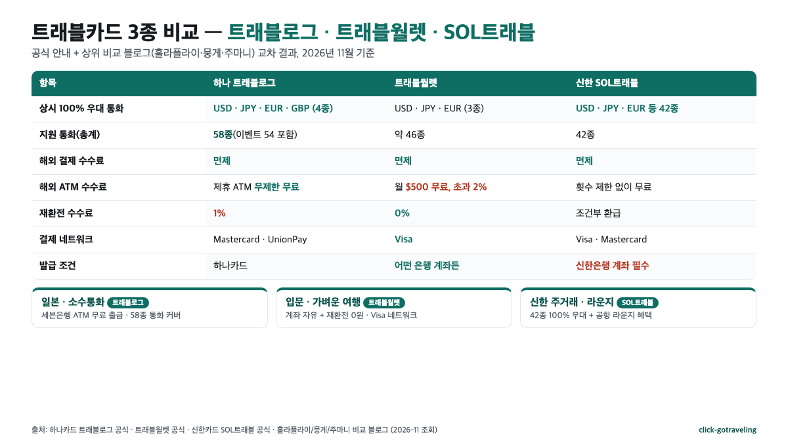
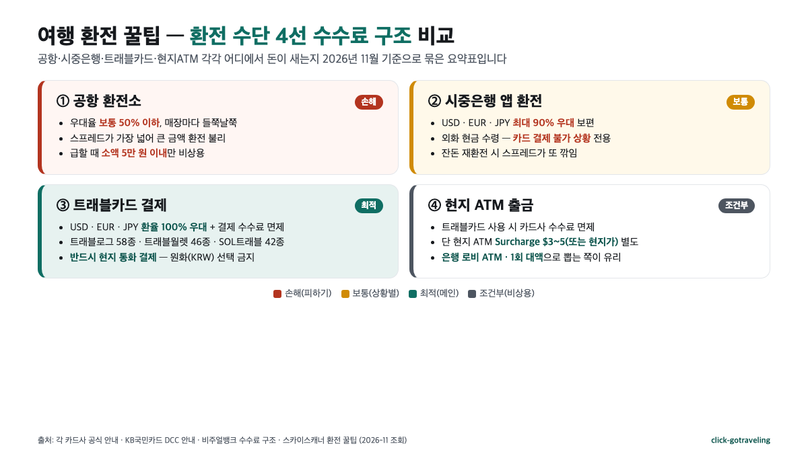

**여행 환전 꿀팁**의 2026년 결론은 짧습니다. **환전은 90%를 트래블로그·트래블월렛·SOL트래블 같은 트래블카드로, 비상용 현금 10%만 현지 ATM**으로, **해외 결제는 신용카드 대신 트래블카드를 쓰되 반드시 현지 통화로 긁는 것**입니다. 공항·시중은행 환전은 수수료 체계상 손해로 수렴하고, 신용카드 해외 결제는 평균 2.5% 안팎의 수수료가 붙으며, 원화결제(DCC)를 잘못 누르면 그 위에 3~8%(심한 사례 10%)가 더 쌓입니다. 상위 블로그 10편(SERP 상위 10개 중 깊이 분석한 수)과 각 카드사 공식 안내를 교차해 숫자로 풀어 보겠습니다.

📌 3줄 요약
트래블로그·트래블월렛·SOL트래블 모두 USD·EUR·JPY는 환율 <b>100% 우대</b>로 환전 수수료가 0원이고, 해외 결제 수수료도 면제됩니다.

신용카드 해외 결제는 국제브랜드 수수료 <b>약 1%</b> + 해외서비스 수수료 <b>0.18~0.3%</b> 이중 구조라 보통 <b>2.5% 안팎</b>이 붙고, 원화결제(DCC)를 선택하면 그 위에 <b>3~8%</b>가 더 쌓입니다.

베스트 조합은 <b>트래블카드 1장(메인) + 비자/마스터 신용카드 1장(백업) + 현지 통화 소액 현금</b>이고, 현지에서는 모든 결제·ATM을 반드시 <b>현지 통화</b>로 눌러야 합니다.

## 여행 환전 해외 카드 꿀팁, 2026 결론부터 압축

상위 블로그 10편을 열어 보면 "트래블카드를 쓰세요"라는 결론은 공통인데, 그 뒤에 따라붙는 숫자가 글마다 다릅니다. 그래서 이 글은 결론을 먼저 못 박아 둡니다. 2026년 11월 기준 **해외여행 돈 쓰기의 베스트 조합은 메인 트래블카드 1장 + 백업 신용카드 1장 + 현지 통화 소액 현금**입니다. 트래블카드는 환전 수수료·해외 결제 수수료·해외 ATM 수수료 세 가지를 한꺼번에 지웁니다. 신용카드는 호텔 보증금·렌터카 디포짓·고액 쇼핑처럼 "신용 한도"가 필요한 결제의 보험이고, 소액 현금은 전통시장·택시·팁처럼 카드가 안 되는 상황의 쿠션입니다.

반대로 피해야 할 세 가지는 ① 공항 환전소에서 거액을 바꾸는 것, ② 신용카드 해외 결제, ③ 결제 단말기나 ATM에서 "원화(KRW)로 결제하시겠습니까"를 누르는 것입니다. 세 가지가 겹치면 100만 원 결제에 10만 원 가까이가 수수료로 날아갑니다. [KB국민카드 공식 DCC 안내](https://kbthink.com/life/card/dcc-block.html)와 [비주얼뱅크 수수료 구조 해설](https://visualbank.io/blog/cards/overseas-card-fee-by-issuer/)에 그 산식이 그대로 나와 있어요.

| 구분 | 환전 수수료 | 해외 결제 수수료 | 해외 ATM 수수료 | DCC 리스크 |
| --- | --- | --- | --- | --- |
| 공항 환전소 | 보통 우대 50% 이하 | — | — | — |
| 시중은행(앱) | USD·EUR·JPY 최대 90% | — | — | — |
| 트래블카드 | USD·EUR·JPY **100% 우대** | **면제** | 조건부 면제 | 결제 통화 선택 주의 |
| 신용카드 해외 결제 | 결제 시점 환율 | 약 **2.5%**(브랜드 1% + 서비스 0.18~0.3%) | 건당 **$3** | 가장 큼 |

세 번째 줄이 왜 가장 유리한지가 이 글의 뼈대고, 네 번째 줄의 2.5%와 DCC 3~8%가 왜 그렇게 나오는지가 뒷부분의 내용입니다.

## 왜 공항·시중은행 환전은 더 이상 손익이 안 맞는가

가장 큰 오해가 "시중은행 90% 우대면 트래블카드 100% 우대랑 10%p 차이뿐이니 비슷하다"는 것입니다. 그런데 **10%p 차이**란 환율 스프레드의 10%를 뜻하지 "환전 금액의 10%"가 아니라서 금액으로 환산하면 몇 천 원 수준인 경우가 많습니다. 문제는 그다음입니다. 시중은행에서 외화 현금으로 받으면 **그 현금으로 할 수 있는 결제가 현금 결제뿐**이고, 호텔·식당·대중교통처럼 카드가 되는 곳에서는 다시 트래블카드가 유리합니다. 즉 90% 우대의 가치는 "출장 시 상당액의 현금이 꼭 필요한 사람"에게만 의미가 있어요.

반대로 공항 환전소는 우대율이 **보통 50% 이하**로 떨어지고 어떤 매장은 우대가 거의 없습니다. [스카이스캐너의 환전 꿀팁 글](https://www.skyscanner.co.kr/flights/advice/8tips-to-save-on-exchange)도 공통적으로 "공항 환전은 급할 때 소액만, 나머지는 트래블카드"로 결론을 모읍니다. 상위 가이드 10편(SERP 상위 10개 중 깊이 분석한 10편) 모두 공항 환전을 **보조 수단**으로만 추천한다는 점이 그 결론을 뒷받침해요.

그렇다고 "현금 0원"이 정답은 아닙니다. 트래블카드가 작동하지 않는 상황이 세 가지 있습니다. 첫째는 전통시장·노점·소형 식당처럼 **카드 자체가 안 되는 곳**이고, 둘째는 택시 미터기·숙소 보증금처럼 **현금이 관행인 결제**이며, 셋째는 **ATM 자체가 적은 지역**(동남아 시골, 발칸 소도시)입니다. 그래서 "환전 금액 중 10% 정도를 소액권으로 들고 가고 나머지는 카드"가 가장 안정적입니다. 금액으로 보면 1인 1주일 기준 **10만~15만 원 상당 현지 통화** 선이 평균적인 상위 블로그 권고치예요.

## 트래블로그·트래블월렛·SOL트래블 — 2026 핵심 비교

*▲ 각 카드사 공식 안내(하나카드 트래블로그·트래블월렛·신한카드 SOL트래블)와 [홀라플라이 2026 비교](https://esim.holafly.com/ko/travel-tips/travel-log-travel-wallet-comparison/)·[주마니 비교](https://jumanni.com/travelog-vs-travelwallet-comparison/)·[뭉게 2026 총정리](https://mungge.com/2026-07-14-travel-travel-card-comparison-2026/) 세 글을 교차해 click-gotraveling이 직접 정리한 표입니다.*

세 카드는 "USD·EUR·JPY 환율 100% 우대 + 해외 결제 수수료 면제"라는 뼈대가 같습니다. 차이가 벌어지는 지점은 **지원 통화 수·ATM 수수료 구조·재환전 수수료·결제 네트워크**예요.

- **하나 트래블로그 체크카드** — 상시 4종(USD·JPY·EUR·GBP) 100% 우대 + 54종 이벤트 무료 환전(2026-12-31까지)으로 사실상 **58종 통화**에서 수수료 0원입니다. 해외 결제 수수료·국제브랜드 수수료 모두 면제되고 ATM 출금도 **제휴 ATM에서 횟수 제한 없이 무료**예요. 다만 재환전(남은 외화를 원화로 되돌릴 때) 때 **1% 수수료**가 붙고, 결제 네트워크는 Mastercard·UnionPay라 Visa가 더 강한 국가에서는 백업이 필요합니다. 수치 출처는 [뭉게 2026 비교](https://mungge.com/2026-07-14-travel-travel-card-comparison-2026/)와 [하나카드 트래블로그 공식](https://app.hanamembership.com/gw/gsp/gSP00201m.do) 안내.
- **트래블월렛**(Travel Pay) — 상시 100% 우대 통화가 **USD·EUR·JPY 3종**으로 가장 좁지만, 나머지 40종 안팎 통화도 지원합니다. ATM 수수료는 **월 $500까지 무료, 초과분은 2% 과금**이라 트래블로그보다 보수적이에요. 대신 **재환전 수수료가 0원**이라 "쓰고 남은 외화를 그대로 원화로 보내도 손해가 거의 없다"는 점이 강점이고, 네트워크는 Visa라 미국·유럽 쪽에서 거절 위험이 적습니다. 어떤 은행 계좌로도 충전 가능해 **입문 카드**로 가장 많이 추천돼요([주마니 2026 비교](https://jumanni.com/travelog-vs-travelwallet-comparison/)).
- **신한 SOL트래블 체크카드** — 공식 안내 기준 **42종 통화 100% 우대**로 트래블로그와 트래블월렛 중간 포지션입니다. ATM 수수료 면제·횟수 제한 없음에 더해 **공항 라운지·편의점 할인** 같은 신한카드 자체 혜택이 붙어요. 단 **신한은행 입출금 계좌가 필수**라 신한 통장이 없다면 가입 단계부터 번거롭습니다([네오노마드 3종 비교](https://neonomadj.com/%ED%8A%B8%EB%9E%98%EB%B8%94%EB%A1%9C%EA%B7%B8-vs-sol%ED%8A%B8%EB%9E%98%EB%B8%94-vs-%ED%8A%B8%EB%9E%98%EB%B8%94%EC%9B%94%EB%A0%9B-%ED%95%B4%EC%99%B8%EC%97%AC%ED%96%89-%EC%B9%B4%EB%93%9C/)).

| 항목 | 트래블로그 | 트래블월렛 | SOL트래블 |
| --- | --- | --- | --- |
| 상시 100% 우대 통화 | USD·JPY·EUR·**GBP 4종** | USD·JPY·EUR 3종 | USD·JPY·EUR 등 **42종** |
| 지원 통화(총계) | 58종(이벤트 포함) | 약 46종 | 42종 |
| 해외 결제 수수료 | **면제** | **면제** | **면제** |
| 해외 ATM 수수료 | 제휴 ATM 무제한 무료 | **월 $500 무료, 초과 2%** | 횟수 제한 없이 무료 |
| 재환전 수수료 | 1% | **0%** | 조건부 환급 |
| 결제 네트워크 | Mastercard·UnionPay | **Visa** | Visa·Mastercard |
| 전제 조건 | 하나카드 발급 | 어떤 은행 계좌든 | **신한은행 계좌 필수** |

세 카드를 하나로 압축하면 다음과 같아요. **일본·소수통화 국가 자주 간다면 트래블로그, 입문·가벼운 여행이면 트래블월렛, 신한 주거래 + 공항 라운지도 쓰고 싶다면 SOL트래블**. 상위 블로그 공통 결론도 "카드 1장으로 모든 상황을 커버하긴 어렵고, 네트워크가 다른 카드 2장을 섞는 쪽이 안전"으로 모입니다.

## 신용카드 해외 결제 수수료 2.5%는 어떻게 나오는가

트래블카드가 "0원" 쪽에 있다면 일반 신용카드는 반대쪽입니다. 해외 결제 수수료는 두 겹이에요. [비주얼뱅크의 카드사별 수수료 구조 분석](https://visualbank.io/blog/cards/overseas-card-fee-by-issuer/)과 [KB국민카드 공식 안내](https://kbthink.com/card/travel-vs-credit.html)가 똑같이 쪼개 설명합니다.

첫 번째 겹은 **국제브랜드 수수료**로 Visa·Mastercard·JCB 등 국제 결제망을 쓰는 대가입니다. 2026년 기준 **약 1%** 수준이에요. 두 번째 겹은 **카드사 해외서비스 수수료**(해외이용수수료)로, 국내 카드사가 부과하며 보통 **0.18~0.3%** 선입니다. 둘을 합치면 1.2~1.3%인데, 여기에 **환전 시점의 매매기준율 스프레드**까지 녹아들어 체감 수수료가 **약 2.5% 수준**으로 수렴해요. ATM 출금은 수수료 구조가 더 심합니다. [에브리로그 트래블로그 공식 안내 요약](https://everylog.co.kr/%ED%8A%B8%EB%9E%98%EB%B8%94-%EC%B2%B4%ED%81%AC%EC%B9%B4%EB%93%9C-%ED%8A%B8%EB%9E%98%EB%B8%94%EB%A1%9C%EA%B7%B8-%EC%82%AC%EC%9A%A9%EB%B2%95-%ED%98%9C%ED%83%9D/) 기준 **일반 카드 해외 ATM 출금 시 해외서비스 수수료 건당 $3 + 국제브랜드 수수료 1% 추가**가 붙고, 여기에 **현지 ATM 운영사 수수료**(Surcharge)가 또 별도로 더해집니다.

이 수수료는 트래블카드로는 통째로 사라지는 비용입니다. 10만 원짜리 호텔을 신용카드로 결제하면 수수료 약 2,500원, 트래블카드로 결제하면 0원이에요. 10일 여행에서 100만 원을 긁으면 **단순 산수로 2.5만 원 절감**이고, 여기에 ATM 2회·DCC 실수까지 겹치면 금방 10만 원대로 늘어납니다.

## 원화결제(DCC) 함정 — 3~8%, 실제 사례 10%

해외 결제 중 가장 많이 터지는 사고가 **원화결제**(DCC, Dynamic Currency Conversion)입니다. 결제 단말기나 ATM이 "원화로 결제하시겠습니까? (Would you like to pay in KRW?)"라고 묻는 그 순간이에요. 여기서 "예"를 누르면 **가맹점이 임의로 정한 환율로 1차 환전** → **국제브랜드가 달러로 2차 환전** → **국내 카드사가 다시 원화로 3차 환전** 구조가 되고, 1차 가맹점 환율이 평균 **3~8% 불리하게** 설정됩니다. [KB국민카드 공식 DCC 안내](https://kbthink.com/life/card/dcc-block.html)와 [그린스케치의 베트남 DCC 사례](https://www.greenskech2.com/2026/03/dcc.html)가 같은 산식으로 설명하고 있어요.

실제 사례도 상위 블로그 다수에 공통으로 등장합니다. 그린스케치 글의 베트남 다낭 사례는 **약 200만 동 식당 결제에서 원화결제 선택으로 9,800원이 약 9% 더 비싸게 청구**됐고, [비주얼뱅크 수수료 해설](https://visualbank.io/blog/cards/overseas-card-fee-by-issuer/)도 "100만 원 결제 시 최대 10만 원까지 추가 비용이 발생"하는 극단 사례를 언급합니다. 왜 가맹점이 자꾸 권유하는지도 명확해요. **DCC로 생긴 환전 마진의 일부가 그 상점·결제대행사의 수익**으로 돌아가기 때문입니다.

대응은 단순합니다. ① 결제 전에 카드사 앱에서 **해외원화결제 차단**(DCC 차단)을 켜 두고, ② 단말기에서 반드시 **현지 통화**(USD·JPY·EUR 등)로 긁는 것이에요. KB·신한·현대·삼성·우리·NH 등 주요 카드사 모두 무료로 제공합니다. 단 **차단을 켠 상태에서 일부 해외 사이트에서 결제가 거절**될 수 있는데([KB국민카드 공식 안내](https://kbthink.com/life/card/dcc-block.html)에 설명), 그때만 일시 해제하고 결제 후 다시 켜는 쪽이 안전합니다.

## 현지 ATM 출금 — 수수료 구조와 피하는 법

*▲ 공항 환전소·시중은행 앱 환전·트래블카드 결제·현지 ATM 출금 4가지 방식의 수수료 구조를 각 카드사 공식 안내와 상위 10편 비교 블로그를 교차해 click-gotraveling이 직접 비교한 인포그래픽입니다.*

트래블카드를 써도 ATM은 수수료 "덫"이 두 겹 있습니다. 첫째는 **카드사 쪽 수수료**(트래블카드는 보통 면제), 둘째는 **현지 ATM 운영사가 그 기계에 부과하는 Surcharge**예요. 트래블카드는 두 번째를 지워주지 않습니다. 예컨대 베트남·태국·필리핀 공항 ATM은 **건당 100~200밧·4만 동·250페소 수준**의 Surcharge가 흔하고 유럽·미국 사설 ATM도 **$3~5**가 자주 붙습니다.

손해를 줄이는 공통 요령은 세 가지로 수렴해요. 첫째, **은행 로비 안의 ATM**을 쓰는 것(사설 ATM보다 Surcharge가 적거나 없음). 둘째, **한 번 뽑을 때 금액을 크게 뽑는 것**(건당 수수료 체계라 소액 반복이 가장 불리). 셋째, 트래블월렛을 쓴다면 **월 $500 무료 한도 안에서 설계**하는 것(초과 2% 수수료 유의)입니다. [뭉게 2026 비교](https://mungge.com/2026-07-14-travel-travel-card-comparison-2026/)와 [홀라플라이 비교](https://esim.holafly.com/ko/travel-tips/travel-log-travel-wallet-comparison/) 모두 "트래블로그는 ATM 횟수 제한이 없어 소액 반복에 유리하고, 트래블월렛은 월 1회 대액 출금에 유리하다"는 결론을 공유합니다.

하나 더, **ATM 화면에서도 DCC가 나옵니다**. 출금 금액 확정 전 "Continue without conversion"(또는 Decline conversion) 쪽을 눌러야 현지 통화 기준으로 빠지고, "Accept conversion / Convert to KRW"를 누르면 결제 때와 같은 3~8% 손실이 ATM 출금에도 그대로 적용돼요.

## 통화·지역별 조합 — USD·EUR·JPY·동남아

같은 트래블카드라도 어느 통화를 쓰느냐에 따라 체감 혜택이 조금씩 달라집니다. 2026년 11월 기준 상위 블로그 공통 권고를 지역별로 묶으면 다음과 같아요.

| 지역·통화 | 메인 카드 | 백업 카드 | 비상 현금 |
| --- | --- | --- | --- |
| 미국·캐나다(USD) | 트래블월렛(Visa) | SOL트래블·트래블로그 | $100 소액 지폐 |
| 서유럽(EUR) | 트래블월렛(Visa) | 트래블로그(Mastercard) | €100 전후 |
| 영국(GBP) | **트래블로그**(상시 GBP 100%) | 신용카드 비자 | £50~100 |
| 일본(JPY) | **트래블로그**(일본 세븐은행 무료 출금) | 트래블월렛 | ¥10,000 전후 |
| 동남아(VND·THB·IDR 등) | 트래블로그(소수통화 54종 커버) | 트래블월렛 | 소액 지폐 혼합 |
| 중국·홍콩(CNY·HKD) | 트래블로그(UnionPay 호환) | — | 알리페이·위챗페이 연동도 고려 |

가장 흔한 조합이 **트래블카드 2종**(네트워크 다른 2장)과 **신용카드 1장**(비상 보증금용)입니다. 트래블로그(Mastercard)와 트래블월렛(Visa)을 함께 들고 가면 **한쪽 네트워크가 안 되는 가맹점에서도 다른 쪽으로 뚫립니다**. 상위 블로그가 공통으로 "카드 1장만 들고 가지 말라"고 쓰는 이유예요.

유럽 2주·일본 1주 같은 전형 코스를 짜고 있다면 트래블카드·현금 비중을 미리 계산해 두는 쪽이 안전합니다. [처음 가는 해외여행 준비물 체크리스트](/overseas-travel-checklist-first-time/)의 "결제 수단 우선순위" 섹션과 함께 보면 체크리스트가 겹치지 않고 깔끔해요.

## 분실·도난·결제 거절 대비 — 외교부와 영사콜센터

카드 2장과 현금 10%까지 챙겼다면 마지막으로 둘 셋째의 안전망이 남습니다. 첫째는 **카드 분실·도난 신고 번호 저장**이에요. 하나·신한·국민·현대·삼성·우리·NH 각 카드사 모두 **24시간 해외 전용 분실신고 번호**를 운영합니다. 발급 즉시 폰 연락처에 "카드사명 분실신고"로 저장해 두면 좋아요. 둘째는 **카드 복사본·여권 복사본을 클라우드에 저장**해 두는 것이고, 셋째는 **외교부 영사콜센터**입니다.

[외교부 해외안전여행](https://www.0404.go.kr/) 공식 포털에 따르면 영사콜센터는 **24시간 연중무휴**로 운영되고, **대표번호 +82-2-3210-0404**로 로밍 전화 또는 현지 번호로 걸 수 있습니다. 결제 실패로 돈이 다 떨어진 비상 상황에는 **긴급 경비 지원 제도**(가족 송금 중계)를, 범죄·사고 상황에는 **통역 지원·현지 변호사 안내**를 받을 수 있어요. 여행 경보 1~4단계(남색·황색·적색·흑색) 안내도 같은 포털에서 상시 업데이트되므로, 출발 전에 목적지 상태를 한 번 확인해 두는 쪽이 안전합니다.

## 수수료 0원에 가장 가까워지는 7가지 체크리스트

💳 출발 전 1주일 안에 끝낼 7가지
① <b>트래블카드 1장 + 백업 카드 1장</b>을 네트워크가 다른 조합(Visa + Mastercard)으로 발급받습니다.

② 카드사 앱에서 <b>해외원화결제(DCC) 차단</b>을 켭니다(일부 사이트 결제 거절 시 일시 해제 후 재설정).

③ 환율이 낮다 싶을 때 <b>USD·EUR·JPY를 미리 충전</b>해 두면 평균 매수가가 내려갑니다.

④ 공항 환전 대신 <b>현지 ATM 1회 대액 출금</b>으로 비상 현금 10%를 확보합니다.

⑤ 결제 때 <b>"현지 통화(Local currency)"</b>로만 긁습니다. 원화 선택 금지.

⑥ 분실·도난 대비로 카드사 <b>24시간 해외 분실신고 번호</b>를 저장하고 카드 복사본을 클라우드에 둡니다.

⑦ 외교부 <b>영사콜센터 +82-2-3210-0404</b>를 폰 즐겨찾기에 넣습니다.

이 일곱 가지만 체크해 두면 10일 여행 기준 **수수료 10만 원 안쪽**으로 쉽게 잡힙니다. 반대로 공항 환전 + 신용카드 결제 + DCC 수락이 겹치면 같은 10일에 **20만~30만 원**이 그냥 날아가는 구조라, "트래블카드 발급 번거로움"보다 손익이 훨씬 큰 쪽에 서는 선택이에요.

## 자주 묻는 질문

**Q. 여행 환전 꿀팁에서 트래블카드가 신용카드보다 유리한 가장 큰 이유는 뭔가요?** 신용카드 해외 결제는 국제브랜드 수수료 약 1% + 카드사 해외서비스 수수료 0.18~0.3%가 이중으로 붙어 보통 2.5% 안팎의 수수료가 발생합니다. 트래블카드는 USD·EUR·JPY 기준 두 수수료 모두 면제되고 환율도 100% 우대라, 10일 여행 기준 2만~5만 원이 그대로 절약돼요.

**Q. 해외 카드 사용 꿀팁 중 가장 많이 손해 보는 실수는 무엇인가요?** 결제 단말기나 ATM 화면에서 "원화(KRW)로 결제" 또는 "Accept conversion"을 누르는 것입니다. 이게 바로 DCC인데, 가맹점이 임의로 정한 환율이 적용돼 3~8%, 심한 경우 10%까지 수수료가 추가로 붙습니다. 반드시 "현지 통화(Local currency)"로 눌러야 하고, 카드사 앱에서 DCC 차단을 미리 켜 두면 실수가 원천 봉쇄됩니다.

**Q. 공항 환전은 전혀 쓰면 안 되나요?** 모두 아닙니다. 공항 환전은 우대율이 보통 50% 이하로 떨어져 큰 금액을 바꾸면 손해지만, 비행기에서 내리자마자 공항철도·택시비 정도의 **소액**(5만 원 내외)은 시간을 아끼는 쪽이 유리할 수 있습니다. 나머지는 트래블카드 + 현지 ATM 1회 대액 출금 조합으로 해결하는 것이 2026년 상위 블로그 공통 결론입니다.

**Q. 트래블로그·트래블월렛 중 하나만 발급받는다면 어느 쪽이 낫나요?** 입문·가벼운 여행이면 트래블월렛이 쉽습니다. 어떤 은행 계좌든 연동되고 Visa 네트워크에 재환전 수수료 0원이라 처음 쓰기에 편해요. 반대로 일본 세븐은행 ATM을 자주 쓰거나 동남아·소수통화 국가를 자주 간다면 트래블로그가 유리합니다. 상시 100% 우대 통화가 USD·EUR·JPY·GBP 4종이고 이벤트까지 포함하면 58종 통화가 수수료 0원이에요.

**Q. 신용카드는 아예 안 들고 가도 되나요?** 백업으로 1장은 챙기는 쪽이 안전합니다. 호텔 체크인 보증금(디포짓)·렌터카 보증금처럼 "신용 한도"가 필요한 결제는 체크카드로 안 되거나 거절되는 경우가 흔하기 때문입니다. 단 평소 결제는 트래블카드로 하고 신용카드는 보증금·고액 쇼핑·해외 사이트 결제 거절 대비로만 쓰는 쪽이 수수료 관점에서 최적이에요.

**Q. 환전 수수료 100% 우대는 "수수료 0원"과 같은 뜻인가요?** 환전 수수료 100% 우대는 "환전 수수료만" 0원이라는 뜻이고, 환율 자체는 매매기준율 그대로 적용된다는 의미입니다. 즉 환율이 요동치는 날에는 유리한 환율에 미리 충전해 두는 쪽이 전체 비용을 더 낮춥니다. 트래블로그·트래블월렛·SOL트래블 모두 "환율이 낮을 때 미리 충전" 기능을 제공하므로 출발 2~4주 전부터 환율을 보며 분할 매수하는 전략이 자주 추천돼요.

## 이미지 출처

본문 그림 3장은 모두 click-gotraveling이 자체 디자인한 인포그래픽(HTML → PNG)으로, 참고한 1차 자료는 그림별로 다릅니다. 아래는 각 그림이 묶어 쓴 공식 출처와 조회일(2026-11) 목록입니다.

- **히어로 카드** — 트래블카드 100% 우대·수수료 0원 요지와 DCC 3~8% 숫자를 디자인 라벨로 재조합. 수치 출처: [KB국민카드 DCC 안내](https://kbthink.com/life/card/dcc-block.html)·[비주얼뱅크 수수료 구조](https://visualbank.io/blog/cards/overseas-card-fee-by-issuer/), 2026-11 조회.
- **환전 수단 4선 비교 인포그래픽** — 공항·시중은행·트래블카드·현지ATM 수수료 구조를 각 공식 안내와 상위 블로그 10편을 교차해 자체 비교. 참고: [스카이스캐너 환전 꿀팁](https://www.skyscanner.co.kr/flights/advice/8tips-to-save-on-exchange)·[KB국민카드 트래블카드 vs 신용카드](https://kbthink.com/card/travel-vs-credit.html), 2026-11 조회.
- **트래블카드 3종 수수료 비교표** — 트래블로그·트래블월렛·SOL트래블의 지원 통화·ATM·재환전·네트워크를 자체 정리. 참고: [홀라플라이 2026 비교](https://esim.holafly.com/ko/travel-tips/travel-log-travel-wallet-comparison/)·[뭉게 2026 총정리](https://mungge.com/2026-07-14-travel-travel-card-comparison-2026/)·[주마니 비교](https://jumanni.com/travelog-vs-travelwallet-comparison/)·[하나카드 트래블로그 공식](https://app.hanamembership.com/gw/gsp/gSP00201m.do), 2026-11 조회.

저작권 표기: 모든 그림은 **click-gotraveling 자체 제작·2026-11 조회값 기준**이며, 각 그림에 쓰인 숫자는 위 1차 출처에서 가져왔고 재가공·시각화는 click-gotraveling이 수행했습니다. 상업적 재사용 시 출처 표기를 부탁드립니다.

---

**관련 키워드** — #여행환전꿀팁 #해외카드사용 #트래블로그 #트래블월렛 #SOL트래블 #해외결제수수료 #DCC차단 #공항환전 #해외ATM수수료 #환전수수료우대 #해외여행카드추천 #트래블카드비교
