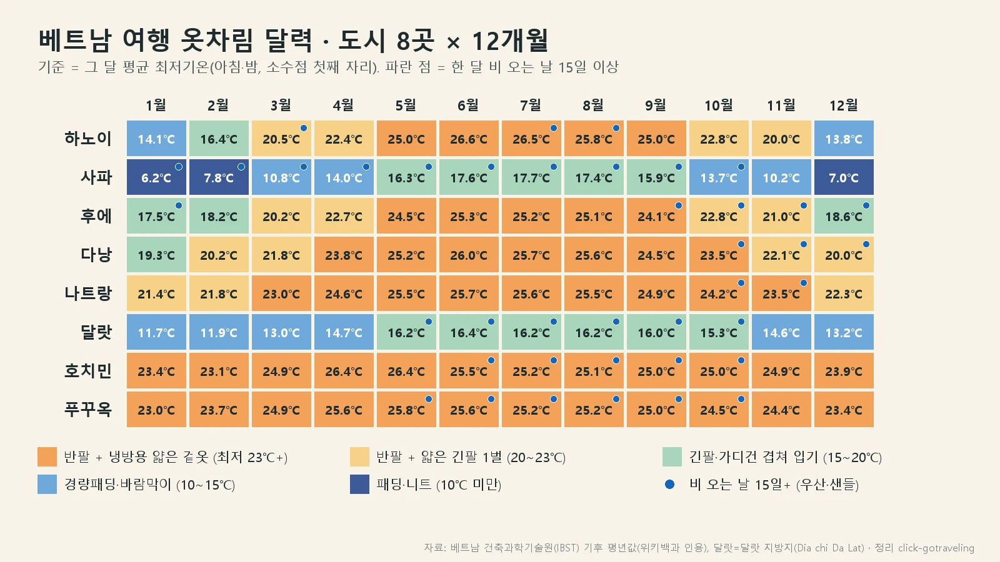
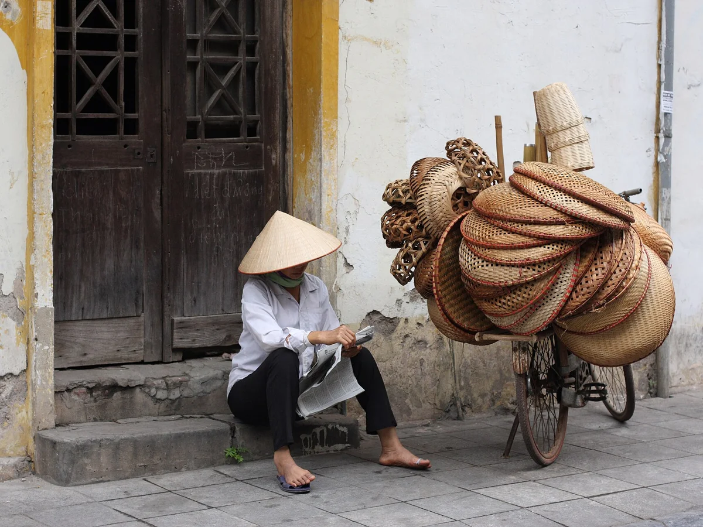

베트남 여행 옷차림은 "어느 도시에, 몇 월에 가느냐"를 정하면 거의 다 풀립니다. 호치민과 푸꾸옥은 1년 내내 반팔이면 되지만 하노이의 12월·1월과 달랏은 아침저녁 기온이 14℃ 안팎까지 내려가 겉옷이 꼭 있어야 해요. 같은 1월이라도 하노이와 호치민의 아침 기온은 8℃ 넘게 차이가 납니다(베트남 건축과학기술원 IBST 기후 평년값 기준).

📌 3줄 요약
남부(호치민·푸꾸옥·나트랑)는 1년 내내 반팔에, 실내 냉방용 얇은 겉옷 하나면 충분합니다.

하노이 12~1월, 사파 겨울, 달랏은 1년 내내 경량패딩이나 바람막이가 필요한 기온입니다.

다낭·후에는 10~12월 우기에 비 오는 날이 한 달 20일 안팎이라 우산과 빨리 마르는 옷이 핵심입니다.

## 도시 8곳 월별 옷차림 달력

여행 날짜와 도시를 아래 그림에서 찾으면 챙길 옷이 바로 나옵니다. 제가 잡은 기준은 그 달의 **평균 최저기온**이에요. 한낮 기온은 대부분 30℃ 안팎이라 고민할 게 별로 없고 옷차림이 갈리는 건 아침 일찍 나설 때와 해 진 뒤이기 때문입니다.

*▲ 베트남 건축과학기술원(IBST) 기후 평년값을 [위키백과 기후 표](https://en.wikipedia.org/wiki/Hanoi#Climate)에서 옮겨 직접 칠한 표입니다. 달랏은 위키백과 달랏 기후 표(달랏 지방지·IBST 인용) 값이고, 칸의 숫자와 색은 모두 소수점 첫째 자리 값 기준입니다.*

도시 8곳의 12개월, 모두 96칸을 제가 같은 기준으로 하나씩 칠해 보니 **96칸 중 50칸이 주황색**(반팔에 얇은 겉옷)이었습니다. 반대로 경량패딩 이상이 필요한 칸은 15칸뿐이었고 그 15칸은 전부 하노이 12~1월, 사파, 달랏에 몰려 있었어요. 베트남 옷차림 고민은 대부분 이 세 곳에 가는 사람의 몫인 셈입니다.

5단계를 표로 묶어보면 이렇습니다.

| 단계 | 평균 최저기온 | 챙길 옷 | 해당하는 곳(예) |
| --- | --- | --- | --- |
| 1 | 23℃ 이상 | 반팔·반바지 + 냉방용 얇은 겉옷 | 호치민·푸꾸옥 연중, 다낭 4~10월 |
| 2 | 20~23℃ | 반팔 + 얇은 긴팔 1벌 | 다낭 2~3·11~12월, 하노이 3·4·10·11월 |
| 3 | 15~20℃ | 긴팔·가디건 겹쳐 입기 | 하노이 2월, 후에 12~2월, 달랏 5~10월 |
| 4 | 10~15℃ | 경량패딩·바람막이 + 긴바지 | 하노이 12·1월, 달랏 11~4월 |
| 5 | 10℃ 미만 | 패딩·니트·목도리 | 사파 12~2월 |

이 표의 숫자는 평년값이라 해마다 1~2℃씩 오르내립니다. 출발 1주일 전에는 [베트남 국가수문기상예보센터](https://nchmf.gov.vn/kttv/) 예보로 실제 기온을 한 번 더 확인하세요.

## 반팔만 챙겨도 되는 곳은 어디인가요?

호치민·푸꾸옥은 12개월 모두 최저 23℃ 이상이라 반팔과 반바지만으로 됩니다. 나트랑도 12~2월 아침이 21~22℃로 살짝 내려가는 것 말고는 같은 차림이에요. 다만 이 세 곳에서도 얇은 긴팔 한 벌은 빼지 않는 게 좋습니다.

첫째 이유는 실내 냉방입니다. 쇼핑몰·카페·마사지숍·장거리 버스는 에어컨을 세게 트는 편이라 밖과 안의 온도 차가 큽니다. 둘째는 햇볕이에요. 한낮 최고기온이 31~35℃인 남부에서는 반팔보다 통풍 잘되는 얇은 긴팔이 오히려 덜 탑니다.

우기도 기억해 두세요. 호치민은 6~10월에 한 달 16~19일, 푸꾸옥은 5~10월에 19~24일꼴로 비가 옵니다. 대부분 오후에 짧고 굵게 쏟아지는 소나기라 큰 우산보다 접이식 우산과 물에 젖어도 되는 샌들이 쓸모 있어요.

💡 남부 옷차림 한 줄 요령
반팔 위주 + 얇은 긴팔 셔츠 1벌 + 샌들 1켤레. 긴팔은 냉방, 햇볕, 사원 방문까지 세 번 쓸 수 있습니다.

## 하노이 12월·1월 옷차림은 경량패딩이 필요할까요?

필요합니다. 하노이 1월 평균 최저기온은 14℃, 최고기온은 20℃ 정도예요. 숫자만 보면 선선한 정도지만 습도가 높고 흐린 날이 많아 체감은 더 쌀쌀합니다. 미국 기상 데이터 사이트 [웨더스파크](https://weatherspark.com/countries/VN)도 하노이 1월을 최고 20℃(68°F)·최저 14℃(57°F)로 보고 있어 두 자료가 거의 같습니다.

그래서 한겨울 롱패딩까지는 필요 없고 **경량패딩이나 바람막이에 긴바지**가 맞습니다. 낮에는 20℃ 가까이 오르니 안에는 반팔이나 얇은 긴팔을 입고 겉옷을 벗었다 입었다 하는 방식이 편해요. 오래된 숙소는 난방이 약한 곳이 있어 잘 때 입을 긴팔 잠옷도 하나 넣어 두세요.

2월은 16℃, 3월은 20℃로 금방 풀립니다. 3~4월과 10~11월은 반팔에 얇은 긴팔 하나면 되는 시기라 하노이를 처음 간다면 이 두 시기가 짐이 가장 가볍습니다.

*▲ 하노이 구시가지의 상인. 사진처럼 얇은 긴팔과 모자로 햇볕을 가리는 차림이 남부 여행에도 그대로 통합니다. 사진 ⓒ yeowatzup, CC BY 2.0 (Wikimedia Commons)*

## 다낭·후에 옷차림은 우기에 무엇이 달라지나요?

다낭은 기온보다 비가 변수입니다. 제가 칠한 표에서도 다낭 칸은 대부분 주황색이지만 10~12월에 파란 점이 몰려 있어요. 10월 강수량이 628mm로 1년 중 가장 많고 10~11월에는 한 달에 20일 정도 비가 와요. 후에는 10월 강수량이 약 770mm로 다낭보다 더 많습니다. 이 시기에는 빨리 마르는 소재의 옷, 샌들이나 젖어도 되는 운동화, 접이식 우산이 반팔보다 먼저입니다.

기온은 다낭 12~2월 아침이 19~20℃, 후에는 17~19℃까지 내려갑니다. 반팔에 얇은 긴팔이나 가디건을 더하면 되는 수준이에요. 반대로 4~8월은 최고기온이 31~34℃까지 올라가니 린넨이나 얇은 면 소재가 편합니다.

다낭에서 바나힐에 간다면 겉옷을 따로 챙기세요. 해발 약 1,487m 고지대라 시내보다 기온이 낮습니다. 출처마다 차이는 있지만 5~10℃ 정도 서늘하다고 안내합니다. 안개와 비도 잦아요. 호이안은 다낭 시내에서 약 30km 떨어진 평지라 다낭과 같은 옷차림으로 보면 됩니다. 다낭 우기를 더 자세히 알고 싶다면 [다낭 우기 월별 날씨와 대비법](/danang-rainy-season/)을 함께 보세요.

## 달랏은 왜 7월에도 겉옷이 필요할까?

달랏은 해발 1,500m 고원 도시라 한여름에도 아침저녁이 16℃ 안팎입니다. 표에서 달랏은 12개월 내내 초록이나 파란색이고 주황색 칸이 한 번도 없어요. 8곳 가운데 이런 도시는 달랏과 사파 둘뿐이었습니다.

그래서 남부 여행에 달랏을 끼워 넣을 때 가장 실수가 많습니다. 호치민에서 반팔만 싸서 넘어가면 해 진 뒤 야시장 구경이 꽤 춥게 느껴질 수 있어요. 11~4월은 최저 12~15℃라 경량패딩이나 플리스가 맞고 5~10월은 15~16℃ 정도라 가디건이나 바람막이면 됩니다.

5~10월은 우기라 한 달에 20~24일 비가 옵니다. 달랏 일정이 이 시기라면 바람막이를 방수되는 것으로 고르면 우비 역할까지 해결돼요.

## 사파 겨울 옷차림, 하노이와 같은 짐으로 될까요?

안 됩니다. 사파 1월 평균 최저기온은 6℃, 12월은 7℃로 하노이보다 7~8℃ 낮아요. 하노이용 경량패딩만으로는 부족하니 니트나 두꺼운 패딩, 목도리까지 챙겨야 합니다. 판시판 정상은 한파가 오면 영하로 떨어지고 눈이나 서리가 내렸다는 현지 보도도 여러 해 나왔습니다.

사파는 비도 많습니다. 5~8월에는 한 달 22~26일, 겨울에도 13~16일은 비 오는 날이에요. 트레킹을 한다면 미끄럼 방지 신발과 방수 겉옷이 기본입니다.

하노이와 사파를 같이 도는 12~2월 일정이라면 하노이는 경량패딩, 사파는 그 위에 니트 하나를 더 입는 식으로 겹쳐 입기 좋게 짐을 짜세요. 두꺼운 옷을 한 벌 더 넣는 것보다 부피가 작습니다.

## 베트남 사원·궁 방문 복장, 어디까지 가려야 하나요?

어깨와 무릎을 가리면 됩니다. 사원과 탑, 후에 황성 같은 유적지는 민소매, 짧은 반바지, 짧은 치마 차림을 피하라고 여러 안내가 공통으로 권해요. [베트남항공 여행 가이드](https://www.vietnamairlines.com/kr/ko/plan-book/travel/travel-guide/what-to-wear-in-vietnam)도 "사찰과 탑에서는 어깨와 무릎을 가리는 것이 존경의 표시입니다"라고 적고 있어요. 주요 법당에 들어갈 때는 신발을 벗는 곳이 많고, 실내에서는 모자도 벗는 게 예의입니다.

여행 중 반팔·반바지를 입고 다니다가 사원 일정이 생기면 얇은 긴팔 셔츠와 큰 스카프 한 장으로 해결됩니다. 스카프는 어깨를 덮거나 허리에 둘러 무릎을 가리는 용도로 쓸 수 있어요. 벗고 신기 쉬운 샌들이면 입구에서 시간도 덜 걸립니다.

몸에 딱 붙거나 비치는 옷도 피하는 게 좋습니다. 큰 관광지에서는 가릴 천을 빌려주기도 하지만 동네 작은 사원은 그런 준비가 없는 곳이 많아요.

## 북부와 남부를 한 번에 돌 때 짐 꾸리기

하노이에서 호치민까지 종단하는 일정이면 계절이 두 개라고 생각하고 짐을 나누세요. 12~2월이라면 하노이 아침은 14℃, 호치민 낮은 32℃라서 같은 여행 안에서 18℃ 차이를 겪습니다. 이럴 때는 "남부 기본 짐 + 북부용 겉옷 한 벌"이 가장 가볍습니다.

| 품목 | 남부만(호치민·푸꾸옥) | 북부 포함(12~2월) | 우기(다낭 10~12월 등) |
| --- | --- | --- | --- |
| 상의 | 반팔 4~5, 얇은 긴팔 1 | 반팔 3, 긴팔 2 | 속건 반팔 4~5 |
| 겉옷 | 냉방용 얇은 셔츠 | 경량패딩 또는 바람막이 | 방수 바람막이 |
| 하의 | 반바지 2, 긴바지 1 | 긴바지 2, 반바지 1 | 빨리 마르는 바지 2 |
| 신발 | 샌들 + 운동화 | 운동화 + 샌들 | 젖어도 되는 샌들 |
| 기타 | 모자·선크림 | 스카프·잠옷용 긴팔 | 접이식 우산 |

겉옷은 입고 비행기에 타면 캐리어 공간을 아낄 수 있어요. 북부 일정이 끝나면 경량패딩은 압축 파우치에 넣어 두면 됩니다. 여권·상비약까지 포함한 전체 목록은 [베트남 여행 준비물 체크리스트](/vietnam-travel-checklist/)에, 캐리어 공간 정리는 [캐리어 짐싸는법](/carrier-packing-guide/)에 정리해 두었습니다.

## 자주 묻는 질문

**Q. 베트남 1월에 여행 가면 무슨 옷을 챙겨야 하나요?** 도시에 따라 다릅니다. 호치민·푸꾸옥은 반팔, 다낭·나트랑은 반팔에 얇은 긴팔, 하노이와 달랏은 경량패딩, 사파는 두꺼운 패딩까지 필요합니다.

**Q. 다낭 12월 옷차림은 반팔로 충분한가요?** 낮에는 반팔로 충분하지만 아침저녁 평균 최저기온이 20℃ 정도라 얇은 긴팔이나 가디건을 하나 챙기세요. 우기 막바지라 우산과 샌들도 필요합니다.

**Q. 베트남에서 반바지 입고 사원에 들어가도 되나요?** 짧은 반바지는 피하는 게 좋습니다. 무릎과 어깨를 가리는 차림이 기본이고 스카프를 허리에 둘러 무릎을 가리는 방법도 많이 씁니다.

**Q. 호치민은 12월에도 더운가요?** 네. 12월 평균 최고기온이 31~32℃, 최저기온이 23℃ 안팎으로 1년 중 가장 선선한 달이어도 반팔 날씨입니다. 건기라 비도 적은 편이에요.

**Q. 하노이 겨울에 롱패딩까지 가져가야 하나요?** 보통은 필요 없습니다. 1월 최저 14℃ 정도라 경량패딩이나 바람막이로 충분합니다. 한파 예보가 있을 때만 더 두꺼운 옷을 고려하세요.

## 이미지 출처

- 대표 이미지, 호이안 구시가지 등불 거리, 사진 ⓒ Christophe95, CC BY-SA 4.0 (Wikimedia Commons)
- 하노이 구시가지 상인, 사진 ⓒ yeowatzup, CC BY 2.0 (Wikimedia Commons)
- 월별 옷차림 달력, click-gotraveling 자체 제작(자료 IBST 기후 평년값)
- 달력 기후 자료 원문 — 위키백과 기후 표 [하노이](https://en.wikipedia.org/wiki/Hanoi#Climate) · [사파](https://en.wikipedia.org/wiki/Sa_Pa_(town)#Climate) · [후에](https://en.wikipedia.org/wiki/Hu%E1%BA%BF#Climate) · [다낭](https://en.wikipedia.org/wiki/Da_Nang#Climate) · [나트랑](https://en.wikipedia.org/wiki/Nha_Trang_(city)#Climate) · [달랏](https://en.wikipedia.org/wiki/Da_Lat#Climate) · [호치민](https://en.wikipedia.org/wiki/Ho_Chi_Minh_City#Climate) · [푸꾸옥](https://en.wikipedia.org/wiki/Phu_Quoc#Climate)

---

**관련 키워드** — #베트남여행옷차림 #베트남옷차림 #다낭옷차림 #하노이옷차림 #나트랑옷차림 #호치민옷차림 #달랏옷차림 #베트남1월날씨 #다낭12월옷차림 #베트남사원복장
